## Your Private Cloud

This first chapter provides a tour of IaaS operations management, starting with why reactive and hectic operations is common, and the paradigm shift required to proactive & predictive operations.

### Overview

What you architect is [**SDDC**](https://en.wikipedia.org/wiki/Software-defined_data_center). But what you handover as a business result to your CIO is [**IaaS**](https://en.wikipedia.org/wiki/Infrastructure_as_a_service). What you bought from your vendor is SDDC, but what you sell to your customers is IaaS.

The transformation from SDDC to IaaS requires Operations Transformation. We transform from complaint-based to SLA-based, which requires fundamental process changes from alert-driven to insight-driven.

SDDC is a system, IaaS is a service. A system cares about its architecture, while a service cares about its service level.

Whether the Application Team or VM Owner pays for the service with a chargeback model or not, it is a service. VM Owners no longer own, hence care, about the underlying architecture.

They are 2 sides of the same coin. We can assess if the architecture is good or not, based on the actual result in production. Does it result in firefighting and blamestorming? Or do you have peaceful operations where alerts are meaningful and actionable?

Many operations rely on alerts as the starting point. Actions are taken based on alerts, resulting in reactive day-to-day operations.

IT Operations covers a wide area of systems. It’s common to see more than 1K alert definitions across all systems under monitoring. As the team wants to be alerted early, a conservative threshold is set up. This results in alert storms.

Since automation is perceived as the holy grail of solutions, alerts are typically set to auto close if the symptom disappears. The creates a bigger problem, common in large enterprises with a large IT team. That problem is “lazy operations”, where no alert is associated with no problem.

#### Complaint-based Operations

How do you know that the Infrastructure as a Service (IaaS) Platform (be it on-prem [private cloud](https://www.vmware.com/topics/glossary/content/private-cloud.html) or externally in the cloud) is serving its workload *well*? If you depend on complaints, then you run “complaint-based” operations.

Changing from reactive to proactive is unfortunately a complex undertaking, especially in large organizations where there are many roles and personas. It requires [operations transformation](https://www.vmware.com/content/dam/digitalmarketing/vmware/en/pdf/files/pdf/services/vmware-operations-transformation-services.pdf) and a paradigm shift. It is not easy to get customers to agree on a Service Level Agreement ([SLA](https://en.wikipedia.org/wiki/Service-level_agreement)) when you’ve promised them “good” for years already. This book aims to provide practical guidance, something you can implement with the current version of Aria products.­

##### The Litmus Test

The following questions below help you assess the maturity of your IaaS business.

###### Is your IaaS cheaper than public cloud?

The commoditization of infrastructure means your IaaS is being compared with similar platforms such as VMware Cloud on AWS and Amazon Web Services.

If not, your CIO may question your business value. The primary reason for having an in-house architect is so you can bring better price/performance, after taking into account your salary.

###### Do your customers blame your IaaS?

If the answer is yes, take a moment to ponder why. There is a high chance you are relying on complaints in your operations, so you actually encourage them. No complaint, no problem. That’s why it’s aptly named Complaint-based Operations.

The reason why you rely on complaints is the operations team have no other means by which to measure success. You have not defined the performance of your IaaS. That’s one of the goals of this book.

A sign of matured operations is that you have complete, correct, and accurate SLAs (Service-level agreements). Complete means you have Performance SLAs and Compliance SLAs, not just Availability SLAs. Correct means the SLA is measured on each *paying* VM, and not at the infrastructure level. It also means you use the right metrics. Accurate means the measurement has to be measured every 5 minutes, as any longer intervals than this can miss the problem.

###### Does troubleshooting mean all hands-on deck?

Do you have a process that is followed by all teams (network, storage, server, OS, application)? Does that process end with [Root Cause Analysis](https://en.wikipedia.org/wiki/Root_cause_analysis) (RCA)?

As part of RCA, do you set up alerts so the same issue can be detected faster if it happens again? Without an alert configured, the RCA should not be closed. The alert is necessary as it will trigger the next RCA process.

###### Does Help Desk provide a good first level defense?

If Help Desk simply passes issues through to the next level, you need to look at why.

Help Desk is your first line of defense. They are not as technical as you are. Equip them with [Standard Operating Procedures](https://www.ibm.com/docs/en/pm-and-q/2.6.1?topic=framework-managing-standard-operating-procedures) and simple dashboards so that they can handle VM Owner complaints by discovering:

- Is the problem caused by IaaS not serving the VM well?

- If yes, which part of the infrastructure: CPU, RAM, Disk, Network?

- If not, how to prove it convincingly?

###### Do you struggle with many over-provisioned VMs?

This is an indicator that you are operating as a System Builder as opposed to a Service Provider. As a System Builder, you are meddling with each System (read: Application). You size them and argue with the application teams, who are actually your customers. You are busy as there are many applications, and you are outnumbered.

If you are operating as an internal [Cloud Service Provider](https://azure.microsoft.com/en-us/overview/what-is-a-cloud-provider/), you should not be “in the way” of the business. You use an effective pricing model to drive the right behavior. Does a public cloud provider block application teams when they buy 40 CPU [AWS EC2](https://aws.amazon.com/ec2/?ec2-whats-new.sort-by=item.additionalFields.postDateTime&ec2-whats-new.sort-order=desc) VMs when they only need 2 CPU? They don’t, hence neither should you.

###### Can you justify new infrastructure when utilization is not high? 

This is not referring to additional money that comes with new projects. This is referring to existing workloads on existing clusters/storage.

Capacity is measured on utilization and performance. A cluster is at full capacity if it can’t serve its VMs well. Since it takes time to buy hardware, you must have an *early warning* system to detect this performance degradation.

##### Common Mistakes

“If you don’t have a problem, I don’t have a solution” summarizes how I engage customers. After \>1.5 decades of engagements with hundreds of VMware customers and outsourced partners, here are typical mistakes I’ve observed:

- Using automation as the primary solution for transformation.

- Private Cloud is seen as *automation* project as opposed to operation. Private Cloud is not virtualization with automation and self-service. It is the required technical foundation to transform the business of enterprise IT from system builder to service provider. The automation, workflow and self-service portal are merely supporting features. The primary components of Private Cloud are SLAs and Class of Service, hence it’s operations-centric, not automation-centric.

- VMware Cloud Foundation is architected with server-consolidation mindset. That means the system has no awareness of IaaS and SLAs. Different classes of service are mixed in the same cluster or datastore.

- There is class of service, but the system does not clearly state it. The naming standard does not include class of service.

- Performance is never defined properly. The infrastructure is designed for performance, but the benchmark does not align with what actually being sold. There is no Performance SLA, and often there are no Key Performance Indicators (KPI)[^1].

- The infrastructure has no awareness of business units, applications, or application-tiers. The business is not reflected in the infrastructure.

#### Maturity Model

It’s a good practice to assess the level of operational maturity, as it allows you to summarize where you are. There are different variants of these models, so don’t be hesitant to tailor to your goals. I’ve included a short assessment within Part 4 Chapter 1 to get you going.

- When scoring yourself, assign score on the following area:

- **Policy**: Is your policy outdated? Best Practice typically means proven or common practice.

- **People**: How skillful is the team vs the need? This includes the way the team is organized.

- **Process**: How effective are the key processes (e.g. planning process, troubleshooting process)?

- **Pillar**: How mature is each pillar of operations? For example, if your capacity management is mature, you are balancing cost and capacity very well. If your performance management is mature, you’re not reactive to endless complaints because you have SLA formally agreed.

- **Platform**: This covers both the technology supporting the business workload, and the IT tools used by the operations team to support the former. For example, if you do not have clear visibility, you’re flying blind.

##### Multi-Cloud Management

A single private cloud - something you have complete control of - is hard enough to operate, let alone operating multiple incompatible infrastructures. Multi-cloud operations, where you are responsible for something that you do not have complete controls take the operations challenge to the next level. Don’t be disheartened if your organization is struggling with running multi-cloud operations.

The complexity is due to the immaturity of the architecture. There are simply too many components involved, as shown in the [landscape diagram](https://landscape.cncf.io/) by Cloud Native Computing Foundation. The individual products that make up the architecture is not important, hence I intentionally make the diagram small.

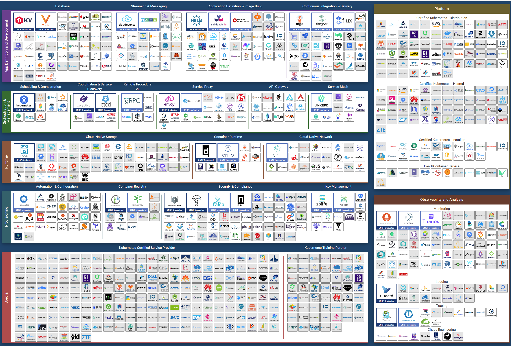

Eventually though…, the architecture will slowly mature and turn into a commodity. CIOs will begin to focus on the operations, as the business will demand proper governance with SLAs.

Regardless of the underlying system architecture, CIOs are still required to manage cost, capacity, compliance, performance, and availability. The Pillars of Operations do not change just because you change the plumbing.

#### The Business of IaaS

There are 3 variants of an IaaS business. They differ in terms of what you actually sell, how you do pricing, and what SLA you put on the table.

<table>
<colgroup>
<col style="width: 10%" />
<col style="width: 36%" />
<col style="width: 25%" />
<col style="width: 26%" />
</colgroup>
<thead>
<tr class="header">
<th>Item</th>
<th>Pricing</th>
<th>Availability SLA</th>
<th>Performance SLA</th>
</tr>
</thead>
<tbody>
<tr class="odd">
<td><strong>VM</strong></td>
<td>
Price depends on VM size. A larger VM has a higher price.

Price depends on quality. A better tier has a higher price.

Example of an item purchased: 1 VM, 4 vCPU, 16 RAM, 200 GB disk, in Gold Tier.
</td>
<td>
Per VM.

Depends on the tier.
</td>
<td>
Per VM.

Depends on the tier.
</td>
</tr>
<tr class="even">
<td><strong>Resource Pool</strong></td>
<td>
Sold per GHz, GB RAM, TB Disk.

Example of item purchased: 100 GHz CPU, 1 TB RAM, 80 TB Disk.

It can come with a 100% reservation; hence it’s guaranteed. Alternatively, it may have partial reservation. It typically comes with best effort burst, in the form of expandable resource pool.

On the other hand, it may come with a limit but it’s always higher than what you paid for. For example, you pay for 1 TB of RAM. You can have 0.5 TB guaranteed and a 2 TB limit.
</td>
<td>
Per VM.

Limited tiering capabilities.
</td>
<td>
N/A.

While Resource is reserved, customer is allowed to overcommit within their own limit. It’s not something the IaaS service definition imposes.
</td>
</tr>
<tr class="odd">
<td><strong>Hardware</strong></td>
<td>
Price per ESXi host. Customers decide how many VMs they want to place. HA is provided by vendor.

Example of items purchased: 8 ESXi Hosts.

Example provider: Azure VMware Solution (AVS).
</td>
<td>On the Host or Cluster, not VM.</td>
<td>
N/A

Customer can squeeze as many VMs.
</td>
</tr>
</tbody>
</table>

Class of service is harder to implement in resource pools as there are more moving parts. You can have cascading resource pools.

##### VM as a Service 

The most popular variant of IaaS is VM as a Service. It is typical example of “buy wholesale sell retail” business. You buy in bulk (hardware, software) and commit DC space for years, then sell in small chunks (VM, K8 Pod). You make profit as your buy price is several magnitudes lower than your sell price, on a per unit basis. You probably pay 5x less per GHz than you sell.

<table>
<colgroup>
<col style="width: 24%" />
<col style="width: 75%" />
</colgroup>
<thead>
<tr class="header">
<th><strong>Purpose</strong></th>
<th>
Serve the workload. They take the shape of VMs. The VMs in turn can be K8 nodes or classic applications.

The workload must be grouped by tenant and business applications.
</th>
</tr>
</thead>
<tbody>
<tr class="odd">
<td><strong>KPI</strong></td>
<td>
The key metrics used to measure the performance of the infrastructure.

Is it serving the VMs according to its SLA?
</td>
</tr>
<tr class="even">
<td><strong>Cost</strong></td>
<td>
The total cost should be cheaper than public cloud.

Typically, customer aims at &gt;2x cheaper, not just marginally cheaper.
</td>
</tr>
<tr class="odd">
<td><strong>Pillars</strong></td>
<td>
The key pillars that transform the SDDC into IaaS.

IaaS has multiple class of services. Each has their own Availability SLA, Performance SLA, Security SLA, and Service SLA.
</td>
</tr>
<tr class="even">
<td><strong>Proof</strong></td>
<td>
The metrics demonstrating that the architecture works as intended.

Operations become proactive. It’s based on insight, not alert.
</td>
</tr>
</tbody>
</table>

The business goal is to ensure the application and VMs are running well yet cost effective. In this way, you keep the customers happy.

The cost part is easy to quantify. You know what you actually spend on hardware, software, services and salary. The “well” in running well is the hard part as there is a big unknown. This is also the source of argument between application teams and infrastructure teams.

Say you are architecting for 10K VMs in 2 data centers. You envisage 2K VMs in the first month, 5K VMs in the first half year, and eventually to 10K within the first year. Do you know the basic info about each of these 10K VMs, so that you can architect an infrastructure to serve them well?

- How big are they? What are their vCPU, RAM, and Disk configuration?

- How intense are they? CPU utilization, RAM utilization, disk IOPS, network throughput?

- What are their workload patterns? Daily, weekly, monthly, no pattern, etc?

The answer is obviously no. Even application teams do not know as some of the applications may not be developed yet. Their vendors may not know either as the actual usage is not yet known.

Promising that the SDDC will serve all 10K VMs well is akin to promising the highway you architect will serve all the cars, buses and motorcycles well, when we can’t predict how many they are and how often they will use it. We will cover this more in the Performance chapter.

So how can we promise that your IaaS will serve your customers well?

We can by using price/performance. The principle you share with your customers is the common sense principle used in all service industries:

- You want it cheap; it won't be fast.

- You want it fast; it won't be cheap.

This is where the Class of Service and the associated SLAs come in. The highest class of service provides the best uptime and performance but comes at a price. All these attributes are well defined in the SLA, leaving no room for ambiguity. The contract is not subject to interpretation. You define all the key metrics up front, assuring your customers that you are confident of delivering as promised.

You then architect your IaaS to deliver the above class of services. The class of service becomes your business offering. With that, you are ready to begin with the end in mind.

###### Capabilities

The platform should provide a complete self-service portal for all types of users. The features should cover all stages in the life cycle, starting from provisioning. Provisioning should have an SLA and be supported with workflows and electronic approval.

###### Key Metrics

You measure across the pillars of operations management. Each pillar is measured, hence managed, by a purpose-built metrics. This enables you to manage at scale.

<table>
<colgroup>
<col style="width: 18%" />
<col style="width: 29%" />
<col style="width: 52%" />
</colgroup>
<thead>
<tr class="header">
<th>Pillars</th>
<th>Metrics</th>
<th></th>
</tr>
</thead>
<tbody>
<tr class="odd">
<td rowspan="2">Availability</td>
<td>Operational Availability (%)</td>
<td>Relative Availability, against your availability architecture and green zone.</td>
</tr>
<tr class="even">
<td>Actual Availability (%)</td>
<td>Absolute availability, reporting the fact as it is. This metric typically has lower value than Operational Availability (%).</td>
</tr>
<tr class="odd">
<td rowspan="2">Performance</td>
<td>KPI (%)</td>
<td>Absolute performance, reporting the fact as it is.</td>
</tr>
<tr class="even">
<td>SLI (%) and SLA (%)</td>
<td>
Relative performance, against your promised SLA.

SLI = SLA Leading Indicator
</td>
</tr>
<tr class="odd">
<td rowspan="2">Capacity</td>
<td>Capacity Remaining (%)</td>
<td>Relative to usable capacity, not total capacity.</td>
</tr>
<tr class="even">
<td>Time Remaining (days)</td>
<td>The number of days until Capacity Remaining (%) hits 0.</td>
</tr>
<tr class="odd">
<td>Compliance</td>
<td>Benchmark X (%) Compliant</td>
<td>
Compliance against specific industry or internal benchmark, such as PCI-DSS.

1 metric per benchmark.
</td>
</tr>
</tbody>
</table>

##### The Restaurant Analogy

[Sunny Dua](https://www.linkedin.com/in/duasunny/)[^2] and I use the restaurant analogy when explaining the need of SLA. The analogy has resonated well with many customers. Humans can always relate to food!

Essentially, a restaurant has 2 areas, often with a clear demarcation line:

- The Dining Area.

- The Kitchen.

Think of your IaaS business like a restaurant business. It has a dining area, where your customers live, and a kitchen, where you prepare the food. Guess which one is more important to the owner?

You are right. The dining area.

If everything runs smoothly in the dining area, customers are being served on time and on quality, and they are paying you well; it is a good day for the business. Whether you are running around in the hot kitchen is a separate, internal matter. The customers do not need to know about it.

We use the analogy to drive the message that you need to focus on the customers first, and your SDDC second. If you take care of your customers well, and they are happy with your service, the problem you have in your IaaS is a secondary and internal matter.

- The “dining area” is the Consumer layer. Look at the diagram below. It is where your customers’ VMs live. In the public cloud such as AWS, that’s all you can see.

- The “kitchen” is the Provider Layer. This is your infrastructure layer, where VMware and the hardware reside.

Public cloud is part of the kitchen. Just because you no longer own the infrastructure does not mean you don’t take management responsibility. The structure of enterprise IT means the infrastructure team ends up being held accountable.

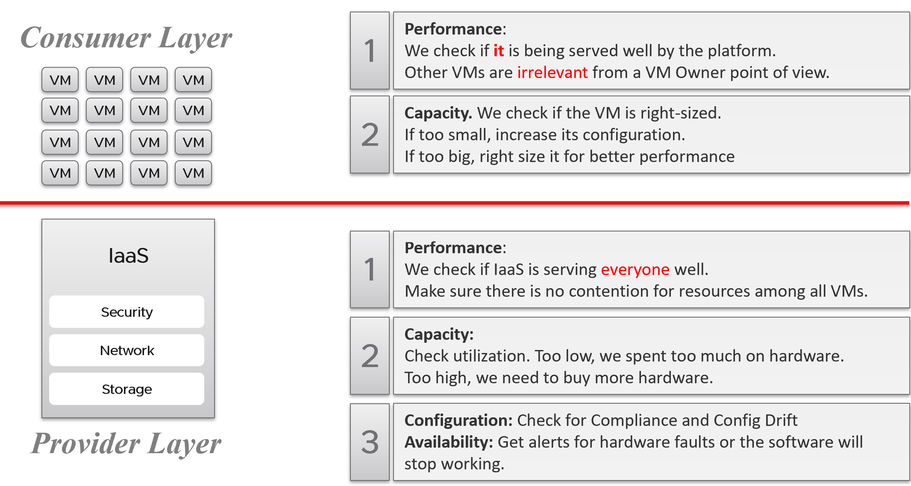

There is clearly a line of demarcation between the two layers. Your customers should not care about the details of your SDDC or EUC. The VM Owner does not care if you are firefighting in the data center. Because they do not care, whether you are using an older VMware Cloud Foundation or the latest, this is not something you want them to dictate to you. The same goes with your choice of hardware brand and specification.

Conduct regular sessions with the application teams on the following topics:

- How to run best on VMware, with optimal performance, highest availability, most secured while keeping cost minimal.

- How to monitor the performance, availability, and security when you’re running on VMware. How to know you’re being served well by the IaaS platform according to the promised.

- Windows and Linux performance best practices.

- Why rightsized is better than oversized for VM.

Understand their expectation of the infrastructure. In large environments, different VM Owners can have different expectations and levels of knowledge.

The application teams become consumers of a shared service—the cloud platform. Depending on the SLA, the application teams can be served as if they have dedicated access to the infrastructure, or they can take a performance hit in exchange for a lower price. For SLAs where performance is guaranteed, a VM running in the cluster should not be impacted by any other VMs. The performance must be as good as if it is the only VM running on the ESXi host.

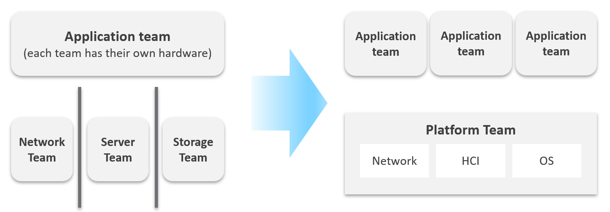

Let’s zoom into the kitchen area, as that’s also undergoing a transformation. The Server team or Windows team or Linux team typically took the ownership of the shared platform and evolved to become the platform team. With the evolution of [Hyper Converged Infrastructure](https://en.wikipedia.org/wiki/Hyper-converged_infrastructure), storage is being absorbed into the platform. The boundary with the Network team is also becoming blurry with network virtualization. Many network services such as Firewalls and Load Balancers are virtualized. Recently, with the arrival of the Kubernetes, the platform team began owning containers and K8s, plus there are new teams (DevOps and/or SRE) that sit in between Platform team and Application team.

### Purpose-Driven Architecture

- When you architect IaaS or Desktop as a Service ([DaaS](https://www.vmware.com/topics/glossary/content/desktop-as-a-service)), what goals do you have in mind? I don’t mean the design considerations, such as availability and performance best practices. I mean the *business results* that your architecture has to deliver, viewed from the people who paid for the system, and by the people who will pay for the service. Set aside your opinion on the goal, as you neither pay for it nor use it.

Logically, the answer depends on what is being sold. You can either sell application or infrastructure, broadly speaking. Some popular examples are:

<table>
<colgroup>
<col style="width: 13%" />
<col style="width: 44%" />
<col style="width: 41%" />
</colgroup>
<thead>
<tr class="header">
<th>Service</th>
<th>What you sell</th>
<th>Examples</th>
</tr>
</thead>
<tbody>
<tr class="odd">
<td><strong>SaaS</strong></td>
<td>The software is provided as a service. Customers need not install it on-site. Common among ISVs who want to avoid on-prem installation, avoid outdated installations, or mine their customers’ data.</td>
<td>Salesforce, VMware Skyline, Microsoft Office 365.</td>
</tr>
<tr class="even">
<td><strong>DBaaS</strong></td>
<td>
Database as a Service. There are 2 variants:

Instance: A customer shares the binary with others. Patching the software means all instances using the instance get patched. They all need to have common maintenance window.

Dedicated binary: Customers can have different versions, patch levels, and downtime schedules.
</td>
<td>Examples such as Mongo DB as a Service or MS SQL as a Service are common among enterprise. The DBA provides this as service to the application team, who are not as deep on databases knowledge.</td>
</tr>
<tr class="odd">
<td><strong>PaaS</strong></td>
<td>
Platform as a Service.

A set of services used by business applications. AWS provides many such PaaS services and is the main reason why customers choose them.
</td>
<td>Central IT provides a set of common services (e.g., login, payment) to all business units websites.</td>
</tr>
<tr class="even">
<td><strong>DaaS</strong></td>
<td>
Desktop as a Service. Typically, Windows 10 + End-User applications. Application teams must be involved, as a simple 10% CPU increase of your browser can impact performance SLAs as the ESXi host becomes heavily over committed.

The goal is to ensure End Users are getting a quality desktop experience while keeping the price per user low.
</td>
<td>
Many enterprises’ IT provides this for better security and PC-manageability. They may deploy this with thin client.

VMware Horizon Cloud, Microsoft Windows Cloud are cloud examples.
</td>
</tr>
<tr class="odd">
<td><strong>K8aaS</strong></td>
<td>
Kubernetes as a Service. There are 2 variants:

Dedicated cluster.

Shared cluster.
</td>
<td>Amazon EKS</td>
</tr>
<tr class="even">
<td><strong>IaaS</strong></td>
<td colspan="2">There are 3 variants here. As this is the topic of the book, let’s explore in depth.</td>
</tr>
</tbody>
</table>

#### Begin with The End in Mind

It’s important to reflect the business in both the IaaS platform and your operations. It makes the infrastructure team aware of the context and impact to the business. In their day-to-day operations, they need to be Business Application centric. This calls for a paradigm shift.

Your CIO wants live information projected for his peers to see on how IT is serving the business. This requires you to have awareness of the business units and their critical applications.

In your service offering, you include the ability for customers to check their own VM health, and how their VMs are served by the underlying platform. This means your architecture needs to know how to associate tenants with their VMs. At the very least, create a structure so they can browse or find their applications and VMs.

##### The Crown Jewel

They are your mission critical business applications. They form a small percentage of your VM population. However, they are essential to the company revenue, profit or image. They are your crown jewel system.

Different industries have their own set of mission critical systems. If you are bank, it’s your Internet Banking. If you’re eCommerce, it’s your online portal.

In order to be proactive, you need to monitor these applications closely. Likely a few times a day, not just one time in the morning. The application team is watching their own system throughout the day, so you can’t afford to be blind to what’s happening from infrastructure viewpoint.

Is the problem with your business application caused by your infrastructure? The problem is typically performance, although it could be availability or security.

You can create a universal model for all business applications since the infrastructure metrics are the same.

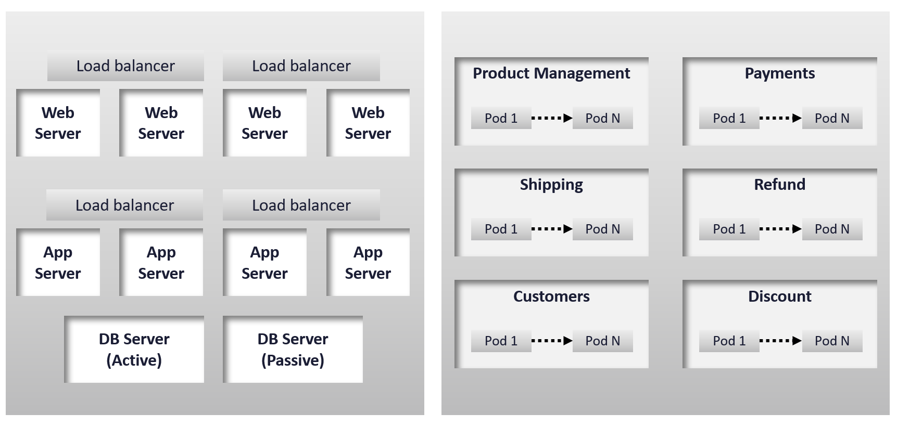

The health of a tier is the average health of its members. This is because a tier scales out across distributed instances. We are not taking the minimum value because processing within a tier does not happen in sequence. This is not a convoy. A good Load Balancer will balance both performance and availability.

“Hold on!”, you might say. Since it is scale-out architecture, the Application Team has catered for this. If they only need 3 web servers, they will deploy 4 or even 5. So, both performance and availability are not affected if one web server goes down. The measurement of a tier has to take into account this extra capacity, and not simply do an average of all members.

This logic sounds reasonable. But is it correct?

It is correct for availability. It is not correct for performance. Performance needs to include all nodes as it reflects reality.

##### Day 0 \| Day 1 \| Day 2

Planning is Day 0, Architecture is Day 1, and Operations is Day 2.

By Architecture, I mean the detailed technical work, including building and commissioning the system. While the business plan and high level marketecture[^3] is defined during Day 0 (Planning), the real architecture work is done on Day 1.

It’s a common misunderstanding to think the sequence is 0 1 2.

However, if we think deeper, Day 2 impacts Day 0, which is Planning. The reason is the End State drives your Plan. Your Plan drives your Architecture. So, it’s 2 à 0 à 1, not 0 à 1 à 2.

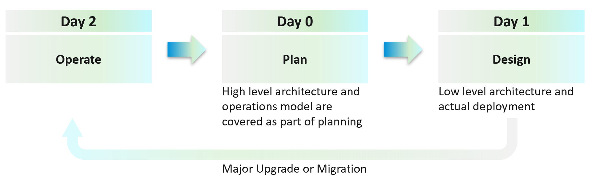

Day 2 is not simply the first few days after you go live. It’s the day you set sail[^4].

Let’s use an example to illustrate how Day 2 impacts Day 0, which in turn impacts Day 1.

Say you are an internal cloud provider, and you plan to charge per VM. You plan to have 2 classes of offerings:

- **Gold**: suitable for production workloads. Performance optimized.

- **Silver**: suitable for non-production workloads. Cost optimized.

For Gold, you plan to not overcommit CPU and RAM. If 1 CPU typically uses 4 GB RAM, then a 64-core ESXi host will only need 256 GB. If you buy a host with 1 TB RAM, then you may end up in a position where you are not able to sell the remaining 768 GB as you have no more vCPUs to sell. This means your hardware specification is impacted. That’s an example of how Day 2 impacts Day 0.

For Silver, you plan to overcommit 4:1 for CPU and 2:1 for memory.

- You assume that 1 vCPU typically uses 4 GB RAM. Your customers are allowed to buy more or less memory, so this 4:1 ratio between CPU and RAM is just a guideline for overall planning.

- You plan to run vSAN with dedupe + NSX + vSphere Replication. You also expect heavy IO VMs, which requires kernel processing. For all these supporting, non-business workloads, you allocate 8 cores and 64 GB RAM.

- If you buy a 64-core ESXi, you have 56 cores left and you will be able to sell 224 vCPU.

- These 224 vCPU will need 896 GB RAM. Since you overcommit 2:1, you need 448 GB for VM. Total RAM you need is 448 + 64 = 512 GB.

- That means the hardware spec you need is 64 core and 512 GB RAM. If you buy more RAM than this, you may not be able to sell this extra RAM as you may not have vCPU to accompany them.

The above 2 examples show how your hardware spec can’t be decided without considering the average VM profile and the overcommit ratio you plan. Yes, Day 2 does dictate requirements and constraints to Day 0.

You also promise the concept of Availability Zones for Gold class, as they host mission critical business services. Your company policy for [Business Continuity](https://en.wikipedia.org/wiki/Business_continuity_planning) dictates that in the event of an entire cluster failure, you plan to cap the number of VMs affected. If you limit to say 300 production VMs, then your cluster size should not be too big as you won’t be able to fully utilize the resource. I’ve seen multiple customers having 32-node production clusters running 1K – 2K VMs.

##### Promise vs Reality

In a large environment, you may have the luxury of designing different infrastructure for different workload types. Common examples are GPU Intensive workload, Disk Intensive, etc. If the infrastructure is superior to your standard offering, you need to be careful in setting the right expectation.

Let’s take an example: you promise you can handle CPU Intensive workload as you’ve chosen the best CPU.

Notice the issues here?

There are at least 2 of them.

1. You probably heard of [Winston Churchill](https://en.wikipedia.org/wiki/Winston_Churchill) quotation “Sometimes doing your best is not good enough.” What you think is the best CPU may not be good enough for the workload, either in terms of GHz, number of threads, or power efficiency. For example, if your ESXi sports a 3.8 GHz speed but the application wants 5 GHz, giving it extra vCPU does not exactly meet the requirement.

2. Assuming you pass the first issue above, how do you prove that this so-called “best CPU” is actually able to handle the workload? What metrics do you use? Remember it’s just a CPU. All you have as metrics are just GHz and vCPU. If you rely on the application team metric, you need to be prepared to spend time doing testing with them. You should also apply 100% reservation to eliminate infrastructure-level contention. The problem with reservations is that you cannot overcommit. It means you defeat the purpose of virtualization to begin with.

So, what can you do?

1. Set the right expectation. For example, you state that your infrastructure uses dynamic power management. In most cases, this is good for the application as they get Turbo Boost when they are running hard. In situation of light use, the application may run at lower speed.

2. Do not promise something you can’t measure. In this case, the main metric you want to measure is “Is the CPU available when the VM asks for it”. Metrics such as Ready, Co-stop, Overlap, and Other Wait track these moments of contention. You provide great observability by showing these metrics.

3. Measure what is relevant to your business. If what you offer (read: the SLA) does not guarantee that the *whole core* is available to the VM, then do not measure the time the VM vCPU runs on a shared core.

##### VCDX \| VCMX

Why do we draw a distinction between promise and reality?

My take is because IT Architects typically do not include Day 2 in the architecture. This is specific to VMware; hence I’m proposing VCDX should be accompanied by VCMX (Management). Designing the architecture and transforming the operations are 2 different skills[^5].

As a service provider, while your technical knowledge is important, your customer measures you on your service level. While they care about your systems architecture and its technological marvel, they measure you on service quality.

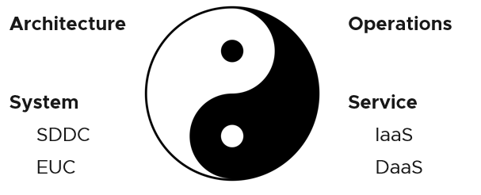

Architecture and Operations are two equally large realms. While we certainly consider Operations when designing a system, it is not a part of Architecture. This book is an example of Operations. Notice it goes deep into metrics as troubleshooting is at the heart of operations.

Architecture and Operations also differ in other industries. The person who designs the space shuttle is not the person operating it. You need to be an astronaut to be qualified to operate a space shuttle. The person who designs an F1 race car is not the person driving it. Different expertise is required. They complete each other and are inter-dependent, like [Yin and Yang](https://en.wikipedia.org/wiki/Yin_and_yang).

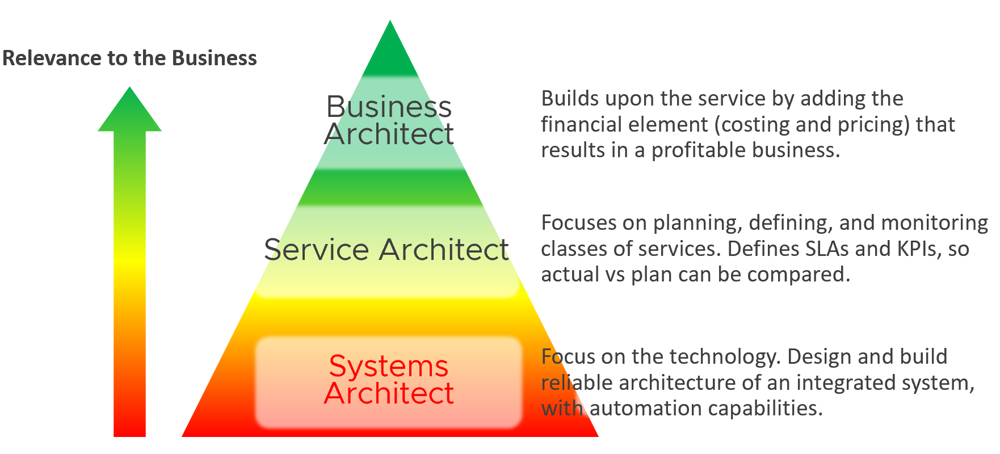

Since Infrastructure is becoming a service, you need to know how to architect a service (e.g., IaaS, Database as a Service, Desktop as a Service).

- What are the services the IaaS is providing? How do you define a service?

- What metrics do you use to quantify its quality?

- How many services? How do you distinguish between a higher-class service and normal one?

You also need to know what type of services are on demand. Service Architects go out, meet customers and understand their requirements. What classes of services are on demand now and in the future? From there, you can architect the corresponding services to anticipate the demand.

As a Business Architect, you not only know the cost of running the service, but you also know how & when to break even. You are not responsible for profit and loss, as you are not the CIO or Cloud Service Provider CEO, but you do play a strategic advisor role to them. You know what to price, how to price, and most importantly you know your price is competitive (or, at least you can provide a business justification for reasons other than price).

From my interactions with customers, I notice that Infrastructure Architects are not leading the Day 0 phase. They provide input to the Planning stage but are not the lead architects driving it. The Infrastructure Architect tends to focus on technical bits, something that CFOs and CIOs value less (hence they spend less time on it). They also do not architect the operations. I see many seasoned VMware Architects not extending their influence beyond architecture. I think that’s a lost opportunity because Day 1 and Day 2 is actually part of the same side. Think of it as a [Mobius strip](http://en.wikipedia.org/wiki/M%C3%B6bius_strip).

Service Architect and Business Architect are the next steps for Infrastructure Architect. I shared story “The Chef and his cooking” back in 2014 during one of the [VMUG](https://www.vmug.com) session.

By the way, how do you know who is the real architect of a system? Let’s say you have mega VDI system, with integrated components such as VMware, Omnissa, thin clients, office networks and many other things. Who is the true architect of this?

My answer:

The owner of the hands on the keyboard figuring out the root cause when there is a massive problem that no one knows why. That’s your real architect. The team who drew the architecture diagrams are not.

#### Automate \| Operate

You need to account for situations where things go wrong, intentional or unintentional. Real problems happen in Day 2 as that’s when you have business workloads doing revenue generating transactions. Do not architect something you are not willing to troubleshoot. Think of the roles and skills required to operate your architecture. Provide the necessary visibility into each component and define what constitutes health.

I hope the above examples show that Day 2 is where you want to start. As said in a famous [quote](https://www.franklincovey.com/the-7-habits/habit-2/): “Begin with the end in mind”.

Did you notice something missing in the discussion above?

Yes, I did not cover Automation.

Why is that?

For me, that’s part of architecture. You should not automate what you cannot even operate. So, automation is not part of operations. Automation is a feature of your Architecture, meaning you design the system with automation in mind. Using an analogy, it’s like a plane with many automation features. Fly-by-wire. That’s a *feature* of the plane. How you *use* the plane to ensure passengers arrive at the destination safely, comfortably, timely and fresh: that’s operations.

In terms of transformation journey, automation should be placed last. Do not automate what you cannot operate. You’re speeding up the problem if your operations is not well governed.

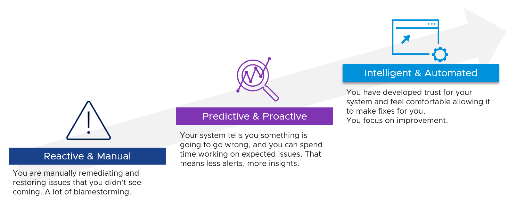

#### Observability

Observability needs to be built-in, not bolted-on, in your system architecture. That means ensuring it can be monitored clearly, down to the smallest component. Do not deploy system into production that can’t be properly monitored. Unfortunately, this is typically the last thing in our IT industry, especially with tight deadlines, limited skills and low budgets. Many applications, software, and hardware do not systematically leave trails for post-mortem analysis.

To “solve” the above problem, our IT industry came up with new buzzwords and make them larger than life. You hear jargon such as observability, unknown unknown, golden signal, SLO, SLI, and reliability. Observability is pitched as more than monitoring + troubleshooting, although it’s just a nature of a system.

Observability is not a superset of monitoring. They are two different things.

| Observability                                                                                                                                                    | Monitoring                                                                                                                     |
|------------------------------------------------------------------------------------------------------------------------------------------------------------------|--------------------------------------------------------------------------------------------------------------------------------|
| It is a property of the system to be managed                                                                                                                     | It is an action done by an actor                                                                                               |
| Observability and Debuggability are peers. Just because a system emits metrics and logs regularly, does not mean it has ways to be stepped through and debugged. | Monitoring & Troubleshooting are peers. Just because an admin has the skills to monitor a system, does not mean he can fix it. |

It is certainly important to elevate the proactive work to detect unknown problems that you are not even aware of. I love slicing and dicing millions of data points (metrics, logs, events, traces, NetFlow) and discover new insights. It also helps me understanding the behavior of low-level metrics better. Many times, they are not what the manual says as documentation on metrics is often not deep. I’ve discovered many bugs in metrics from multiple vendors in the last 1+ decade.

CIOs should not only encourage, but also require the subject matter experts to allocate time to this proactive exploration. It should be part of a regular cadence to share work and findings. It’s both a good exercise to keep the knowledge deep, plus you never know what you will discover!

Having said that, do we need a new term? I don’t think so since it has caused confusion. Lots of software can do this, along with many other things. It’s all part of monitoring and troubleshooting. There is no need to invent a new category of software. This is the classic “old wine in a new bottle” trick.

If we really want a new term, the word debuggability carries more value as just because a system is observable does not mean you can do something to fix it, let alone intervening to debug it. It is painful watching your system deteriorate with nothing you can do about it. In modern days, debugging is no longer limited to slow and manual process of stepping through code. It can involve in-line analytics as the codes processing. This certainly requires the system to be built with debuggability in mind.

##### Input \| Output 

There are **6**[^6] types of inputs which work together to give you your alerts, dashboards, and reports. Each of those input types has their own purpose and format. They also tend to overlap. So typically, different observability tools excel on each.

Output is documented in PART 2 of the book.

An alert may feel like an input, as you start from it. It is not an input as it’s a trigger you create based on the values of the data types. For example, you create an alert when certain log events occur, certain property changes and certain metrics threshold being crossed.

Review this diagram. What do you notice?

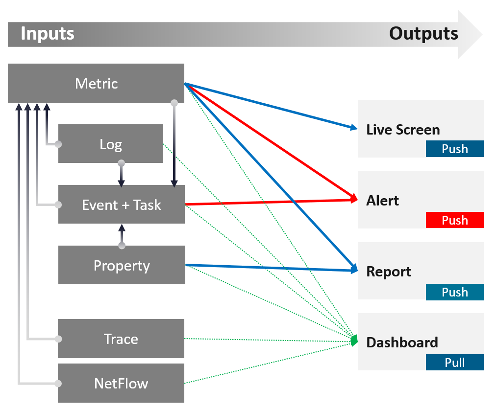

<table>
<colgroup>
<col style="width: 17%" />
<col style="width: 82%" />
</colgroup>
<thead>
<tr class="header">
<th><strong>Metric</strong></th>
<th>
The definition is it is produced at regular intervals, even if the value is constant. That’s why state is a metric, not a property.

Unlike property, a metric is not editable by user. Its valued is not entered by users. It’s generated by system.

A metric always originates as a number. It may be translated into a string for ease of understanding.

The number could be a code, whose description is a string. For example, “-1” means no limit. By the way, I prefer infinity to indicate no limit as that seems more natural.

It can be a raw metric or computed metric. A computed metric is derived from existing metrics and properties. An example of a computed metric is a super metric in VCF Operations.

There are 3 types of metrics (contention, consumption and context). They are explained further in the vSphere Metric book.

If it crosses a certain threshold, it can trigger an event or generate a log message. From events, we can create a metric, such as a count of vMotion in the cluster.

If the number does not match expectation, we can trigger an alert. A daily proactive dashboard showing the trend across hundreds of clusters may give a clue if a problem will happen today. In this case, the proactive work avoids the alert to begin with.
</th>
</tr>
</thead>
<tbody>
<tr class="odd">
<td><strong>Property</strong></td>
<td>
This is the opposite of metric, as it does not happen in predictable interval.

There are 3 types of properties:

<table>
<colgroup>
<col style="width: 17%" />
<col style="width: 82%" />
</colgroup>
<thead>
<tr class="header">
<th><strong>Label or Tag</strong></th>
<th>
Label is always external; we attach is to an object.

Examples: VM Owner Name, Cluster Class of Service, Cost Center.
</th>
</tr>
</thead>
<tbody>
<tr class="odd">
<td><strong>Setting</strong></td>
<td>
Also known as configuration. Inherent or original part of the object. It also defines the object.

Examples: VM Configured vCPU, ESXi Power Management, DRS Level.
</td>
</tr>
<tr class="even">
<td><strong>Non-setting</strong></td>
<td>
It just provides context. Does not define or impact the object itself.

Examples: date created, parent folder, parent ESXi.
</td>
</tr>
</tbody>
</table>

Property change is a type of event, which can trigger an alert. Since not all properties are important, the significant of the event is also impacted.

For examples:

<ul>
<li>
Number of VMs in a cluster is not a property, even if it does not change for years.
</li>
<li>
Maximum number of VM in a cluster is a property, as that’s part of the cluster capability.
</li>
<li>
Number of ESXi hosts in a cluster is a property as the cluster is configured with that. Number of running ESXi hosts is however a metric.
</li>
</ul></td>
</tr>
<tr class="even">
<td><strong>Log</strong></td>
<td>
A log is a raw message, typically produced by developers directly.

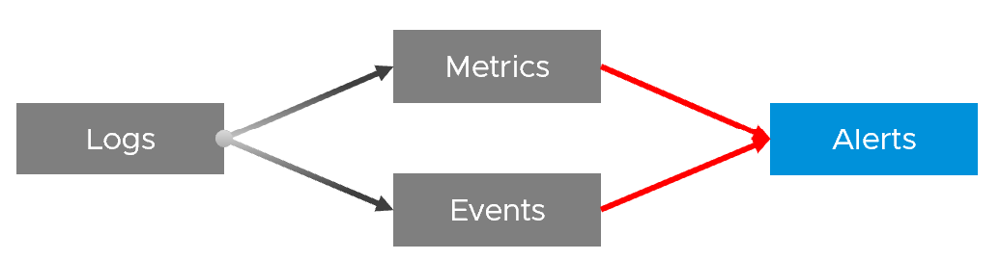

Numbers can be extracted to form metrics, while text can describe an event. Metrics and Events can then trigger alerts.

&gt;99.9% of the logs are not useful. How do you minimize the cost while maximizing the benefit?
</td>
</tr>
<tr class="odd">
<td rowspan="2"><strong>Event</strong></td>
<td>
An event is a record of something that happened. It could be bad, neutral, or good. It could be planned or unplanned. The bad ones may warrant an alert. Unlike a metric, it does not happen on regular interval.

An event has a start time. It might also have an end time. For example, threshold bridged is an event. If the value drops below the threshold, the event ended.
</td>
</tr>
<tr class="even">
<td>
It can be a setting change, a state change, or a label change. A label is “external”, meaning it is not an inherent property of the object. Events also trap the activities performed on those objects.

For example:

<ul>
<li>
“Marielle the vSphere Admin enabled DRS on Cluster 007 on 10 June at 10:06 am”. Notice it has the actor, the target, the activity, and the date/time.
</li>
<li>
“Cluster 007 DRS was enabled” is an example of the state change (from disabled to enabled)
</li>
<li>
“Cluster 007 DRS automation level was changed from 2 to 5” is an example of setting change. The state remains fully automated.
</li>
<li>
Cluster 007 will be decommissioned and has a tag assigned to mark it as such. This is an example of a label change. There is no setting or state change.
</li>
</ul></td>
</tr>
</tbody>
</table>

In addition to the 4 basic inputs above, you need the following in certain situation:

<table>
<colgroup>
<col style="width: 19%" />
<col style="width: 80%" />
</colgroup>
<thead>
<tr class="header">
<th><strong>Traces</strong></th>
<th>
A trace is a record of code in-motion. Some can produce numbers, which are metrics.

This is needed is low level, function-level troubleshooting.

By the way, function tracing can be traced back (pun intended) to Solaris 10 <a href="https://en.wikipedia.org/wiki/DTrace">Dtrace</a>, back to 2005!
</th>
</tr>
</thead>
<tbody>
<tr class="odd">
<td><strong>NetFlow</strong></td>
<td>A <a href="https://en.wikipedia.org/wiki/NetFlow">NetFlow</a> captures path taken, typically flows of network packets. It shows networked relationship and can produce metrics.</td>
</tr>
</tbody>
</table>

##### Symptom \| Alert \| Insight

The reason you have alert storm is you treat alert as To-Do List. You want to be reminded of everything so you do not miss anything.

Analogy: Think of Alerts as your Accident/Emergency Department. You can have dozens of departments dealing with all sorts of illness, but only 1 central location for urgent matters. So where are your “dozens of departments” in your private cloud? Some focus on security, some on storage, some on capacity, some of performance. If you monitor your blood pressure, weight, regularly, why not have daily health check for VCF?

Alert hopefully starts with symptom, a minor and non-urgent issue. This gives you a window to catch during your proactive daily health check.

Mild symptoms that do not go away over time becomes an alert, as it has become urgent.

While symptom and alerts are closely related, insight is something else altogether.

- The former is bottom up, the latter is top down. You typically gain an insight from a collection of alerts and symptoms, plus additional context. Insight uses many more metrics, especially the supporting metrics.

- Insight is much harder to realize as it requires both technology expertise and environment experience. It deals with “hint” instead of issue. You need to know the overall architecture and what’s happening operationally, so you can derive an insight from the alerts and symptoms.

- Insights complement alerts, not replace them. Insights do not have the concept of “auto close” as they do not involve help desk tickets

Proactive Alert is an oxymoron.

Proactive means you’re acting before something happened which forces you to react. The moment you react, you’re reactive. Just because the business is not impacted does not make it proactive.

For example:

- vSAN shows high disk latency on Sunday midnight. You’re called to investigate, before business become impacted on Monday morning. You fixed it on the weekend and save the business.

- Does that “weekend warrior” make it a proactive alert?

- What if the same alert happens during business hours and business impacted? Does that make it reactive?

Alerts rely on threshold, be it dynamic or static. A Threshold has an inherent limitation. It misses the big picture, as it can only see what has crossed the threshold.

For one object that reached this threshold, there could be many just beneath the level. Think of an iceberg. The small portion above sea level, the tip of the iceberg, is an alert. It does not provide the total picture. In fact, the chunk beneath the surface is far larger.

Insights answer much harder questions, which are typically fuzzy hence they can’t be defined as alerts. Examples of questions are:

- Are we being attacked? Are they events and activities that happens in parts of our environment where they are not supposed to happen?

- Is performance degrading? Is there any common pattern and cause?

- Is the environment behaving differently to what we expect?

Insights focus on the underlying problem. They also help buy you time so you can address the problem before the users complain. In the following example, the alerts use the SLA metrics and threshold. Insights require more granular metrics and supporting metrics

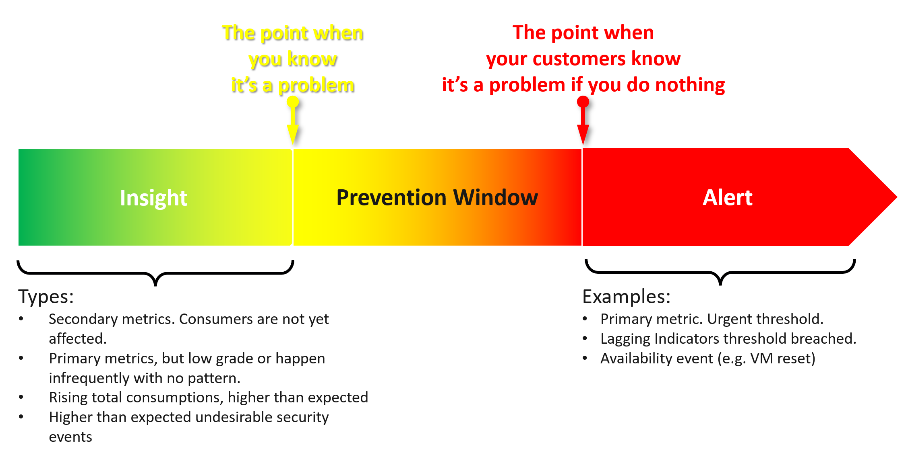What do you think of the preceding example? Would it result in less alerts and less reactive troubleshooting?

The main limitation of proactivity is false positives. It also requires daily operational discipline.

An Insight is useless to those who are not familiar with the environment. The numbers shown by an Insight should match reality, and only a person intimately involved with the actual operations can sense if the numbers are not correct.

Let’s take an example: the insight shows your total IOPS throughput is low. If you don’t know what to expect on that day, that number is meaningless. But if on that day you expect high throughput because your company is in the retail industry and it’s the day before Christmas, then you know the sales are not happening as per expectation. Proactively check before your CEO complains why business is not doing well.

|                    | Alert                                                                               | Insight                                                                                          |
|--------------------|-------------------------------------------------------------------------------------|--------------------------------------------------------------------------------------------------|
| **Goal**           | To fix. You’re ill.                                                                 | To prevent. You’re not sick.                                                                     |
| **What it is**     | A formal event with ticket recorded in the system. May have an incident associated. | Not a formal event. No incident.                                                                 |
| **Situation**      | Business or operations may be impacted.                                             | No impact.                                                                                       |
|                    | Known problem. You may not know the root cause though.                              | No known problem.                                                                                |
|                    | Urgent. You must look at it today.                                                  | Not urgent. Can do on the next business day, or even next week.                                  |
|                    | Hopefully not important issue                                                       | Important issue                                                                                  |
| **Nature**         | Reactive and unpredictable.                                                         | Proactive and regular. Daily, weekly, monthly.                                                   |
|                    | The system tells you. Response is mandatory.                                        | Response is not applicable as you initiate.                                                      |
| **Person**         | Low expertise. Follow steps or SOP.                                                 | Deep expertise. No steps to follow.                                                              |
|                    | Does not need to know the overall environment and workload well.                    | Must know both the environment and recent operations.                                            |
| **Metric**         | Focus on primary metrics (the What).                                                | Focus on both primary metrics and secondary metrics (which explains why primary metrics are bad) |
| **User Interface** | Start with Email or notification on your mobile phone.                              | Start with a big dashboard on desktop.                                                           |
|                    | A specific alert. You work bottom up.                                               | The big picture of the overall environment. You work top down.                                   |

##### Lagging Indicator \| Leading Indicator

<table>
<colgroup>
<col style="width: 16%" />
<col style="width: 41%" />
<col style="width: 41%" />
</colgroup>
<thead>
<tr class="header">
<th></th>
<th>Lagging Indicator</th>
<th>Leading Indicator</th>
</tr>
</thead>
<tbody>
<tr class="odd">
<td><strong>Used in</strong></td>
<td>
Alerts.

Reason is alert is your fallback, if you forget to proactively address.
</td>
<td>Insights.</td>
</tr>
<tr class="even">
<td><strong>Focus</strong></td>
<td>“Dining-area” metrics. Metrics that impact customers.</td>
<td>“Kitchen” metrics. Underlying metrics that impact the primary metrics.</td>
</tr>
<tr class="odd">
<td><strong>Technicality</strong></td>
<td>Simple to understand the meaning (not necessarily the underlying formula).</td>
<td>Tend to be low level metrics that require deep technical knowledge.</td>
</tr>
<tr class="even">
<td><strong>Persona</strong></td>
<td>Level 1 and Help Desk.</td>
<td>Subject Matter Expert. Familiarity with the environment is required.</td>
</tr>
</tbody>
</table>

##### Alert 

What, exactly, is alert?

The 3R of alert:

<table>
<colgroup>
<col style="width: 19%" />
<col style="width: 80%" />
</colgroup>
<thead>
<tr class="header">
<th>Rapid</th>
<th>
The issue is urgent; hence you want to know the problem as soon as possible.

If time is not an essence, then a daily SOP with dashboard is more effective as you can see the big picture. Avoid sending alerts to people that do not deal with day-to-day operations. Long term actions such as capacity management are best served with dashboard.

Do not treat alert as To Do List. It is also not a Reminder
</th>
</tr>
</thead>
<tbody>
<tr class="odd">
<td>Real</td>
<td>
Don’t confuse alert with symptom.

If there is nothing wrong, there is no need to trigger an alert. That’s why in general you do not set up an alert on inventory changes, as inventory is merely an account of something.
</td>
</tr>
<tr class="even">
<td>Rare</td>
<td>
If it happens too frequent, it will numb you.

Alert focuses on exception, not the big picture. As a result, you want this to be minimal. If the whole house is on fire, it’s too late for an alert.
</td>
</tr>
</tbody>
</table>

What distinguishes red criticality versus orange criticality versus yellow criticality?

The following diagram provides the answer:

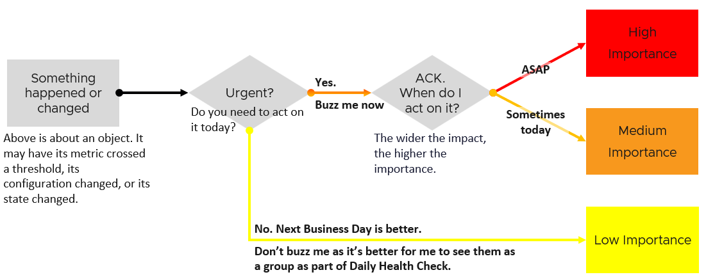

Let’s summarize how the colors translate into day-to-day operations:

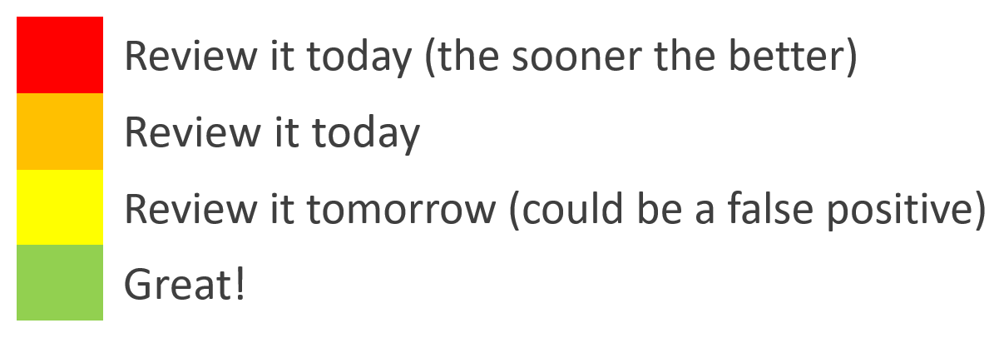

<table>
<colgroup>
<col style="width: 19%" />
<col style="width: 80%" />
</colgroup>
<thead>
<tr class="header">
<th>Yellow</th>
<th>Symptom. Non urgent. Leading Indicators. Symptoms. Could be important, could also be false positive</th>
</tr>
</thead>
<tbody>
<tr class="odd">
<td>Orange</td>
<td>Alert. Urgent, but importance is not high. Attend by end of day, do not delay until tomorrow.</td>
</tr>
<tr class="even">
<td rowspan="2">Red</td>
<td>Alert. Urgent and important. However, it does not always mean you must drop everything you do and start firefighting in seconds. Attend within 1-2 hours.</td>
</tr>
<tr class="odd">
<td>
There is a small subset of Red where you need to drop everything. Think of it as emergency. It may not be important, but it’s definitely urgent. If you get the alert at 0200 hours, you attend to it at 02:00 as each minute matters.

An analogy we can relate in life is you accidentally cut yourself. Even though it’s not life threatening, you want to stop the bleeding immediately, not 1 minute later. The good part is such emergency situation rarely happens. There is no alert defined for it in VCF yet. I’m keen to hear a real-world suggestion!
</td>
</tr>
</tbody>
</table>

#### The 2 Sides of VCF

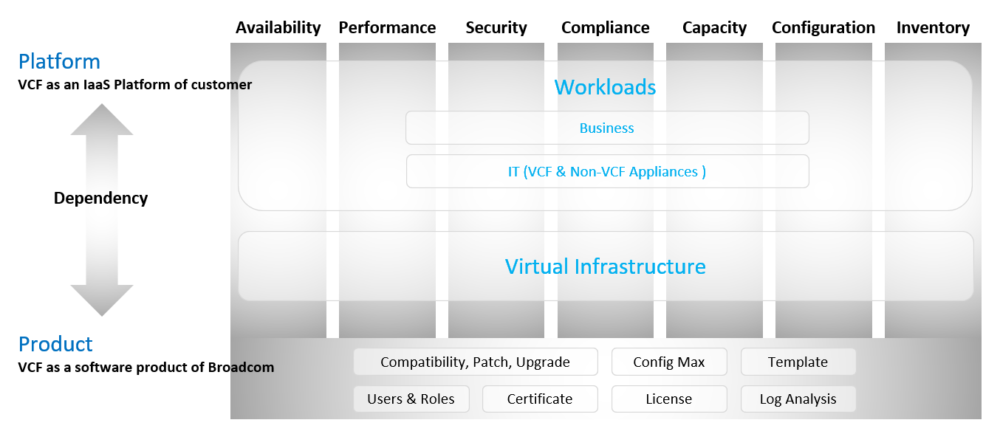

Think of it as “no workload” vs “with workload”. Workload means the customers VM, not your infrastructure software.

Infrastructure software is virtual appliance or K8 pods that you need to have as part of your private cloud platform.

VCF belongs to a category of software called SDDC. You use the software on commodity hardware and create a private cloud on your premises. This is not so obvious as it’s the only product in this category.

Because of its nature as a data center defined as a software, there are 2 sides of VCF:

- As an IaaS platform of customer. This is what the application team care.

- As a software product of Broadcom. This is what the infrastructure team care. The software takes the shape of one of these 2 forms:

  - Virtual appliance. Examples are vCenter Server and NSX Edge

  - OS kernel software. Examples are ESXi VMkernel, vSAN and NSX kernel modules.

The 2 sides can impact one another, requiring you to see them as one. You need to manage all aspects of operations such as availability, security, and inventory.

- There are 2 layers: consumer and provider.

- The consumer layer is where VM and containers run. This layer consists of 3 sublayers (application, Guest OS, and virtual machine). VCF scope ends at VM (BIOS & motherboard) and Tools, as the Guest OS is largely outside the influence of VCF the product.

- The provider layer is the virtualized platform (compute, storage, network).

### Service Level Agreement

The difference between an enterprise grade Cloud and non-enterprise grade Cloud is the SLA. A cloud provider can state that they have the best technology, the most experienced professionals, the most innovative process, industry certifications, blah blah blah to prove that they are the best. All that will not carry weight if they are afraid to back it up with the SLA in their contract. The SLA enables customers to hold the cloud provider accountable as it carries a financial penalty.

Once the SLA is defined, then customers want to know how it will be delivered. This is where the process, architecture, certification etc. come in. The **what** always comes before the **how**.

With that, let’s define “SLA”.

First, it is just a *component* of a business contract. The business contract is a legally binding document which has many other clauses outside the SLA section. The contract first needs to set the context and definition. After that, it has a set of agreements, with SLA being one of them. Examples of other agreements include confidentiality agreements, terms of payment, non-competitive agreements, and marketing agreements.

The SLA section has actual metrics that define the SLA. Google calls this SLO. It works for them as they do not have SLA (to you as their customers). As enterprise IT, you have SLA to your tenants. SLO creates confusion as it sounds like a peer to SLA, when it’s just a goal. Private Cloud does not need SLO, as SLA and SLI are sufficient in practice. SLI is not a peer to SLA.

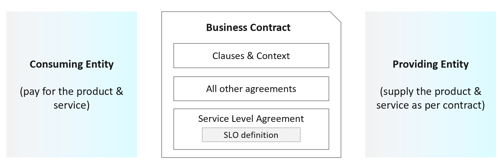

Guess how many SLAs do you need?

It depends on the type of services. Most service providers will only commit to the simplest and most obvious one, which is availability. It’s the simplest as it’s binary. The darn thing is either up or down. Google only covers availability in [their SLA post](https://cloud.google.com/blog/products/devops-sre/sre-fundamentals-slis-slas-and-slos) here, which is based on Google Cloud’s [SLA](https://cloud.google.com/blog/products/devops-sre/availability-part-deux-cre-life-lessons). AWS only cover their infrastructure, and not your EC2 VM. I have read [this](https://cloud.google.com/blog/products/devops-sre/sre-fundamentals-slis-slas-and-slos) and many other articles. While it makes sense for Google business, it’s not suitable for IaaS. Happy to discuss my documented analysis .

Just because something is up, does not mean it is fast. In fact, a service that is slow to the point it’s unusable is as good as down.

Just because something is fast, does not mean it’s secured. This is why a Security SLA is necessary.

#### The 4 SLAs of IaaS

The business of IaaS should provide four SLAs, as customers want complete coverage. These four are focused on Availability, Performance, Compliance, and Service.

The following diagram showing the first three: what they do, and what they measure.

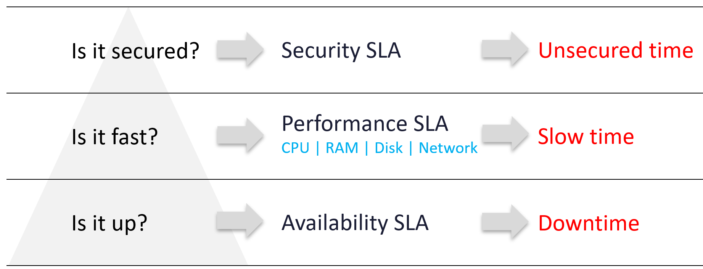

In the Availability SLA, you measure downtime. In the Performance SLA, you measure ”slow time”. In the Compliance SLA, you measure unsecured time. Regardless, you measure something and express it in 0 – 100%, with 100% being perfect relative to the contract.

Wait, why am I not showing the 4th one?

Because it plays a secondary role. The first 3 covers the actual workload, while the 4th one covers the human (typically tenant or application team).

<table>
<colgroup>
<col style="width: 20%" />
<col style="width: 79%" />
</colgroup>
<thead>
<tr class="header">
<th><strong>Availability</strong></th>
<th>
This is the most basic SLA. It is the oldest and most well-known.

In reality, it is largely a given. It does not matter what the agreed number is. If the darn thing is down, you better hurry to bring it up before there is a complaint or things get worse!
</th>
</tr>
</thead>
<tbody>
<tr class="odd">
<td><strong>Performance</strong></td>
<td>
The Performance SLA is far more valuable than Availability SLA. It is the solution to <a href="#_Complaint-based_Operations">complaint-based operations</a> by defining what exactly is “fast”.

In IaaS, it covers CPU, Memory, Disk and Network, hence there are four metrics used.
</td>
</tr>
<tr class="even">
<td><strong>Compliance</strong></td>
<td>
Also called Security SLA as the goal is secured environment.

This is hardly talked about, as customers and providers expect this to be 100%. This is why you need to provide an SLA, as promising 100% will lead to disappointment.

It measures compliance with industry security regulation or certification.
</td>
</tr>
<tr class="odd">
<td><strong>Service</strong></td>
<td>Service provided by both human and system (typically in the form of self-service portal)</td>
</tr>
</tbody>
</table>

##### VM vs Guest OS

VM and Guest OS are 2 separate objects but they are 1 logical entity due to 1:1 permanent relationship. It is common for IaaS provider to cover both.

If your responsibility includes the Guest OS, then your SLA needs to include Windows or Linux.

<table>
<colgroup>
<col style="width: 17%" />
<col style="width: 41%" />
<col style="width: 41%" />
</colgroup>
<thead>
<tr class="header">
<th>Type of SLA</th>
<th>Virtual Machine</th>
<th>Guest OS</th>
</tr>
</thead>
<tbody>
<tr class="odd">
<td>Availability</td>
<td>
VM is powered on. BIOS is up and running. A VM is basically a virtual motherboard.

Windows and Linux are not part of SLA.
</td>
<td>
Windows or Linux is up and running. This may include basic services such as security agents.

Application is not part of SLA
</td>
</tr>
<tr class="even">
<td>Performance</td>
<td>VM is getting the CPU, memory, disk, and network resources it demands</td>
<td>Windows or Linux performance counters are within expectation.</td>
</tr>
<tr class="odd">
<td>Security</td>
<td>VM is protected as per vSphere hardening guide or industry regulation.</td>
<td>Windows or Linux is protected as per respective vendors or industry regulation.</td>
</tr>
</tbody>
</table>

In this book, I assume your IaaS offering includes Guest OS. However, the metrics for Windows and Linux are not yet complete due to the lack of maturity of their performance modeling.

##### Availability SLA

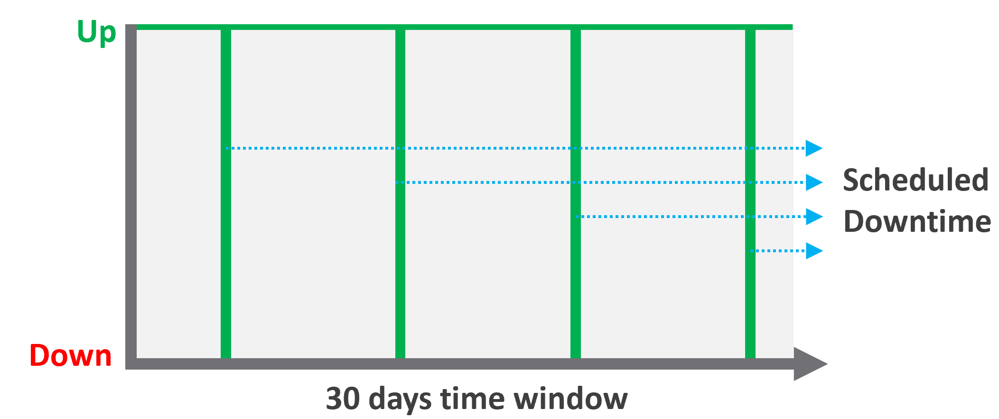

Many vendors claim a very high availability SLA. This is misleading as they do not include scheduled downtime. This unique saving grace lets you state you’re 99.999% available even though the actual reality, experienced by end customer, is lower. This is why you need 2 metrics:

- One for availability as defined in the SLA.

- One for actual availability. It reflects reality.

The 2 metrics names are:

- Actual Availability (%). This is much easier to measure as it does not consider context. Down is down, regardless of when, who and why.

- Operational Availability (%) This is harder to measure.

Example:

- All VMs has weekly scheduled downtime to apply urgent security patch. It’s every Sunday 0000 – 0200 hours.

- Last month, the database server was brought down for patching 3 times. But all happened within the scheduled downtime. While Windows was only shutdown for 15 minutes, the large database took 45 minutes to fully restore.

- In this case, the Operational Availability (%) for the month of June is 100%. It meets SLA.

- The Actual Availability (%) accounts for the 3 hours of total downtime. It’s 3x of (15 minutes + 45 minutes). In the month of June, there are 24 hours x 30 days = 720 hours. Actual Availability (%) = 717 / 720 = 99.58%

###### Formula

<table>
<colgroup>
<col style="width: 18%" />
<col style="width: 81%" />
</colgroup>
<thead>
<tr class="header">
<th rowspan="2">Definition</th>
<th>
Defined as Guest OS is pingable, because running but isolated fails the availability test.

The Ping Source is predefined and set by the IaaS provider, not the customer. It pings the VM, not a specific process (e.g. web server. This is IaaS, not web server as a service.).
</th>
</tr>
<tr class="odd">
<th>The uptime only covers the Guest OS. If it takes the application 15 minutes to become fully operational as it has to load files and other services, that’s not counted.</th>
</tr>
</thead>
<tbody>
<tr class="odd">
<td>Inclusion</td>
<td>If the crash is caused by VMware Tools or IT Infrastructure owned drivers/agents, then it’s counted.</td>
</tr>
<tr class="even">
<td rowspan="3">Exclusion</td>
<td>
Unscheduled downtime caused by customers. If the crash is caused by bad applications behaviors, the SLA is not affected as that’s not within the control of IaaS provider.

As it takes time to figure out what caused the downtime, you need to be able to recalculate the metric.
</td>
</tr>
<tr class="odd">
<td>VM owner-initiated reboots as they might reboot their OS to solve problems or after installing software. How to track as developer may not inform the IaaS team, as Windows does not fully trap this event?</td>
</tr>
<tr class="even">
<td>Scheduled downtime. Guest OS upgrades, patches that requires reboot, Tools upgrade, VM Hardware version are not counted if you execute within the agreed scheduled downtime.</td>
</tr>
<tr class="odd">
<td>Complication</td>
<td>
A challenge that impacts availability but not performance is recovery time.

Windows or Linux maybe up in 1 minute, but it needs to perform fsck (filesystem consistency check) before application can launch. This is considered as part of downtime.
</td>
</tr>
</tbody>
</table>

###### Supporting Techniques

You need to back up your promises with solutions that are convincing for customers. Here are some solutions that you may offer to justify and support the higher availability SLA.

| Backup            | Gold Tier provides application-level back up. It also provides more frequent full back up, and customers are provided with self-service individual file restore.                                        |     |
|-------------------|---------------------------------------------------------------------------------------------------------------------------------------------------------------------------------------------------------|-----|
| High Availability | Gold Tier provides application-level monitoring. Customers can also ask for specific boot-up sequence of their VMs, and ask for VM-Host affinity rules to minimize risk.                                |     |
| Disaster Recovery | Gold Tier provides lower [RPO and RTO](https://en.wikipedia.org/wiki/Disaster_recovery). Customers are also entitled to annual real-world tests, where the production workload is run from the DR site. |     |
| Snapshot          | Gold Tier provides longer snapshots and larger snapshots.                                                                                                                                               |     |
| OS Management     | Gold Tier provides flexibility in patching. Customers can specify delay in patching and request custom patch packages, where not all patches from Microsoft or Red Hat is applied.                      |     |
| VM Management     | Gold Tier provides flexibility in updating Tools and VM Hardware. Customers are allowed to defer the updates.                                                                                           |     |

##### Performance SLA

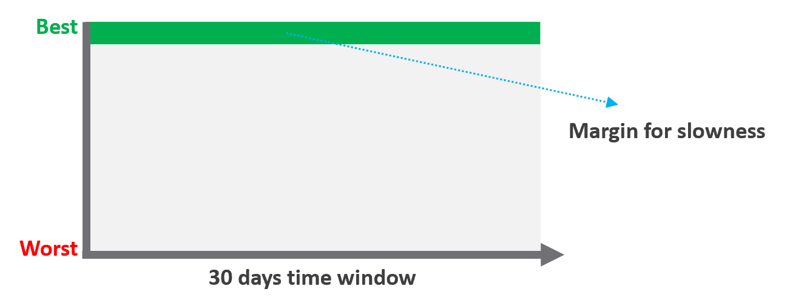

Unlike availability, which has the luxury of scheduled downtime, there is no such thing as scheduled “slow time” with performance. You can’t say that you’re doing infrastructure upgrades and use that as excuse for why VM performance will be slow. As a result, you need to put your margin or buffer somewhere else.

Slow is not binary. It’s a spectrum from 0 contention to absolute worst (as good as dead). Some metrics such as disk latency can never be 0. It will be a small number, but it’s not 0. The same goes with the value of the CPU Ready metric. So, we need to define a threshold above 0.

<table>
<colgroup>
<col style="width: 17%" />
<col style="width: 82%" />
</colgroup>
<thead>
<tr class="header">
<th>Definition</th>
<th>
All are measured at VM level, not individual vCPU or vDisk. For disk, it’s also the average of Read &amp; Write.

All are averaged over 300 seconds, which is an appropriate balance for SLA monitoring. An SLA that is based on a 1-minute average will be too tight and result in either a cost increase or a reduction in threshold.
</th>
</tr>
</thead>
<tbody>
<tr class="odd">
<td>Inclusion</td>
<td>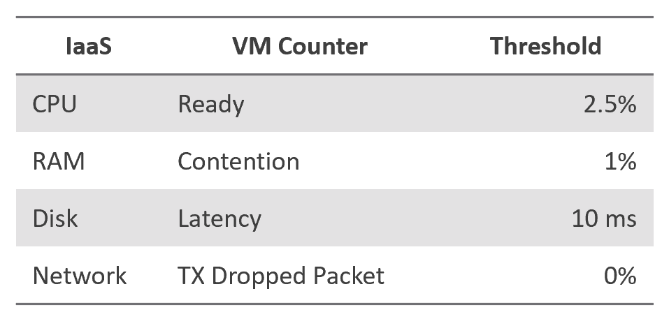</td>
</tr>
<tr class="even">
<td rowspan="2">Exclusion</td>
<td>Received Packet Dropped. It’s not reliable enough to be used in the SLA contract due to false positives. A packet could be dropped as it’s not for the VM. More details in the <a href="#_Network_Metrics">Network metric</a> chapter.</td>
</tr>
<tr class="odd">
<td>Other forms of contention, such as CPU Overlap, CPU Other Wait, and vMotion. They are too granular for the purpose of a contract. You track them via KPIs instead.</td>
</tr>
</tbody>
</table>

Why should you only use CPU Ready and exclude CPU Co-Stop and CPU Contention from the Performance SLA?

It took me years to vrealize the mistake.

You should exclude CPU Contention because its value can go as high as 37.5% without the application noticing any degradation. You can login to Windows or Linux and feel that it’s responsive.

Use the above threshold as they are. There are two main reasons:

- Major changes in the value, such as changing CPU Ready from 2.5% to 5%, will require you to adjust your “nines” to a higher number. This requires you to profile your environment first.

- A common value in the industry will also enable you to compare with your peers and get an industry-acceptable numbers. You can then compare how well you serve your mission critical VMs, your Test/Development VMs, etc.

Just like in Availability, there are extra things you can do to give confidence to your customers. For example:

- Gold Tier provides priority on the network. Customers can opt for a periodic ping service to ensure network latency between their applications remain within the agreed threshold.

##### Security SLA

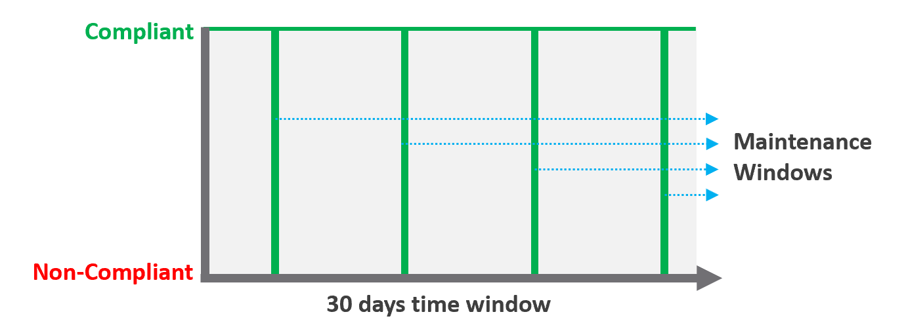

<table>
<colgroup>
<col style="width: 18%" />
<col style="width: 81%" />
</colgroup>
<thead>
<tr class="header">
<th>Definition</th>
<th>
Percentage of compliance against an agreed security policy or benchmark. A compliance SLA differs from an Availability or Performance SLA in one key area: the compliance SLA should promise perfect compliance. Compliance is binary: you are either compliant or you aren’t. You shouldn’t be telling your customers that you will have less than perfect compliance with your own security requirements.

It has a window, typically ad-hoc, to enable investigation or maintenance which may result in temporarily becoming non-compliant against your compliance benchmark.

Compliance calculation is purely from Infrastructure Team point of view.
</th>
</tr>
</thead>
<tbody>
<tr class="odd">
<td rowspan="2">Inclusion</td>
<td>
Internal security standards, typically an adaptation of VMware best practices or the VMware Security Hardening Guides.

Regulatory benchmarks, e.g. CIS, ISO, DISA, FISMA, PCI DSS, HIPAA.

For the vSphere infrastructure, compliance with these benchmarks (and custom ones) can be directly managed through the compliance features of VCF Operations.
</td>
</tr>
<tr class="even">
<td>A VM compliance must consider its immediate surrounding. If the parent ESXi, the vSAN storage, and the distributed network and storage is not secured, the score need to reflect it.</td>
</tr>
<tr class="odd">
<td rowspan="2">Exclusion</td>
<td>This depends on the definition of your IaaS Service. You are only providing SLAs for what you control.</td>
</tr>
<tr class="even">
<td>
If you provide the guest VM OS as part of your IaaS service, then you will need to maintain compliance by managing configuration (using something like Group Policy and/or a configuration management tool) and you will also most likely have some security tools and agents that run inside each VM. When the guest OS is part of the service, you should be measuring availability by whether the guest OS is running (e.g. via ICMP ping).

If you do not provide the guest OS as part of the IaaS service, then you do not need to worry about maintaining compliance in the guest OS, and you are also measuring availability by whether the VM is powered on.
</td>
</tr>
</tbody>
</table>

##### Service SLA

IaaS is built on commodity hardware and provided as a utility. Having said that, there are many ways to differentiate your service vs your competitors. Use class of service to distinguish premium service classes. The following table lists some examples.

<table>
<colgroup>
<col style="width: 18%" />
<col style="width: 81%" />
</colgroup>
<thead>
<tr class="header">
<th><strong>Provisioning Time</strong></th>
<th>In environment where the churn is high, the time taken to provision become important. You need to clearly define what “provisioned” means, as it can range from bare Windows or Linux to completely set up and configured with applications &amp; database loaded.</th>
</tr>
</thead>
<tbody>
<tr class="odd">
<td><strong>Provisioning Success</strong></td>
<td>Provisioning a complex set of multi-tier business applications with many VMs and many external integrations or endpoints may fail from time to time. If this is relevant to your environment, then add it as part of the SLA so you can focus on the higher class of service.</td>
</tr>
<tr class="even">
<td rowspan="3"><strong>Support</strong></td>
<td>Gold Tier customers will be alerted over email and messaging network within 10 minutes.</td>
</tr>
<tr class="odd">
<td>
The two popular examples are response time and path to escalation. Do not promise resolution time unless it’s completely within your control.

Gold Tier provides faster response time and longer coverage hours (e.g. 24 x 7 x 365). Your ticket is also directly answered by Level 3, bypassing the front liners.
</td>
</tr>
<tr class="even">
<td>Gold Tier comes with regular business reviews, attended by your management.</td>
</tr>
<tr class="odd">
<td><strong>TAM</strong></td>
<td>Gold Tier comes with a Technical Account Manager, acting as single point of contact for customers. The TAM is also the internal champion, representing customer interests within the vendor internal world.</td>
</tr>
<tr class="even">
<td rowspan="3"><strong>Monitoring</strong></td>
<td>Gold Tier VMs will be proactively monitored, not just relying on alerts.</td>
</tr>
<tr class="odd">
<td>Gold Tier provides deeper visibility into the underlying physical infrastructure where customers VM are running. Customers are entitled to see lower-level internal metrics such as vMotion stun time and VMkernel latency.</td>
</tr>
<tr class="even">
<td>Gold tier provides self-service monitoring. Customers are given their own login to a portal where they can monitor their own VMs. They can initiate scheduled downtime</td>
</tr>
</tbody>
</table>

There are other metrics you can add to differentiate one class from another. However, be careful of adding metrics that do not actually serve your business. For example, it can be tempting to put the accessible time of your self-service portal, to protect you from scheduled downtime. You need to work on the basis that your “office” is open 24 x 7 x 365 days.

#### The Metrics of SLAs

Do you set it per week, per month or per year? Let’s find out!

##### The Time Window

SLA is a *monthly* metric, not daily or yearly. You use an entire month of data to calculate it, averaging 8640 datapoints of 5-minute averages.

In the following table, notice 99.999% in a year is more time than 99.95% in a week. Your customers would not accept a yearly metric as they can be exposed to a long downtime. You would not accept a daily metric as there is no room for error. The monthly metric provides a balance between service quality and cost to deliver the service. It also makes reporting easier as you simply follow the calendar month.

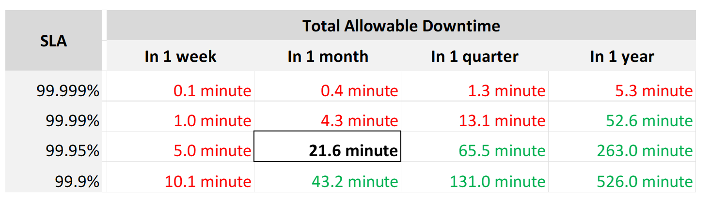

Each additional “9” shrinks your SLA window by 10x. That’s why each decimal can cost a lot more money, as a different architecture may be required.

Even if you measure the SLA once a month, it can still be very difficult to meet. Take a look at the following table:

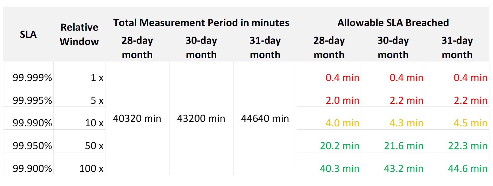

If you promise 99.99%, you only have 4 – 4.5 minutes of downtime per calendar month. That means your architecture must be able to detect the issue and then complete remediation in just a few minutes. That’s a tight space to maneuver.

Let’s analyze the size of the failure window we have per month. The table below gives you a better gauge into what SLA you want to set for each class of service.

| 30-day SLA | Failure Window | Failure Chance per SLA |
|------------|----------------|------------------------|
| 99.99%     | 4.3 minutes    | \< 1 time              |
| 99.98%     | 8.6 minutes    | \< 2 times             |
| 99.97%     | 13.0 minutes   | \< 3 times             |
| 99.96%     | 17.3 minutes   | \< 4 times             |
| 99.95%     | 21.6 minutes   | \< 5 times             |
| 99.90%     | 43.2 minutes   | \< 9 times             |
| 99.80%     | 86.4 minutes   | \< 18 times            |

##### The 2 Sides of an SLA

This is one of those things in life where it’s so obvious that we overlook it.

There are 2 sides of an SLA.

<table>
<colgroup>
<col style="width: 18%" />
<col style="width: 81%" />
</colgroup>
<thead>
<tr class="header">
<th><strong>Promise</strong></th>
<th>
What you promise to your customers.

Obviously, the higher the price, the better the service, the higher the SLA. So, there can be multiple numbers, matching the number of class of services.
</th>
</tr>
</thead>
<tbody>
<tr class="odd">
<td><strong>Reality</strong></td>
<td>
What is delivered. Calculated at the end of the month.

There is only one number, regardless of the class of service. A Gold VM can fail its SLA even though it’s getting a higher number than a Bronze VM.
</td>
</tr>
</tbody>
</table>

##### SLA Calculation

Since an SLA is a monthly counter, it needs to be derived from thousands of 5-minute counters.

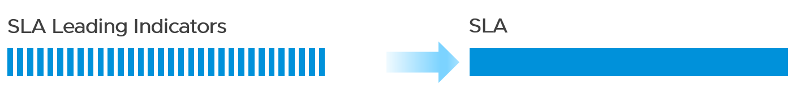

The four elements of IaaS (CPU, Memory, Disk, Network) are evaluated every 5 minutes. As this results in a metric, we need to give it a name. I call this SLA Leading Indicator, as it’s telling you in advance if you’re going to fail the SLA or not, which is at the end of the calendar month.

We need one metric for each service. In IaaS, the formula is:

If VM CPU Ready \> 2.5% then 100% else 0%

If VM Memory Contention \> 1.0% then 100% else 0%

If VM Disk Latency \> 10 ms then 100% else 0%

If VM Network TX Dropped \> 0 % then 100% else 0%

VM SLA Leading Indicator (%) = Average of Above 4 metrics.

So, every 5 minutes, a VM gets a score of 100% or 75% or 50% or 25% or 0%.

The VM Performance SLA (%) value is simply the average of the 5-minute datapoints over the last calendar month.

Whether that’s good or bad, it depends on what is being promised. The higher the class of service, the higher the price, and hence the higher the SLA.

##### Performance Quantification

<table>
<colgroup>
<col style="width: 17%" />
<col style="width: 82%" />
</colgroup>
<thead>
<tr class="header">
<th rowspan="2"><strong>CPU</strong></th>
<th>CPU Ready time of 2.5% in a 5-minute collection period translates into 7.5 seconds of ready state. This 7.5 second freeze does not have to be a contiguous block. Likely it is sub-seconds, spread well over 300,000 milliseconds.</th>
</tr>
<tr class="odd">
<th>
The number is not measured against CPU Utilization. 2 VMs can have identical Ready time while having very different utilization.

VM 01: CPU Ready 10%. CPU Run 90%

VM 02: CPU Ready 10%. CPU Run 10%

To VM 1, the situation is not that bad as it still got to run most of the time.

To VM 2, the performance is bad as it cannot run half the time.
</th>
</tr>
</thead>
<tbody>
<tr class="odd">
<td><strong>Memory</strong></td>
<td>Memory Contention is relative to the amount of memory being used. Unlike CPU, it is not measured across time. Reason is memory does not “run”.</td>
</tr>
<tr class="even">
<td rowspan="2"><strong>Disk Latency</strong></td>
<td>This is the average latency across 300 seconds. As disk IO is measured per second, a VM doing 1000 IOPS is doing a total of 300,000 IO commands over the entire 300 seconds.</td>
</tr>
<tr class="odd">
<td>It’s also an average of reads and writes. As each virtual disk can have its own latency, this number is normalized at VM level.</td>
</tr>
</tbody>
</table>

#### Class of Service

Now that you have the 4 SLAs, you compare them with the associated Classes of Service. The reason to offer multiple Classes of Service is that if you only have one Class of Service offering and you promise good service, everyone will expect the same first-class experience.

[Kim Ramirez](https://www.linkedin.com/in/kimkiser1/) advises that from a pricing psychology standpoint it might make sense to offer Gold, with the expectation that nobody will buy it, and it only serves to make Silver look like a good deal. In life, one way we know something is good or bad is via comparison. Relative value can complement absolute value in educating customers.

Having a comparison also addresses potential confusion where customers wonder where Gold is, if they only see Silver and Bronze offers.

If you do not wish to make a certain class available, provide the reason to your customers and/or management.

##### Price/Performance 

The [price-performance ratio](https://en.wikipedia.org/wiki/Price%E2%80%93performance_ratio) is widely accepted as it is simple to understand and it’s built on fairness. You’ve probably heard of this: “I offer 3 variants of service: Cheap, good, and fast. Pick any two. You want it cheap and good; it won’t be fast. You want it cheap and fast; it won’t be good. You want it good and fast; it won’t be cheap!”.

In IaaS, how do you apply the above principle?

- For Availability, this is measurable. If you reduce the downtime window by 2x, logically you should pay 2x.

- For Performance, how do you quantify this since it depends on utilization? Since utilization does not exist yet, you use overcommit ratios. If there are 2x vCPUs in the cluster, then each of them pays half price. This is fair as the cost must be distributed to all.

- For Compliance, this is a little different. Unlike with availability and performance, it is in your interest as a service provider to provide a perfect and consistent level of compliance across all classes of service.

The class of service impacts many parts of operations, so it needs to be central to your plan. The following diagram shows how the quality of the service and overcommit ratio serve as input to operations management.

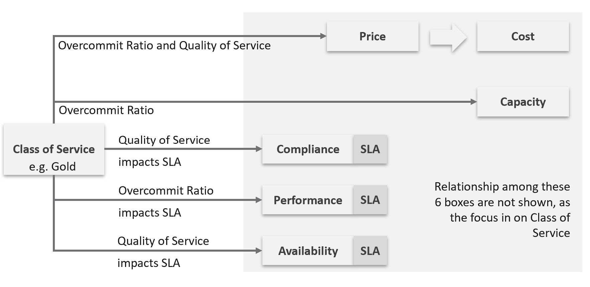

The following table shows a basic and generic guideline to a class of service. The actual model that you will implement will differ, taking into account actual hardware model and business demand.

<table>
<colgroup>
<col style="width: 11%" />
<col style="width: 9%" />
<col style="width: 14%" />
<col style="width: 17%" />
<col style="width: 46%" />
</colgroup>
<thead>
<tr class="header">
<th>Tier</th>
<th>Price</th>
<th>Overcommit</th>
<th>“Performance”</th>
<th>Positioning</th>
</tr>
</thead>
<tbody>
<tr class="odd">
<td><strong>1 (Gold)</strong></td>
<td>1.00 X</td>
<td>1:1</td>
<td>Perfect</td>
<td>Performance “Guarantee”. Suitable for latency-sensitive mission critical applications.</td>
</tr>
<tr class="even">
<td><strong>2 (Silver)</strong></td>
<td>0.50 X</td>
<td>1:2</td>
<td>Great</td>
<td>
50% discount for a mere 5% penalty. Great value compared with Gold Tier.

Suitable for most Production workload.
</td>
</tr>
<tr class="odd">
<td><strong>3 (Bronze)</strong></td>
<td>0.25 X</td>
<td>1:4</td>
<td>Good</td>
<td>
75% discount for a mere 10% penalty.

Notice the price is half and the performance drop is doubled. This makes it fair and consistent.

Suitable for Test &amp; Dev workload.
</td>
</tr>
<tr class="even">
<td><strong>4 (Free)</strong></td>
<td>0.00 X</td>
<td>Max</td>
<td>Average</td>
<td>
Suitable for temporary projects.

No Availability SLA, no Performance SLA
</td>
</tr>
</tbody>
</table>

I put “guarantee” in quote because for CPU this is not possible as the VM CPU Ready counter does not register 0.00% when there is no contention.

###### Performance

The word is shown in quote as it’s a broad definition. It includes all the types of SLA.

The performance column in the table above is backed by clearly defined SLA, because you need to quantify what the penalty exactly translates into.

- Let’s take Bronze as example. I put 10% penalty to position the business value. In reality, the performance metric is not simply ≥ 90% for Bronze.

- Using CPU as example, it is not that the CPU Ready will be ≤ 10% at all times.

- 10% is too high a number. A VM experiencing 9.9% CPU Ready constantly for entire month will pass the SLA. This is obviously unacceptable. A fairer number is 2.5% since it is an average of 5-minute.

- “At all times” translates into 100% SLA. It’s cost prohibitive. On the other hand, average is far too loose. SLA is expressed in “nines”, such as 99.93 or 3 nines. It is never expressed in lower number such as 95% as that translates into 1 in 20 failure rates.

- 2.5% will serve all classes. You just need to adjust the “nines”.

###### Free Tier

The Free Tier is useful to convey the value of the SLA. Human nature tends to appreciate something when after it’s taken away from us.

Business wise, the free tier must be funded by paid tiers. Since it is free, you are excused from providing SLA. It’s acceptable for them to have unpredictable downtime and slow time. Commercial cloud providers provide free tier that are intentionally designed to be slower and less reliable, because they want you to upgrade and pay.

##### The Benchmark to Rule Them All

Gold class has higher SLA than Silver class. For that to happen, that means they are measured against the same threshold or benchmark.

- For availability, you measure all classes against the ideal, which is no downtime.

- For performance, you measure them against the same threshold, which is the “slow time”.

- For compliance, you measure them against the ideal, which is perfect compliance.

- For service, you measure them against the ideal, which is the best possible service.

A VM in silver environment will expect that it does not get what it demands as often as a VM in Gold. If the VM Owner wants to have more *consistent* service in performance, then simply pay more and upgrade to the gold cluster.

This approach is easier than setting up a different performance threshold for each tier. Say you set the following:

- **Gold**: VM Memory Contention: 0.5%

- **Silver**: VM Memory Contention: 1.5%

You notice the problem already?

It is hard to explain the delta or gaps between the class of services. Why is Silver 3x the value if it is only half the price? Shouldn’t it be proportionate?

There is a 2nd problem. If you set *different* standards, it is possible that Silver will perform better than Gold, because it has lower standard. This can create confusion.

This means the performance in production is expected to have a higher score than the development environment. Development environments will obviously perform worse than Production environments.

How much worse, exactly?

Let’s find out by applying all the above into actual numbers. You have 9 numbers, 3 SLA x 3 Class of Service.

##### Recommended SLA

Let’s put all the above SLA in an example. The following is what I’d recommend:

| Tier           | Availability SLA | Performance SLA | Compliance SLA |
|----------------|------------------|-----------------|----------------|
| **1 (Gold)**   | 99.975%          | 99.9%           | 99.95%         |
| **2 (Silver)** | 99.950%          | 99.8%           |                |
| **3 (Bronze)** | 99.900%          | 99.6%           |                |

Why they are all different numbers? Isn’t easier to have 1 number for each class?

Well, they measure different things:

<table>
<colgroup>
<col style="width: 17%" />
<col style="width: 82%" />
</colgroup>
<thead>
<tr class="header">
<th><strong>Availability</strong></th>
<th>
It can afford to have the highest SLA because scheduled downtime and downtime caused by customer is not included.

I put 99.975% as Windows or Linux may need to run filesystem integrity check.

If you have many IT services or Security services that must be started before application services are started, adjust the SLA accordingly.

Notice the downtime windows is 1x, 2x, and 4x. It helps in justifying the price when the gaps are clear and consistent.
</th>
</tr>
</thead>
<tbody>
<tr class="odd">
<td><strong>Performance</strong></td>
<td>
Lower SLA due to stringent standard. It’s stringent so it can cover the mission critical environment. As a result, the Bronze environment will have a harder time meeting it. If you think that’s too strict, reduce the SLA not the threshold. To see how bad the reality, use KPI.

Notice the number for performance is 1x, 2x and 4x. Silver failure window is 2x bigger because its price is 2x cheaper. Remember the Price/Performance principle? The basic concept is you pay double you get something 2x better.

Why not 100% for Gold since there is no overcommit?

Because that’s just the compute portion. You do not control the network and storage portion.
</td>
</tr>
<tr class="even">
<td><strong>Compliance</strong></td>
<td>
It has identical SLA for all classes as it’s in your interest to secure everyone. You don’t want to have a security loophole, which can be used as jump box to attack the rest. I did not put 99.99% as that’s not even 1 chance of mistake. As the value for compliance is the last value of collection, that could be as short as 1 second.

Consider how fast it takes for you to effect a change. If you rely on manual change, then adjust the number accordingly.
</td>
</tr>
</tbody>
</table>

###### Penalty Quantification

Let’s drill down to see what the SLA numbers

In the following sample of 1 hour window, there are 12 measurements of the CPU Performance SLA for VM 007.

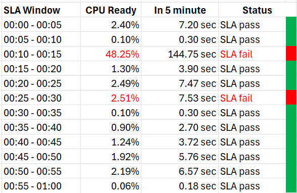

The VM 007 suffers 2 SLA failures.

- The 1st failure is bad. The number is very high. Since SLA is binary, this is simply counted as failure. There is no severe failure in the book of SLA.

- The 2nd failure is barely a failure. Again, since SLA is binary, this is also counted as a complete failure. There is no partial failure.

So why did I recommend 99.9% and not 99.95% for Gold?

- The 0.05% matters operationally.

- 99.9% means the VM may not get the promised SLA for up to 0.1% of a given month. Using a 28-day month as it’s the shortest, this translates into 40.3 minutes.

- Since SLA is computed every 5 minutes, the provider only has up to 8+ chances of SLA failure in the month of February.

- This means CPU Ready \> 2.5% for 8 times in the February months.

##### Sample Offering

Putting the above together, what does a sample class of service actually look like?

###### Price & SLA

SLA is the hard product, the main thing that you get when you pay for the service. Using the airline business as an analogy, the hard product is the seat. Other things such as in-flight entertainment and meals are soft products.

In IaaS, since you do not typically care about the hardware specification (e.g. the type of SSD for storage, the memory brand and technology), you focus on the SLA.

<table>
<colgroup>
<col style="width: 21%" />
<col style="width: 16%" />
<col style="width: 16%" />
<col style="width: 45%" />
</colgroup>
<thead>
<tr class="header">
<th></th>
<th>Gold</th>
<th>Silver</th>
<th>Description</th>
</tr>
</thead>
<tbody>
<tr class="odd">
<td>Price</td>
<td>2x</td>
<td>1x</td>
<td>Gold is priced 2x Silver.</td>
</tr>
<tr class="even">
<td>Over-commit</td>
<td>
CPU 2:1

RAM 1:1
</td>
<td>
CPU 4:1

RAM 2:1
</td>
<td>The reason why Silver is half price is because there are twice as many consumers.</td>
</tr>
<tr class="odd">
<td>Availability SLA</td>
<td>99.975%</td>
<td>99.950%</td>
<td>Gold has 2x less downtime</td>
</tr>
<tr class="even">
<td>Performance SLA</td>
<td>99.9%</td>
<td>99.80%</td>
<td>Gold has 2x less “slow time”</td>
</tr>
<tr class="odd">
<td>Compliance SLA</td>
<td>100%</td>
<td>100%</td>
<td>You should maintain perfect compliance with your compliance requirements for all classes of service.</td>
</tr>
<tr class="even">
<td>Service SLA</td>
<td>Gold</td>
<td>Silver</td>
<td>See the Service section for details.</td>
</tr>
</tbody>
</table>

If you mix environments, it becomes operationally challenging. Your only tool is to apply reservations and shares. For example, give Gold 2x the value over Silver to justify the 2x price.

The preceding table is a generic guideline. As part of your planning with IT Management, you help them define and decide on each Class of Service. This planning session requires vendors input as you want to optimize cost. Use vendors discounting and licensing model to complement the plan, not dictate the plan.

Yes, it’s a balancing between ideal solution and what actually gives the best bang for the buck.

At the end of the planning session, you may end up with something like this.

<table>
<colgroup>
<col style="width: 16%" />
<col style="width: 33%" />
<col style="width: 25%" />
<col style="width: 24%" />
</colgroup>
<thead>
<tr class="header">
<th>Tier</th>
<th>Price</th>
<th>Compute</th>
<th>Storage</th>
</tr>
</thead>
<tbody>
<tr class="odd">
<td>Gold</td>
<td>Highest</td>
<td>
CPU 1:1

RAM 1:1
</td>
<td>All Flash</td>
</tr>
<tr class="even">
<td>Silver</td>
<td>Good 
(67% of Gold)</td>
<td>
CPU 1:2

RAM 1:1.5
</td>
<td>All Flash</td>
</tr>
<tr class="odd">
<td>Bronze</td>
<td>Low 
(33% of Gold)</td>
<td>
CPU 1:6

RAM 1:2
</td>
<td>All Flash</td>
</tr>
<tr class="even">
<td>Free</td>
<td>Free</td>
<td>N/A</td>
<td>Magnetic</td>
</tr>
</tbody>
</table>

For Silver and Bronze, to maximize consumption of hardware, you base on average ratio of 1 vCPU to 4 GB RAM. This is a common ratio. If you want to tailor this to your own environment, use VCF Operations to give you the actual ratio.

For Silver, you decide on 3:1 CPU overcommit and no RAM overcommit. Based on 1 vCPU 4 GB RAM, you need to buy 12 GB RAM for each physical core. Buying 64 cores maximizes your vSphere license. That means you need 64 x 12 = 768 GB of RAM. If you run vSAN and NSX, you need to account for the overhead accordingly.

The 3:1 overcommit enables you to lower the price by 3x for CPU portion. If you do 50/50 split between CPU and RAM, the overall price is 67% of Gold, yielding a 33% discount.

For 33% discount, what’s a reasonable performance penalty? What’s acceptable to both your CIO and application team?

CIO also decided that free tier is not offered as that’s not the business you want to be in.

As you can see, the hardware spec is driven by the business model. Decide on the overcommit & price first.

If you want your customers to right size in advance, then a 64 vCPU VM needs to be *more* than 64x the price of 1 vCPU VM. If the pricing model is a simple straight line, there is no incentive to go small and no penalty to over provisioning. You will end up forcing rightsizing in production, which is a costly and time-consuming process.

###### Size Limit

Because you overcommit, you run the risk of contention. One way to minimize this risk is to control the maximum size of VMs. You want to avoid monster VMs dominating your overcommitted ESXi hosts. The following table provides an example of the size limit you associate with each class of service.

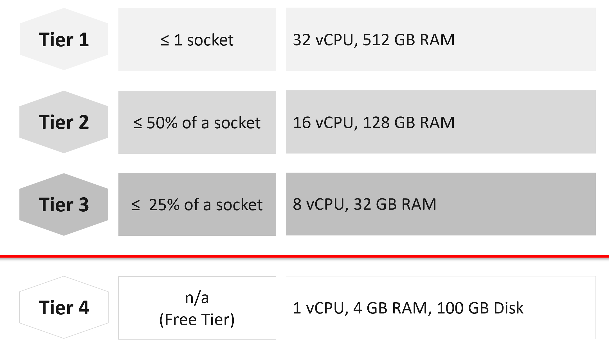

Capping the size at each tier is a good way to prevent monster VMs from causing performance problems in environment with higher overcommit ratio.

If you allow a single VM to be the same size as the ESXi host, you practically can’t do overcommit if you want good performance.

The Free Tier may also be limited further by capping the number of free VMs per customer, else you’d go bankrupt.

For comparison, [AWS’s free tier](https://aws.amazon.com/free/) for EC2 is only 1-2 vCPU & 1 GB RAM as it’s based on t2.micro and t3.micro.

###### Service

Beside the hard product, soft products play an important role in further differentiating Gold from Silver. Support, both reactive and proactive, is one major area where different classes of service can show the value of higher tiers.

|                     | Gold            | Silver            | Description                                                                                                                                                                                       |
|---------------------|-----------------|-------------------|---------------------------------------------------------------------------------------------------------------------------------------------------------------------------------------------------|
| Response Time       | 2 hours         | 4 hours           | Gold has 2x faster response time                                                                                                                                                                  |
| Support Hours       | 24 x 7          | 12 x 7            | Gold has 2x support hours                                                                                                                                                                         |
| Support Process     | Level 2         | Level 1           | Gold bypasses the first level help desk.                                                                                                                                                          |
| Root Cause Analysis | Provided        | Additional Charge | The RCA includes setting alerts to ensure the same incident is identified immediately.                                                                                                            |
| Proactive Support   | Daily           | None              | Gold VMs gets daily health check (KPI and alerts).                                                                                                                                                |
| NOC Screen          | Yes             | No                | Silver VMs are not displayed in a live screen of [Network Operations Center](https://en.wikipedia.org/wiki/Network_operations_center) room. Reason is the business need to focus on the Gold VMs. |
| Report              | Weekly          | Monthly           | Gold has more frequent report.                                                                                                                                                                    |
| Business Review     | Monthly         | None              | Face to Face discussion where we review the SLA and support issues.                                                                                                                               |
| Critical Patch      | Higher priority | Lower priority    | We patch all Gold VMs first before protecting the lower tier VM.                                                                                                                                  |
| Optimization        | Yes             | No                | Performance and capacity optimization (via proactive right-sizing, for example).                                                                                                                  |

###### Availability

This is another soft product in IaaS. Ensure that Gold has much better offering here so the 2x price is clearly justified.

|                   | Gold                    | Silver         | Description                                                                              |
|-------------------|-------------------------|----------------|------------------------------------------------------------------------------------------|
| Snapshot          | 1 week                  | 1 day          | For Gold, we will also remind you just in case you forget. For Silver, it’s auto-delete. |
| Size of snapshot  | No limit                | 100 GB         |                                                                                          |
| No of snapshots   | 2                       | 1              | Gold can have 2x as many snapshots at any given time.                                    |
| Back up           | Higher priority         | Lower priority | We back up all Gold VMs before backing up Silver VMs.                                    |
| Full back up      | Weekly                  | Fortnightly    | Gold has 2x full back up frequency.                                                      |
| Back up level     | Application             | OS             | We will install & manage back up agent.                                                  |
| Back up report    | Yes                     | No             | We provide report for back up status.                                                    |
| Disaster Recovery | Separate add-on service |                | Both services do not have DR as default.                                                 |

#### Compute & Storage

A VM runs in a cluster but is stored in a datastore. How do you architect both the compute and storage subsystems to support the class of service?

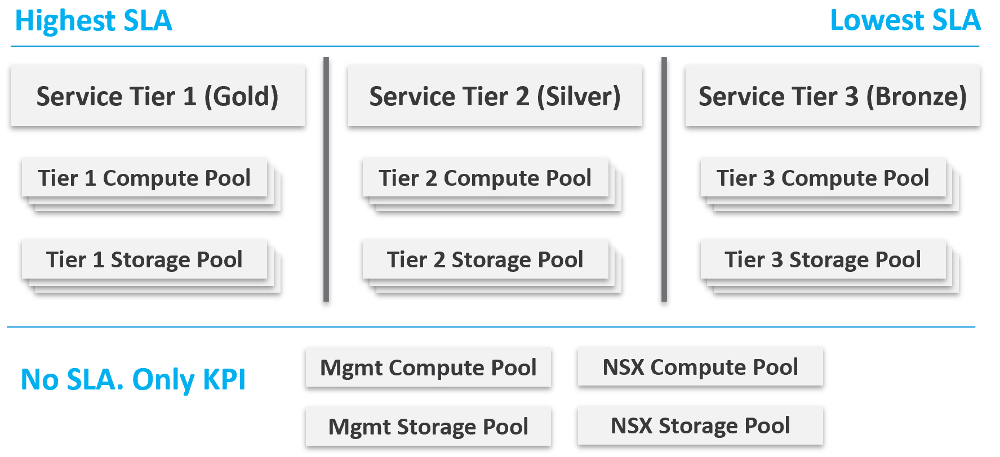

From a performance management point of view, vSphere clusters with vSAN form the smallest logical building block of the resources. While resource pools and VM-Host affinity rules can provide smaller subdivisions, they are operationally complex, and they cannot deliver the promised quality of IaaS service. Resource pools cannot provide a differentiated class of service. For example: your SLA states that Gold is two times faster than silver because it is charged at 200% more. A resource pool can give Gold two times more shares, but whether those extra shares translate into half the CPU readiness cannot be determined upfront.

Same with storage. A VMFS datastore is not able to provide differentiated service levels. Even if they can, it’s not based on latency, which is what your customers care about. The same limitation applies in vSAN. Let’s take an example.

- You promise Gold VMs will get 10 ms latency at worst. For Silver VMs, you promise up to 20 ms latency. The justification for 2x the latency is they pay half as much. So far so good.

- You set your storage policy and IO Control, favoring Gold while trying to ensure Silver gets something.

- Since storage IO control configuration is not based on latency, you may end up with 9 ms for Gold and 21 ms for Silver, where you could have gotten 10 ms and 20 ms.

##### Mix and Match

Should we provide flexibility, where customers can choose Gold Compute but Bronze Storage?

In the following example IaaS, mixing is partially allowed. Tier 1 cannot mix with Tier 3, as seen by the missing lines.

The result is 7 combinations instead of 9, as shown by the 3 green lines and 4 red lines.

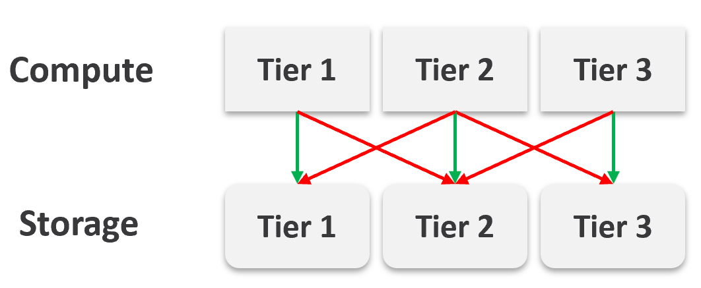

It looks operationally visible.

Now let’s see if the above idea scales….

We will just add one extra cluster for each tier. Only 6 clusters in total.

| 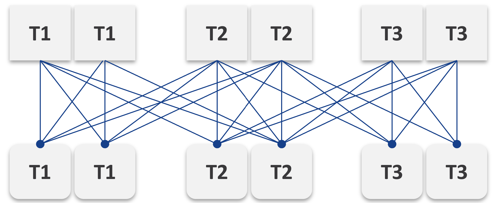 |
|----------------------------------------------------------------------------------------------------------------------------------------------------------------|

Simply adding 1 cluster for each tier dramatically increases the permutation. What if you have 10 clusters each?

This is a classic case of flexibility becoming complexity. Flexibility has its price, so you need to make the business call. In smaller environment, you can afford to be more flexible.

There are further complications. As examples:

- You need to have two tags: one for compute and one for storage. What do you call a VM with Gold compute and Silver storage?

- Separating storage from compute also means 2x the tagging. You now need to tag both the clusters and datastores.

- We can create a logic where the virtual disks inherit the class of service from the datastore. But what if we have RDMs? Yes, that’s still a rather popular choice.

- If you further allow different storage classes for different VMDKs, then you need to tag each virtual disk. This makes reporting difficult as now you need to list each disk attached to each VM.

- Performance troubleshooting also becomes difficult. Say you allow a VM to buy Bronze Compute but Gold Storage, because the load is storage sensitive, but the application team does not care about CPU. What if the VM disk latency is caused by CPU contention?

### SP5 Framework

VCF as the core of your private cloud require a new IT operations management framework. I call it The SP5 Framework. It’s the IT Business Strategy supported by its 5 components (Policy, Pillars, Process, People, Platform).

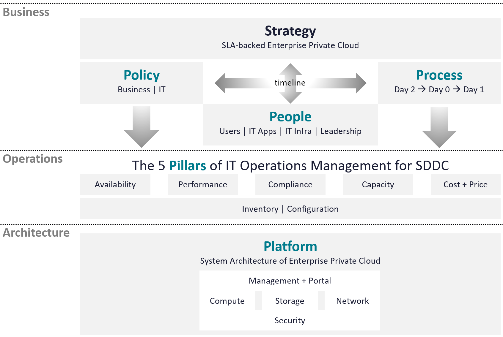

There are 5 pillars of operations management. They are the management disciplines a CIO directly cares about, which is why you need to ensure they are “good”. To achieve that, the people (IT professionals) is organized accordingly. Processes and policies are then put in place to balance between governance and agility. A complete set of policies and SOPs answers “who does what when where and how”. Finally, you implement all these using technology product, such as VMware Cloud Foundation.

What are the capabilities of a private-cloud-ware? How would you explain to your CIO and CTO?

Using a vendor-neutral diagram, we can say that virtualization is the foundation technology that enables the creation of flexible pool of resources.

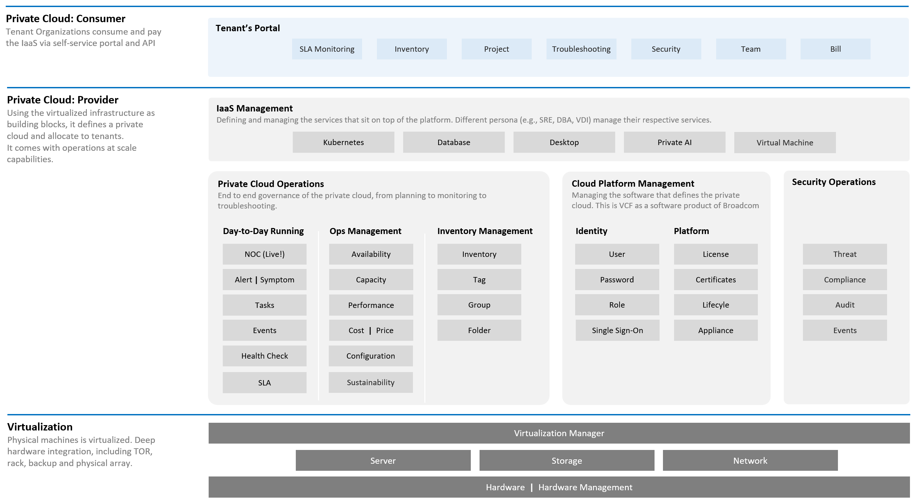

What do you manage, actually? What do your customers want you to manage? How do you manage what you need to manage?

The most basic thing is you need to have visibility into the environment. There are thousands of objects (e.g. VMs, applications, firewalls) with complex relationships and interdependence. Inventory gives you this. That’s why it’s the first box in the diagram below.

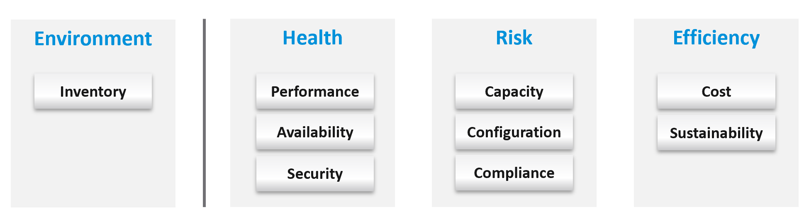

Once you know what you manage, you can then move on towards making sure those things are healthy. If there is no real problem, then you move to address potential problems. If there is no risk, then you look for optimization.

How do you know you’ve mastered operations management? What’s the acid test?

- When you can go on long vacation in peace, without the worry of urgent escalation calls asking for information or decisions that only you can make or provide.

#### Timeline

The clock is emphasized as human and agents operate on a timeline. All the processes are implemented on a rolling timeline.

The roles conducting the tasks are:

| **Level 1 Team** | Watch the Live Screens on the NOC wall                                                              |
|------------------|-----------------------------------------------------------------------------------------------------|
|                  | Manage alerts and perform the SOP associated with the alerts                                        |
| **Level 2 Team** | Conduct the daily health check with the goal of preventing alerts of the day                        |
|                  | Analyze the logs to catch issue early                                                               |
| **App Team**     | Watch their own critical applications. Frequency depends on the business cycles of the application. |

Human and AI agents are 3D being. We operate on a timeline. Human operators also comply to the nature of days and nights.

Different roles have different time pace. The following diagram shows only some of the roles.

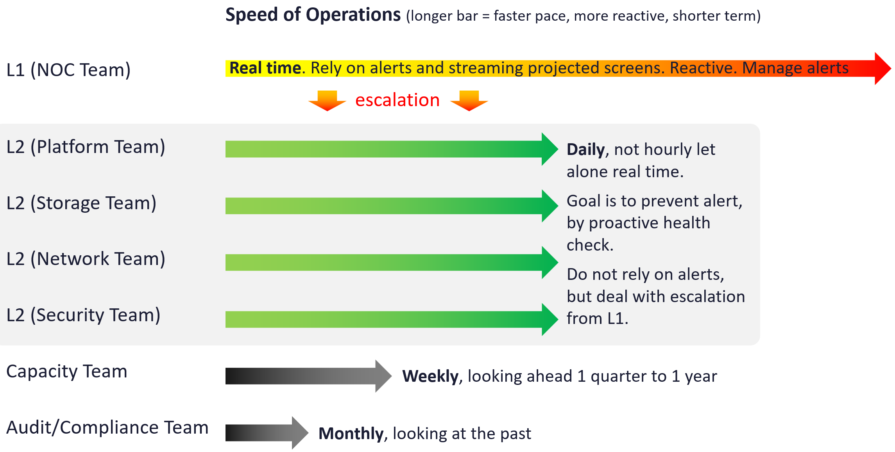

The NOC room team runs at the most pressing speed as they deal with real time situations. They are the only role watching the operations live as it unfolds. As a result, they are typically equipped with multiple large screens on the wall.

Their focus is to keep the environment healthy. Typically, they do not have the skills nor time to improve the environment. This is where the Level 2 team comes in. Unlike the generalists in Level 1, the various groups that make up Level 2 team are specialist on their own area.

These Level 2 team perform proactive check, at the start of each day. The goal is to prevent alerts firing during the day, as that would make their life easier that day.

I added Capacity team and Audit team to show examples of team that do not get involved in day-to-day operations.

##### Cadence 

Let’s now see the diagram differently. This time, we focus on the timeline as human operates along a timeline. We adhere to the natural cycles of nights and days.

As part of proactive operations, there are at least 2 cadences:

- Daily

- Weekly

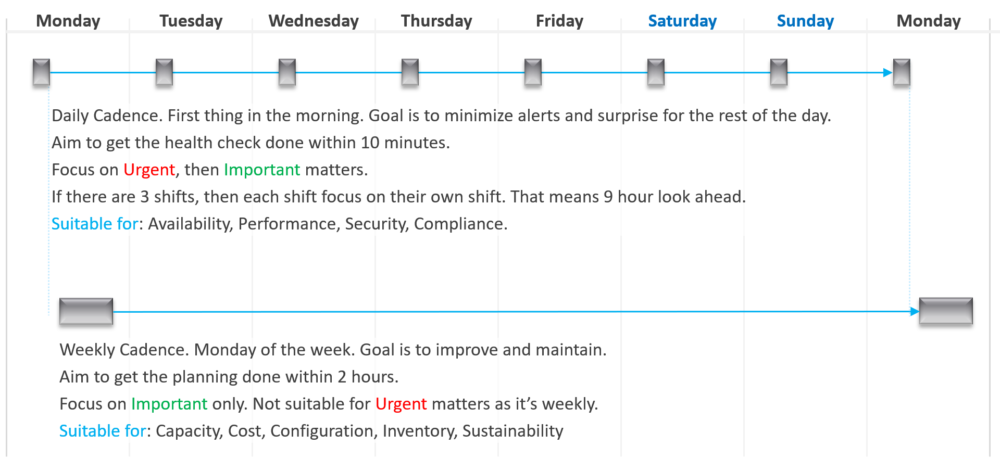

Let’s highlight the differences:

<table>
<colgroup>
<col style="width: 16%" />
<col style="width: 39%" />
<col style="width: 43%" />
</colgroup>
<thead>
<tr class="header">
<th></th>
<th>Daily</th>
<th>Weekly</th>
</tr>
</thead>
<tbody>
<tr class="odd">
<td><strong>When</strong></td>
<td>
First thing in the morning. Do it before you jump into the first problem.

You are planning your day here.
</td>
<td>
On Mondays.

After you settle with your daily cadence. Does not have to be first thing. However, you need to block longer time
</td>
</tr>
<tr class="even">
<td><strong>Duration</strong></td>
<td>
Minutes.

Aim for 5 minutes. This will allow you to do it a few times a day.
</td>
<td>
~ 1 hour.

1 hour is probably what most administrators can practically afford.
</td>
</tr>
<tr class="odd">
<td><strong>Other Tools</strong></td>
<td>Use the dashboard together with the Alerts home page and NOC screens. So yes, ideally you have multiple large monitors.</td>
<td></td>
</tr>
</tbody>
</table>

###### Weekly SOP

Weekly or longer is suitable for different types of tasks. As you have more time and are working on longer time horizon, you should look at both the big picture and look ahead.

The end of the week is a good time to document the changes and lesson learned from the week, and plan ahead for the next week.

<table>
<colgroup>
<col style="width: 16%" />
<col style="width: 83%" />
</colgroup>
<thead>
<tr class="header">
<th rowspan="2"><strong>Capacity</strong></th>
<th>Capacity monitoring and planning. Check actual growth vs projection (plan).</th>
</tr>
<tr class="odd">
<th>Reclamation Process. VM rightsizing, Idle VM, etc. This can be done weekly as you need to deal with the VM owners.</th>
</tr>
</thead>
<tbody>
<tr class="odd">
<td><strong>Compliance</strong></td>
<td>Root cause for non-compliance is documented, and preventive measurement is put in place so it does not happen again.</td>
</tr>
<tr class="even">
<td rowspan="2"><strong>Configuration</strong></td>
<td>
Minor updates. For example, from vSphere 7.0 U1 to U2. This is typically part of standard IT tech stack hygiene, where you keep up with the update from all your vendors while making sure they are compatible. This protects you from security non-compliant and emergency patching during business hours.

Review does not mean immediate implementation. For example, there is a newer version of VMware Tools. You may decide to start implementation in 2 months, as you have 15K VM and you need to prioritize and batch them.
</td>
</tr>
<tr class="odd">
<td>Major upgrade. For example, from vSphere 6.5 to 8.0. This is typically a one-off project, as opposed to regular maintenance. The implementation is typically executed within a green zone, so other regular maintenance may be deferred to make space.</td>
</tr>
<tr class="even">
<td rowspan="2"><strong>Overall</strong></td>
<td>Weekly Management Report. Focus on reviewing the operations of the week, and plan for next week.</td>
</tr>
<tr class="odd">
<td>Review of ad-hoc events. What are the lessons learned, and can they be turned into an SOP and alerts set up?</td>
</tr>
</tbody>
</table>

###### Monthly SOP

The month serve as logical time period as human and business relate well with calendar months. There are different activities at the end of the month or the start of the month.

| **Availability**  | Restore test of backup. Make sure it can be restored and the data is readable.     |
|-------------------|------------------------------------------------------------------------------------|
| **Configuration** | Less urgent update. Review new versions and ensure you do not fall too far behind. |

###### Longer Cadence

You complement the above frequent SOPs with a regular cadence with a longer time horizon. Naturally, the focus is on the big picture, major projects, and strategy.

| **Quarterly**   | Overall      | Quarterly Management Report. Focus on longer term items such budgeting.                                                                             |
|-----------------|--------------|-----------------------------------------------------------------------------------------------------------------------------------------------------|
|                 | Cost         | Budgeting. Review actual versus plan.                                                                                                               |
|                 | Availability | DR Test (Production is still running). Isolate the network. To ensure users are comfortable with the procedure when actual DR strikes.              |
| **Half-yearly** | Availability | HA Test. Actual test that your HA works as intended. Covers vSphere, physical switches, storage array, etc.                                         |
| **Yearly**      | Availability | Actual DR Failover (Production not running) and Failback to primary DC                                                                              |
|                 | Capacity     | Inventory Stock Take. To discover unused VMs and physical items in data center                                                                      |
| **Ad-hoc**      | Capacity     | Unexpected demand. This is why it’s important for capacity teams to stay close with the business, especially the ones working on major initiatives. |

#### Basic Terminology

It is as if observability and monitoring are not confusing, there are other English words used to monitor a system:

- Finding

- Insight

- Issue

- Alert

- Symptom

- Notification

The following diagram shows how they are related.

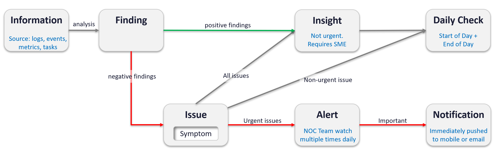

<table>
<colgroup>
<col style="width: 18%" />
<col style="width: 81%" />
</colgroup>
<thead>
<tr class="header">
<th><strong>Finding</strong></th>
<th>
Finding is what is found. It is the result of diagnostic or analysis.

It can be bad things or good things. Bad = Issue.

Since the sources of finding (logs, events, metrics and tasks) focus on negative, a no entry typically means it’s a good day. For example, you find no login to a confidential cluster.

Findings are input to Insight. Generally speaking, it takes someone who is familiar with the environment to derive an insight from findings.
</th>
</tr>
</thead>
<tbody>
<tr class="odd">
<td><strong>Insight</strong></td>
<td>
A useful observation with real business benefit. This typically requires someone with both technology expertise and familiarity of the environment.

Findings are input to Insight. An expert can derive an insight from findings.
</td>
</tr>
<tr class="even">
<td rowspan="2"><strong>Issue</strong></td>
<td>An issue is identified by its 1 or more Symptom. No symptom simply means no issue, you are healthy.</td>
</tr>
<tr class="odd">
<td>
Type of Issues:

<ul>
<li>
Availability: Hard failure, soft failure
</li>
<li>
Configuration: Drift, unsecure
</li>
<li>
Performance
</li>
<li>
Capacity
</li>
<li>
Security
</li>
</ul></td>
</tr>
<tr class="even">
<td><strong>Alert</strong></td>
<td>
It’s an urgent Issue with Symptom crossing threshold.

An issue that is urgent (may not be important) needs to reach Admin fast. Admin wants to be notified.

An issue that is not urgent (but important) can be analyzed after Admin are done with time-sensitive issue
</td>
</tr>
<tr class="odd">
<td><strong>Notification</strong></td>
<td>
A mechanism for VCF Operations to inform users of insights or alerts that need their attention.

This takes different format:

<ul>
<li>
Email
</li>
<li>
Messages
</li>
<li>
On-screen when user login
</li>
</ul></td>
</tr>
</tbody>
</table>

##### Monitor \| Troubleshoot

Monitoring is **What**, while Troubleshooting is **Why**.

Monitor is where you compare Plan vs Actual. That’s why the goal must be clearly defined. Does the reality match what your architecture was supposed to deliver? If not, then you need to adjust your plan. That’s why Plan and Monitor form a circle.

For example, you plan to deploy VDI for 10K users. At 1K, you find out that the users are consuming more resources than plan. You either need to scale down your deployment or add more resources.

You do this when reality is worse than planned, or something is amiss, not when there is a complaint. You want to take time in troubleshooting, so it’s best done proactively. And quietly with no one rushing you for results.

Troubleshooting is often wrongly elevated in importance or status, as if it’s a singular or major area of operations. It is not. What you can troubleshoot, and how you troubleshoot it, should be planned during system architecture phase. Another word, think of what can go wrong, how they can be detected, and the remediation action. If you do not plan the troubleshooting element of your architecture, each actual troubleshooting event will be more painful that it needs be.

<table>
<colgroup>
<col style="width: 18%" />
<col style="width: 38%" />
<col style="width: 42%" />
</colgroup>
<thead>
<tr class="header">
<th></th>
<th><strong>Monitoring</strong></th>
<th><strong>Troubleshooting</strong></th>
</tr>
</thead>
<tbody>
<tr class="odd">
<td>Question answered</td>
<td>What is the problem?</td>
<td>Why does it happen? What is the actual cause of the problem?</td>
</tr>
<tr class="even">
<td>Nature</td>
<td>Proactive.</td>
<td>Reactive.</td>
</tr>
<tr class="odd">
<td>Expertise</td>
<td>Low. A junior IT person is better suited, as it’s repetitive tasks with the aid of predefined dashboards and alerts.</td>
<td>High. Needs experienced IT Pro as there are wide variances in the steps taken. Also needs someone who understands the environment.</td>
</tr>
<tr class="even">
<td>Metric</td>
<td>
Generally, 1 metric. And this metric is also the SLA. This is the 1st metric you or your customer check.

Primary metric. You check it proactively as part of your SOP.
</td>
<td>
Always many metrics. There are layers of metrics, one impacting another.

Secondary metric. You only check if the primary is reaching threshold.
</td>
</tr>
<tr class="odd">
<td>Duration</td>
<td>Should take just 5 minutes.</td>
<td>Can take days, with back-and-forth discussion amongst various teams.</td>
</tr>
<tr class="even">
<td>Frequency</td>
<td>
Performed daily.

Gold Class will have higher frequency of regular monitoring than Bronze, as part of the SLA.
</td>
<td>On demand.</td>
</tr>
<tr class="odd">
<td>Timeline</td>
<td>Now and Future. You consider future load and anticipate.</td>
<td>Now. Future is irrelevant. Your focus is to put out the fire or potential fire.</td>
</tr>
<tr class="even">
<td>Logs</td>
<td>Not required. Metrics, properties, and Event suffice.</td>
<td>Almost always required. For network troubleshooting, you also need NetFlow data.</td>
</tr>
<tr class="odd">
<td>SLA</td>
<td>SLA is applicable in monitoring.</td>
<td>Yes. It becomes urgent if SLA is breached.</td>
</tr>
<tr class="even">
<td>KPI</td>
<td>Use KPIs in monitoring instead of individual metrics.</td>
<td>Yes, but as a starting point. You then drill down into supporting metrics, which are often raw metrics.</td>
</tr>
</tbody>
</table>

In most cases, monitoring is best done using a 5-minute interval, as 1 minute of bad metrics may not have business impact. Troubleshooting on the other hand may require per-second granularity. However, that does not always mean you need to see each and every counter if your remediation action is the same.

###### Troubleshoot

There are many things that can go wrong, especially in production and on the eve before you take a vacation.

Troubleshooting requires expert team. The expert team is also the team setting up the thresholds used by the Level 1 team. Troubleshooting involves logs analysis, as many systems do not generate complete metrics, and there can be many different causes behind a common problem. At the end, the actual root cause may not even be closely related to the problem. Troubleshooting is much more than simply “finding out” and goes beyond just gathering facts. It focuses on why, and then formulates a solution to prevent future incidents. Incidents mean something is dead, slow, or breached. You troubleshoot availability, performance, and security. Capacity and cost are not something you troubleshoot.

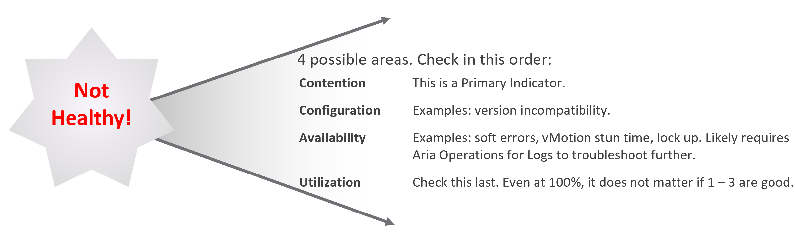

Due to its complex nature, the first time an incident happens is forgivable.

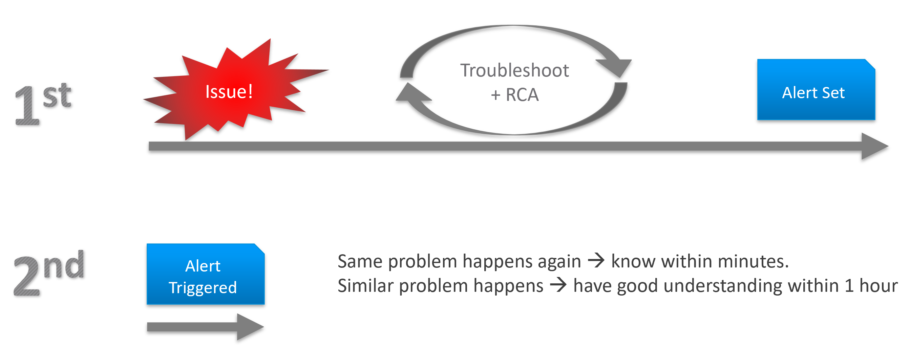

To codify troubleshooting, consider a layered approach. This makes it easier for the less technical teams. Classify your troubleshooting metrics, events and properties into two categories:

<table>
<colgroup>
<col style="width: 20%" />
<col style="width: 79%" />
</colgroup>
<tbody>
<tr class="odd">
<td>Primary Metric</td>
<td>
This defines performance. It is the What. This is always expressible as 0 – 100%, so it’s easier for the Level 1 team. It’s almost always a hybrid metric.

Example: Kubernetes Cluster Performance (%)
</td>
</tr>
<tr class="even">
<td>Secondary Metrics</td>
<td>
This provides some explanation to the primary metric. It is the Why. Aim for this to be expressible as 0 – 100%, so it’s easier for Level 1 team.

Example: Highest ESXi Memory Consumed (%) in a Cluster.

Metrics that can’t be color coded are harder for Level 1 teams, as the meaning depends on the context.

Example: VM Disk IOPS
</td>
</tr>
</tbody>
</table>

###### Root Cause Analysis 

[Root Cause Analysis](https://en.wikipedia.org/wiki/Root_cause_analysis) (RCA) is an important component of an optimized process for operations management.

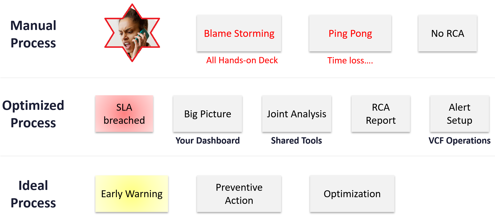

The structure of an RCA report varies among customers, even if the issue they are troubleshooting is essentially the same. Regardless of structure, what do you think is the most important content in the report from an operations management perspective?

The most important content in the report should be the corrective actions to prevent recurrence, such as alerts that are configured to proactively highlight indicators of recurrence. Without these alerts, you cannot reliably detect the issue before it reoccurs and take corrective actions if required.

There is a good chance that the root cause is different than the symptoms. It may happen on a different object altogether and the error message could be seemingly unrelated. A root cause typically starts as a log message, meaning it has not bubbled up into the screen (UI) as formal alarm. When the vendor support team recommends you a specific log message to trap, how do you validate it is correct?

You need to ensure that the alert is valid. That means it should not result in false positive.

Let’s take an example. Take a Virtual Desktop Infrastructure (VDI) system mass disconnect issue, where \>100 users had their sessions disconnected at the same time. The analysis concludes that the problem started with a log message (“resuming traffic on DV port”), so we need to trap this message when it appears again.

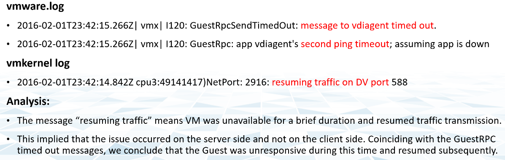

The first thing you need to do is validate the above alert. Using tools like VCF Operations for Logs, you cross check the message against your entire environment, especially the healthy (in this case, unaffected users). Ideally, you cross check for entire week, not just during the time the incident happened.

The following was the result when I cross checked against all the users in the last 5 working days. The log message has happened more than 1000 times, meaning that “resuming traffic on DV port” is not the message that I should base my alert on. There are too many of them and there is a clear pattern following office hours.

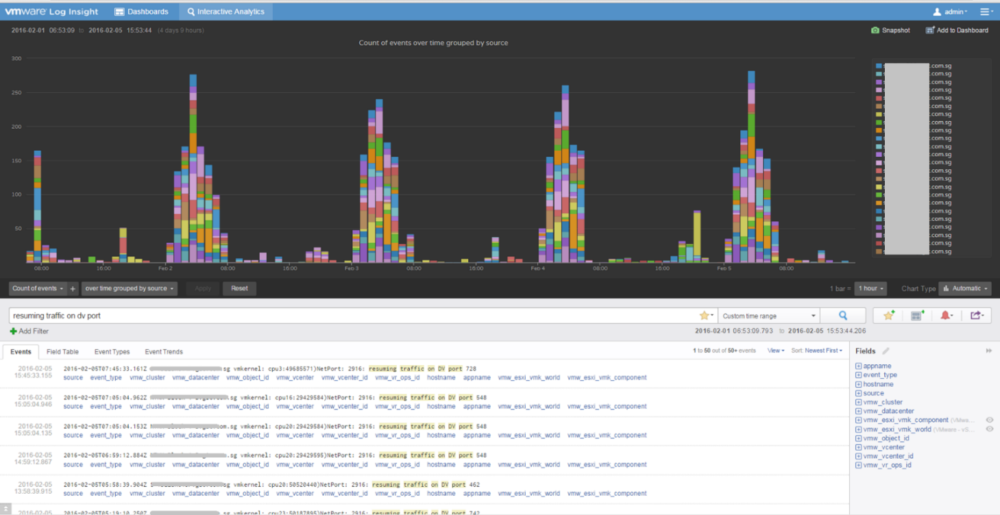

#### Health

The English word Health is used extensively in IT industry for decades, but nobody takes the time to define it subjectively.

You certainly want your environment to be healthy. The desire to achieve that nirvana state results in a definition that is too broad as you try to cover everything. When the health metric covers too many things, you can end up with low score and yet everything is running well!

Health is hard to define, as it depends on the context and object. The English word health itself is subject to interpretation. How healthy are you? For example, I exercise regularly and can perform many rounds of pull ups, push up, deadlift and squats. I’m physically healthy. Biologically though, I’ve been suffering from irritable bowel syndrome and sleep disorder. As for mental health, my wife thinks I have a big problem 😊

Let’s try another real-life context. How healthy is your country? Let’s take the world superpowers (USA and China). Both are well accepted as superpowers, in both economy and military. But how healthy are they?

The answer depends on which aspect and which provinces you’re talking about. It needs to have more context. That’s why you do not have a single score for health.

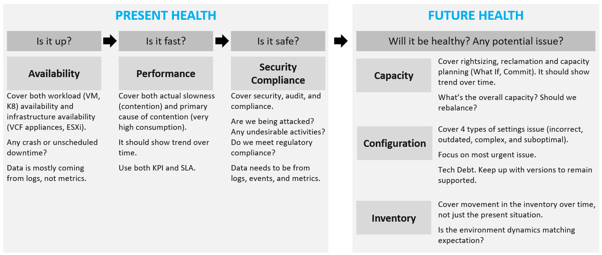

If you insist on defining “health”, then my recommendation is map it to the pillars of operations. When you do that, you vrealize that there are 3 sides of health, not 1. Since there are 3, you need to have 3 different metrics.

<table>
<colgroup>
<col style="width: 18%" />
<col style="width: 0%" />
<col style="width: 81%" />
</colgroup>
<thead>
<tr class="header">
<th colspan="2" rowspan="2"><strong>Present Health</strong></th>
<th>
Your health in the present time, especially right now. It covers real problem that has happened and/or is still ongoing.

The present health only includes reality. It does not include possibility. That’s covered under Risk. Just because you have security risks does not mean you’re being hacked.
</th>
</tr>
<tr class="odd">
<th>
There are 3 problems that impact the present health:

<ul>
<li>
Availability
</li>
<li>
Performance
</li>
<li>
Security (present)
</li>
</ul>

Availability and Performance are related, which means they are not the same thing. Your environment can be 100% up but slow.

Security has 2 parts: present and future. The present health only covers actual security issues. For example, your environment is running fine, but you notice unauthorized access &amp; suspicious commands being issued in your ESXi consoles.
</th>
</tr>
</thead>
<tbody>
<tr class="odd">
<td rowspan="5"><strong>Future Health</strong></td>
<td colspan="2">
It covers potential problems. There is no problem at this moment, but if you do not act on it, you increase the risk of it becoming a problem.

Using a day-to-day life analogy, you are healthy now but have a risk of heart problems if you do not stop smoking, are lacking sleep, consuming unhealthy diet, and are overweight.
</td>
</tr>
<tr class="even">
<td colspan="2">
There are 4 problems that create risk in operations:

<ul>
<li>
Security (future)
</li>
<li>
Compliance
</li>
<li>
Configuration
</li>
<li>
Capacity
</li>
</ul></td>
</tr>
<tr class="odd">
<td colspan="2">
In all the above problems, the present health is not impacted as there is neither slowness, downtime, nor security breach. What you have is a risk, as your applications and operations continue as if nothing happens. Your data has not been stolen. Your customers do not notice, and your business is not affected.

Let’s take an example. You do not configure HA in a vSphere cluster. If all ESXi hosts are running, your availability is 100%. Your performance is also not impacted. However, you have an availability risk.
</td>
</tr>
<tr class="even">
<td colspan="2">
If you improve, your future health will improve. This is about effectiveness and efficiency.

Effectiveness is about doing the right things. Efficiency is about doing things right. You can operate the wrong architecture correctly.

<strong>Efficiency</strong> is about optimization. There is no health problem at present, nor is there a health risk for future problems.

You want to increase efficiency as it lowers cost, reduces complexity, reduce capacity footprint and improve application performance.
</td>
</tr>
<tr class="odd">
<td colspan="2">
There are multiple ways to increase efficiency, hence the definition varies among objects.

<ul>
<li>
Hardware refresh is one common way to increase efficiency as you often get faster performance and more capacity at the same price point.
</li>
<li>
Wastage (oversized, unused EC2, idle, unmapped disk space, orphaned file, etc.)
</li>
<li>
Cost. Compare your cost with other cloud providers as IaaS is essentially a commodity.
</li>
</ul>

Green Operations fits efficiency as sustainable operations call for lean operations.
</td>
</tr>
</tbody>
</table>

#### Why a New Framework?

Before I came up with the pillars of operations, I studied other IT frameworks as it’s easier to use existing as adoption will be faster. There are many frameworks in running the business of IT. [ITSM](https://en.wikipedia.org/wiki/IT_service_management), [IT4IT](https://www.opengroup.org/it4it), [ITIL](https://www.peoplecert.org/Frameworks-Professionals/ITIL-framework), [COBIT](https://en.wikipedia.org/wiki/COBIT), Microsoft Operations Framework, and many others where you can learn about overall IT Management[^7]. In this book, I’m focusing on areas that are related to VMware Cloud Foundation, and only on Day 2.

The philosophy of ticket and incident-based operations are reflected in these frameworks. I’m not against the principle of using tickets as a unit of work, but most implementations have been disappointing to users. That’s odd as the very purpose of the help desk is to help the users. When you call your telco, bank, airline, etc. for support and you get a ticket, how has the experience been to you?

It’s terrible.

So why impose that bad experience to your customers?

The SP5 Framework differs fundamentally as it aims to do away, not just minimize tickets and incidents. The proactive, insight-based operations require a small number of seasoned IT professionals with deep technical expertise and knowledge of the business. It does not work on a very large number of teams spanning many departments, each following rigid and siloed policies.

##### Complexity

I found many frameworks to be heavy. This means they are complex and costly to operationalize. ITIL 5 has [34 management practices](https://www.itgovernance.co.uk/blog/what-are-the-itil-4-management-practices) for the entire IT Business. I find 34 are simply too many to manage. You end up managing the management. This defeats the purpose to begin with.

<table>
<colgroup>
<col style="width: 50%" />
<col style="width: 50%" />
</colgroup>
<thead>
<tr class="header">
<th>Service Management (17)</th>
<th>Technical Management (3)</th>
</tr>
</thead>
<tbody>
<tr class="odd">
<td>
Business Analysis

Service Catalogue Management

Service Design

Service Level Management

Availability Management

Capacity &amp; Performance Management

Service Continuity Management

Information Security Management

Service Request Management

Service Desk

Incident Management

Problem Management

Change Enablement

Service Validation &amp; Testing

Service Configuration Management

Release Management

IT Asset Management
</td>
<td>
Deployment Management

Infrastructure &amp; Platform Management

Software Development &amp; Management
</td>
</tr>
</tbody>
</table>

In addition to managing 20 types of services and technologies, you also need to manage 14 general management:

- Strategy Management

- Portfolio Management

- Architecture Management

- Service Financial Management

- Workforce & Talent Management

- Continual Improvement

- Measurement & Reporting

- Risk Management

- Information Management

- Knowledge Management

- Organizational Change Management

- Project Management

- Relationship Management

- Supplier Management

Even with 34 management practices, ITIL 5 merges Capacity and Performance as 1. In the context Broadcom VCF private cloud, they are distinct disciplines, done by a different persona and are having different processes. This book covers both disciplines in-depth, while ITIL 5 does not.

##### Duplication

Frameworks have lots of big words that are subject to interpretation in the real world as you try to implement them. Some of them also overlap, or even mix up concepts altogether. For examples:

<table>
<colgroup>
<col style="width: 27%" />
<col style="width: 72%" />
</colgroup>
<thead>
<tr class="header">
<th><strong>Monitoring and Alerting</strong></th>
<th>
They are not peers.

When you monitor a system, you will arrive at one of these 3 conclusions:

<ol type="1">
<li>
You need to troubleshoot (because it is broken or wrong)
</li>
<li>
You can optimize. It is not broken or wrong, but you can save money or improve performance.
</li>
<li>
There is nothing you can do.
</li>
</ol>

Alerting is one of the 3 ways for your monitoring system to communicate to you. You interface to the tools via alerts, dashboards, and reports.
</th>
</tr>
</thead>
<tbody>
<tr class="odd">
<td><strong>Changing vs Optimizing</strong></td>
<td>
They are not peers.

Optimizing is part of changing. You can’t optimize without making any change at all. You change something because it is broken or it needs improvement.
</td>
</tr>
<tr class="even">
<td><strong>Operating vs Supporting</strong></td>
<td>Support is part of day-to-day operations. It mostly revolves around inquiries and incidents. If you’re doing operations right, it also involves insights and proactive changes.</td>
</tr>
<tr class="odd">
<td><strong>Automation and Orchestration</strong></td>
<td>Automation is the “big item”. Orchestration is just one of the techniques for automation. It typically strings together a number of different scripts, which could be in different programming languages.</td>
</tr>
<tr class="even">
<td><strong>Measurement and Reporting</strong></td>
<td>
I’d rather call this Monitoring, as Measurement is a noun.

Reporting, as covered in Part 2 Chapter 1, is just one way for computer systems to talk to humans. The other two are alerts and dashboards.
</td>
</tr>
<tr class="odd">
<td><strong>Monitoring and Event Management</strong></td>
<td>
Monitoring is a process, an activity. It is not something you manage. The diagram in the next section shows how Process and Pillar are related.

Unlike alerts, events could be neutral or even positive. An event is an accounting of something that happened, and related to tasks or activities. Just like a metric is an accounting of utilization or contention. A log is a record of something that happened. You don’t manage metrics, event, logs as you don’t have full control over them.

So events are just inputs to your operations. It’s one of the 5 data types to monitoring. The other 4 are metrics, properties, logs, and netflows. These 5 measure the observability of an architecture, and they feed into your monitoring tool. Their values or meaning are defined by the context of the pillar.
</td>
</tr>
<tr class="even">
<td><strong>Operations and Governance</strong></td>
<td>They are the same. You manage operations by having governance. Operations management covers risk (availability risk, capacity risk, security risk) and applies control (compliance to approved configuration, clear accountability for each role, manage cost so they don’t overrun) .</td>
</tr>
</tbody>
</table>

##### Clarity

Being precise is essential, hence the need of jargon. But using jargon when it’s not required is adding complexity. Even worse, using common English word that means something else in real life is confusing. [PCMCIA](https://en.wikipedia.org/wiki/PC_Card) stands for People Can’t Manage Computer Industry Acronyms. It is a lighthearted reference to the confusing terminology in IT industry. To be fair, other industries also have their fair share of issues.

There are many IT management areas that are not pillars of operations. They are either unnecessary or just providing support to Operations Management. For examples:

<table>
<colgroup>
<col style="width: 35%" />
<col style="width: 64%" />
</colgroup>
<thead>
<tr class="header">
<th><strong>Service Level Management</strong></th>
<th>An SLA is not something you manage; it is a by-product. You manage availability, performance, compliance, and if you do that well you will pass your promised SLA.</th>
</tr>
</thead>
<tbody>
<tr class="odd">
<td><strong>Service Continuity Management</strong></td>
<td>This is part of your architecture, not something you manage. A good architecture is a living system, as it’s designed to handle updates and upgrades without compromising the SLA.</td>
</tr>
<tr class="even">
<td><strong>Demand Management</strong></td>
<td>This is part of Capacity, as the art of capacity management is about making sure there is just enough supply to meet demand. Both insufficient and too much capacity are problems.</td>
</tr>
<tr class="odd">
<td><strong>Continuity Management</strong></td>
<td>This is part of Availability, which cover snapshots, HA, DR, replication, active/active, back up, etc.</td>
</tr>
<tr class="even">
<td><strong>Incident management</strong></td>
<td rowspan="3">
To me, incidents (e.g. your website goes down) and problems (e.g. your core routers hit a rare bug) are not something you manage. You manage the impact, such as availability and performance. As part of availability, performance and compliance management, you are bound to have incidents, which were caused by problems (e.g. incompatible configuration, bug).

You should focus on why you have so many availability, performance, compliance, configuration, or capacity problems. By reducing them, you will reduce your incidents. Aim to minimize incidents and problems, instead of accepting their prevalent existence as acceptable and investing on their management.
</td>
</tr>
<tr class="odd">
<td><strong>Service request management</strong></td>
</tr>
<tr class="even">
<td><strong>Problem management</strong></td>
</tr>
<tr class="odd">
<td><strong>Service Desk</strong></td>
<td>This is a technique, a solution you design as part of your monitoring strategy. While the team needs to be managed, it can span thousands of people; it is not a pillar of operations.</td>
</tr>
<tr class="even">
<td><strong>Continual Improvement</strong></td>
<td>To me, this is more culture, realized as a set of processes, policies and structures. See <a href="https://en.wikipedia.org/wiki/Kaizen">Kaizen</a> as an example. While it’s important, it’s not a pillar of operations</td>
</tr>
</tbody>
</table>

### SP5 Framework: Pillars

What do your CIO actually care? Because that is what you will manage.

Well, the first thing your big boss care is availability. You have neither performance nor security issue if the system is down. Hacker cannot even login to an vCenter that is not even available.

Next, just because something is up, does not mean it’s fast. Your boss can argue that your system is so slow it is basically not available to users. So you need to manage performance**.**

Next, just because the system is up does not mean it’s safe. Security and compliance matter.

There are 5 pillars of operations. Each pillar is an individual unit of management. They represent individual disciplines and are compatible with one another.

- Availability management

- Performance management

- Security and Compliance management

- Capacity management

- Value management

How do manage them? What are the key processes required to run multi-cloud operations?

The following diagram maps the process and the pillars.

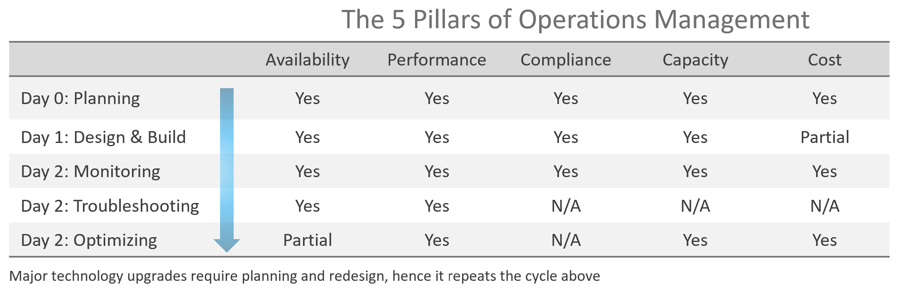

The complexity of each pillar depends on the technology: for example, vSAN capacity is more dynamic than a traditional SAN. In vSAN, changing the storage policy could create a sudden spike in consumption.

The 5 pillars of Operations Management are interdependent. Knowing the relationship is as important as knowing the individual component. Relationship matters as the symptom and the root cause are often two different things. A performance problem could be caused by a configuration problem, such as an outdated configuration or incompatible versions.

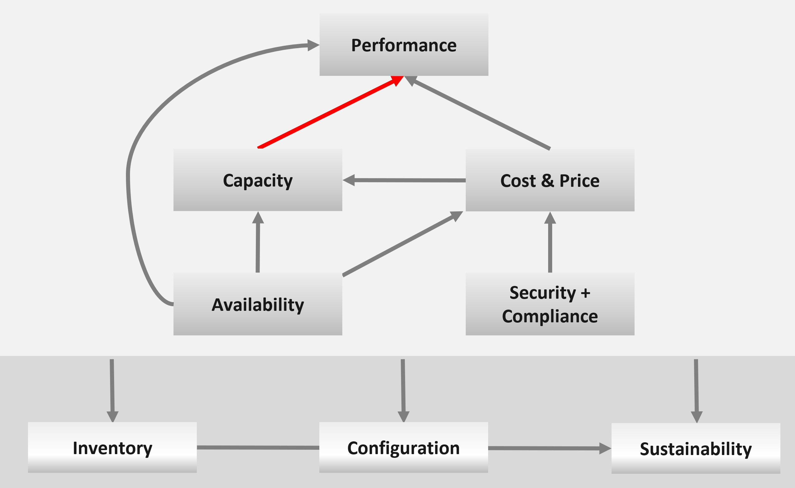

I chose a red line as it’s a complex relationship. As Capacity goes down, Performance remains steady. As Capacity drops below 0%, performance suddenly takes a hit.

I put Security and Compliance together outside as it’s typically managed by a different department. Their scope extends beyond the Data Center to areas like physical building security and employee work-from-home solutions.

Lines with arrow heads means there is impact:

- Availability increases your cost, as you’re adding extra resources for no capacity benefit.

- Availability issue can impact your available capacity. Minimize this with redundancy. In normal operations Availability and Capacity should not overlap as you calculate usable capacity after taking out availability.

- Availability can impact performance, especially if it's intermittent flapping between on and off, or between passive and active nodes.

- Compliance typically increases your cost. The more compliance requirements you must maintain, the larger the operational overhead involved in managing and measuring it.

Lines without arrow heads means there is relationship but not impact:

- Inventory and Configuration do not impact each other.

The following diagram provides more details.

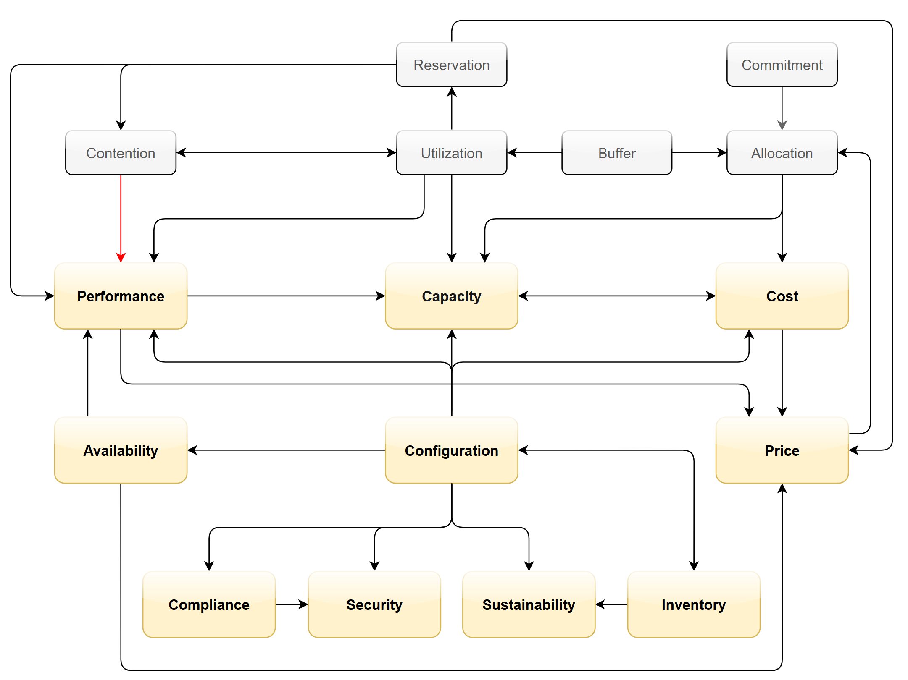

Let’s elaborate on each pillar.

#### Availability

There is a spectrum of availability solutions, including snapshots, back up, redundancy, fault tolerant, clustering, and SRM. Each can have impact on cost. Most of them require additional resources so they must be part of capacity planning, so they do not impact performance. For example, load balancers and replication needs to be accounted for.

You also need to include the potential workload caused by DR events in your capacity planning.

There are two metrics for availability:

- Actual Availability (%)

- Operational Availability (%)

The first one simply measures the fact as it is. It does not consider the HA (high availability) configuration and scheduled down time.

Operational Availability complements it by considering the above. So its value will be higher, as it reflects the operational impact. This is also the number used in the SLA.

The higher the Availability SLA, the higher the cost of the service. There is a big increase for each additional 9 of availability. Five 9s of availability costs 10x more than four 9s as the margin of error is reduced by 10x.

Why isn’t there a line to Performance?

Availability events like a host outage, when accounted for in the design, should not impact performance, as it does not lead to a drop of usable capacity.

#### Performance

Ever heard of “the system is so slow it is as good as down”? Just because something is up, does not mean it’s fast. On the other hand, if you have catered for HA, you can have part of the system down with no impact on performance and capacity.

From day-to-day operations, performance is the most important pillar of operations. This is why the next chapter is Performance Management.

Performance is often confused with capacity as “more work done means good performance”. This “more work” requires higher utilization. This simple thinking has drawback as it associates idle with low performance.

The primary metric for performance is contention. You don’t have performance issues if there is no contention. One common cause for contention is utilization over capacity or limit.

#### Capacity

There are 2 types of capacity:

<table>
<colgroup>
<col style="width: 27%" />
<col style="width: 36%" />
<col style="width: 36%" />
</colgroup>
<thead>
<tr class="header">
<th></th>
<th>Short Term</th>
<th>Long Term</th>
</tr>
</thead>
<tbody>
<tr class="odd">
<td>Performed by</td>
<td>Day to day Operations</td>
<td>Capacity Planner</td>
</tr>
<tr class="even">
<td>Decision Point</td>
<td>Stop provisioning new load</td>
<td>Buy new hardware</td>
</tr>
<tr class="odd">
<td>Availability Management</td>
<td>Highly relevant</td>
<td>Not so much</td>
</tr>
<tr class="even">
<td>Performance Management</td>
<td>Highly relevant</td>
<td>Not so much</td>
</tr>
<tr class="odd">
<td>Value Management</td>
<td>Not so much</td>
<td>Highly relevant</td>
</tr>
<tr class="even">
<td rowspan="2">Timeline</td>
<td>
Present.

This means now or today. It cares less about tomorrow.
</td>
<td>
Future.

Depending on the lead time to add capacity. If procurement is required, this can be months.
</td>
</tr>
<tr class="odd">
<td>Projection is not applicable.</td>
<td>Projection is mandatory</td>
</tr>
<tr class="even">
<td>Scope</td>
<td>Resources that can be provisioned within an hour or so</td>
<td>Resources that are not yet purchased</td>
</tr>
<tr class="odd">
<td>Focus</td>
<td>Hardware</td>
<td>Software (as they are more expensive)</td>
</tr>
</tbody>
</table>

Short term capacity is related to performance. They are interdependent; hence one is often mistaken for the other.

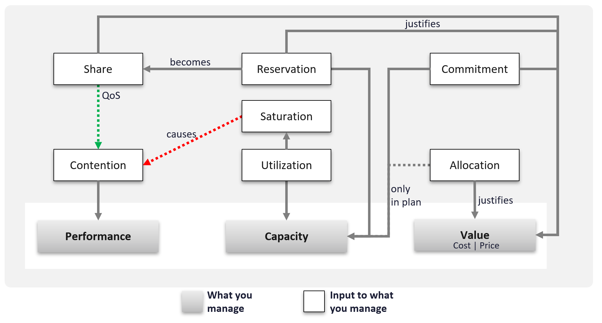

Capacity is affected by Performance as it needs to consider contention metrics not just utilization. If you can’t satisfy existing demands, then you won’t provision new workload, hence capacity is practically full. The utilization metrics may not be high yet, but that’s a secondary consideration as you stop adding new workloads until you figure out why.

Reservation (used in planning stage or phase) becomes shares in running stage.

Capacity also considers demands that do not manifest yet. This is why you need to consider reservations and allocation. They also minimize the consumption to go too high and cause contention.

Price can help address capacity. The best way to address oversized VMs is having a pricing plan that encourages smaller sized VMs. If the price is free then use a business justification to right-size instead.

Using highway transportation as example: You do not add lanes because of congestion that lasts a short time or rarely happens.

- But what if the workload is revenue generating? For example, during annual sales you expect a much higher demand that happens only 1 day in 365 days. Do you build permanent capacity for the rest of the 364 days? Are you able to provide a burstable capacity, either in the cloud or on premises?

Applying the above into vSphere on-premises, perhaps on that special day you need to limit other workloads, power them off, take hardware from other clusters, or move workloads to other clusters.

It focuses on the consumer, while the long-term capacity view focuses on the provider. The short-term view answers questions that care about today. Examples:

- “Can you deploy additional workloads?” The now part of the question is important, as the deployment is typically done by automation. You want to prevent the deployment if it will cause problem. This means you need to check both the present situation and the future situation.

- “Can we take out resource providers temporarily?” Examples are putting ESXi hosts into maintenance mode, or doing a cluster upgrade.

##### Reclamation

Infrastructure team should not force their internal customers to reduce their own consumption. This is a hard political battle, as there are more developers than administrators in a typical large enterprise. A better way is to show the CFO the total cost of wastage, money that can otherwise be saved. CFO will simply hold the budget for new hardware, and force the respective line of business to optimize their current consumption[^8].

#### Compliance and Security

Just because a system is up and fast, does not mean it’s secure.

Security is related to but not the same as Compliance. Security covers issues such as attacks (be it by internal employee or by external threat). Compliance deals with configuration settings or values that may expose security loopholes or are required to conform to specific sets of standards. Compliance is closely related to configuration as you comply by controlling the values of specified configuration items.

Compliance is measured against both internal and/or industry standards. It’s also measured continuously.

In Security you worry about being attacked. This means you track malicious activities, such as inappropriate usage of administrator accounts, or denial of service attacks.

Compliance is binary: you are either compliant with your defined compliance requirements, baselines, or benchmarks, or you aren’t. Compliance is also unaffected by complex and qualitative affairs like resource contention and performance. For this reason, as a service provider, you should guarantee to your customers that you will be perfectly (100%) compliant with your own compliance benchmarks for all classes of service.

However, you only provide a compliance guarantee on what you manage. If you don’t provide the VM’s guest OS as part of the service, then you don’t manage compliance for it, and you don’t provide an SLA against it. If you do provide the guest OS, then you must also manage its configuration via something like Microsoft AD Group Policy.

#### Cost and Price

Last but not least: money.

Cost and Price are necessary in the transformation towards becoming a real service provider.

<table>
<colgroup>
<col style="width: 13%" />
<col style="width: 86%" />
</colgroup>
<thead>
<tr class="header">
<th><strong>Price</strong></th>
<th>
With hardware becoming commodity and infrastructure becoming invisible, price has naturally become a common denominator among all IaaS providers. The general expectation is the price per VM is similar across cloud providers. One way to provide differentiated pricing is SLAs.

While Price should be higher than Cost, it can be set independently of cost. Use discounts and progressive pricing to set the correct price for the right terms and conditions. Progressive pricing will also discourage oversized VMs from being provisioned in the first place. It’s easier to handle then, rather than once VMs are already in production.

At an individual VM level, the better the Performance SLA, the higher the price customer is willing to pay, hence the term Price/Performance.
</th>
</tr>
</thead>
<tbody>
<tr class="odd">
<td><strong>Cost</strong></td>
<td>
At the platform level, cost also goes hand in hand with capacity. The higher the utilization of the IaaS, the lower the cost per VM. Cost is separate from capacity as it can be optimized without reducing capacity.

Cost and capacity can also go independently of each other. You can increase capacity without increasing cost via technology refresh. You can reduce cost without reducing capacity by lowering non-capacity costs such as the rate you pay for services.
</td>
</tr>
</tbody>
</table>

#### Non-Pillars

What’s missing in the 5 pillars?

- **Inventory**. Inventory is simply what you have. Your responsibility is a lot more than accounting of what you have where and how they change over time. Inventory is just a by-product. You plan for capacity, with certain configurations. As you manage your cost & capacity, the inventory will adjust accordingly.

- **Configuration**. Configuration is just a means to an end. You care about configuration only because it impacts security, capacity, performance, and availability. So it is often both the problem and solution to all the above pillars.

- **Sustainability**. It’s covered by both capacity and cost. The only thing unique is the source of power. It’s simply looking at the same things, albeit from a different angle. It does not replace any of the existing pillars of operations management.

- **Reliability**. This is just a characteristic of the system. Obviously, you want performance & available to be consistent, hence reliable and as you gain confidence, it becomes predictable. For example, if your website performance is not reliable or its uptime is not stable, you will troubleshoot from a performance or availability angle. There is no need to elevate the nature of something into an entity by itself. It complicates operations as you end up with overlap.

- **Recoverability**. This is just a property of availability. Just like debuggability is a function of performance & availability.

- **Manageability. **This is just a property of configuration.

Inventory is related, but not identical to configuration. They tend to be confused easily. For example, “configuration maximum” actually means inventory maximum.

<table>
<colgroup>
<col style="width: 49%" />
<col style="width: 50%" />
</colgroup>
<thead>
<tr class="header">
<th>Inventory</th>
<th>Configuration</th>
</tr>
</thead>
<tbody>
<tr class="odd">
<td>An account of what you have where. So, the location, the movement, and the count matter.</td>
<td>Properties of your inventory. The location is just another property of the object</td>
</tr>
<tr class="even">
<td>Inventory uses a small subset of configuration as the focus is on counting the number of objects. The majority of properties managed by configuration are not relevant to inventory.</td>
<td>The full set of settings, that you either intentionally set or have to accept.</td>
</tr>
<tr class="odd">
<td>Configuration drift is not relevant.</td>
<td>Configuration drift is important.</td>
</tr>
<tr class="even">
<td>Inventory movement is important.</td>
<td>Inventory movement is not relevant.</td>
</tr>
<tr class="odd">
<td>Inventory has stock stake concept. This can involve physical or virtual items.</td>
<td>Configuration does not.</td>
</tr>
<tr class="even">
<td>
Deals with distribution. You want to keep them “balanced”.

e.g. number of VMs across all your vSphere clusters.
</td>
<td>
Deals with variance. You want to keep them minimal.

e.g. version of VM hardware versions.
</td>
</tr>
</tbody>
</table>

Examples:

- Number of VMs in a cluster is a part of inventory, not configuration.

- Number of ESXi hosts in a cluster is a part of inventory. But it’s also part of configuration as that’s the design of that cluster. The cluster is configured with 8 ESXi hosts for a reason, and deviation may need to be explained in design documentation.

Inventory also deals with the *change* of inventory. A high number of churns is an inventory problem, not configuration problem. For example, as part of inventory management, you may want to check how many VMs were added, were deleted, were changed in your environment in the last 1 month.

There is a subtle difference between volume of change and the rate of change. Volume typically covers a longer period (e.g. 5 minutes, 1 hour, 1 day), while rate covers shorter period (e.g. per second, per minute).

To make inventory management easier, you typically group items by function. For example, in IaaS, you may have:

<table>
<colgroup>
<col style="width: 24%" />
<col style="width: 75%" />
</colgroup>
<thead>
<tr class="header">
<th><strong>Consumer Layers</strong></th>
<th>
Business Application (typically it spans multiple pods or VMs).

Software (e.g. Microsoft SQL Server).

Container or pod.

VM (which could be in cloud).
</th>
</tr>
</thead>
<tbody>
<tr class="odd">
<td><strong>Provider Layers</strong></td>
<td>
Cloud services (AWS something).

Kubernetes.

vSphere + vSAN + NSX.

Physical (network, arrays, servers, UPS, racks).
</td>
</tr>
</tbody>
</table>

### SP5 Framework: People

There are many personas required to keep operations running well. Some are directly involved in the day-to-day operations, while others focus on the big picture, hence requiring a longer time frame. In small branches of a large organization, the roles are played by the same few people, backing each other up. You can have 3 people doing everything with no structure, or 300 people with clear demarcation and formal hierarchy. Regardless, the jobs still need to be done, so document all the roles and responsibilities. Now you know why I make this document editable.

There is a many-to-many relationship between “jobs to be done” and persona. It reflects the dynamic nature of live operations. You have team members taking leave or away, hence you need someone else to step in on an ad-hoc basis.

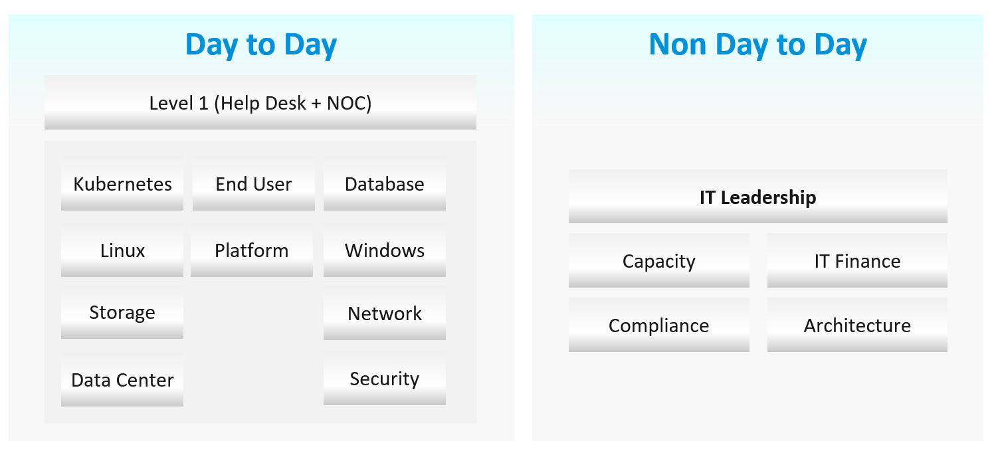

#### Day to Day Roles

<table>
<colgroup>
<col style="width: 21%" />
<col style="width: 78%" />
</colgroup>
<thead>
<tr class="header">
<th><strong>Level 1 Operators</strong></th>
<th>
Deal with the production environment. Perform a regular check on the overall environment. Use both insight and alerts.

Responsible for closing alerts. Alerts should be closed only when root cause is known, not when symptoms disappear. Closing alerts without knowing why they happened prevents lesson learned and can potentially backfire.

Perform simple troubleshooting, following SOP. Typically, these SOPs do not require reading logs.

SOP is ideally automated, taking input parameters, so the chance of human error is minimized if the number of manual steps or frequency is high.

Focus on Availability, Performance and Security.

Typically stationed at <a href="https://en.wikipedia.org/wiki/Network_operations_center">Network Operations Center</a> room and called the Help Desk.
</th>
</tr>
</thead>
<tbody>
<tr class="odd">
<td><strong>Platform</strong></td>
<td>
Activated when Level 1 is unable to solve the problem. For each problem solved, this role should update the troubleshooting guide so Level 1 can be empowered.

Focus on insight, not alerts. Look at the big picture and try to prevent alerts from happening. They focus on risk (e.g. configuration risk, compliance risk).

More senior than Level 1. May specialize is some areas (e.g. vSAN, networking). They document the knowledge base and develop SOP. They automate the SOP as much as possible.

Perform advanced troubleshooting, which often requires logs analysis . Work with the Architecture Team.

Lead or involved in the evaluation of operations management tools. Design and maintain VCF Operations dashboards and alerts.

In larger organization, there can be more levels.
</td>
</tr>
<tr class="even">
<td><strong>Operations Manager</strong></td>
<td>
Manage the level 1, level 2, level 3 operators.

Deal with tenants on SLA.
</td>
</tr>
</tbody>
</table>

#### Other Roles

There are other roles that Ops Teams need to deal with. Here are some of them. In larger organization, each could be a team on their own.

<table>
<colgroup>
<col style="width: 21%" />
<col style="width: 78%" />
</colgroup>
<thead>
<tr class="header">
<th><strong>Security</strong></th>
<th>
In large organizations, this could be a separate department by itself. It could also report outside IT if the scope covers beyond computer system.

They work closely with the Compliance persona.
</th>
</tr>
</thead>
<tbody>
<tr class="odd">
<td><strong>Compliance</strong></td>
<td>
Set the compliance settings to agreed internal and industry standard.

Verify that non-compliance alert was addressed timely and correctly by the operations team. Report &amp; discuss the compliance status with upper management.

Focus on Risk (Configuration, Compliance).
</td>
</tr>
<tr class="even">
<td><strong>Capacity</strong></td>
<td>
Plan the supply side of capacity, working with the architect role.

Plan the demand side of capacity, working with line of business or sales team.

Does not get involved in the day-to-day capacity. ESXi hosts going into maintenance mode is an operational problem, not capacity management matter.
</td>
</tr>
<tr class="odd">
<td><strong>IT Finance</strong></td>
<td>Typically work with Capacity Team on purchasing.</td>
</tr>
<tr class="even">
<td><strong>IT Management</strong></td>
<td>
There can be multiple levels here, all the way to the CIO and CTO.

Look at the big picture, trends over time, and future. Not so much what’s going on hour-by-hour.

Weekly report, focusing on the overall health and not individual users or pools.

Monthly presentation and review, supported for live dashboard for an interactive discussion.

Generally, does not get involved in troubleshooting and architecture.

Primary focus is Compliance and Cost. Performance is not the focus, as that was likely promised to be “good” by the Architect as part of the design.
</td>
</tr>
<tr class="odd">
<td><strong>Architecture</strong></td>
<td>
Design the system architecture. Needs to get input from Day 2 team, and design with the end in mind.

Look into the future. Evaluate new technology and assess if technology refresh or migration to a new architecture makes business sense.

May lend support on complex troubleshooting.

In larger organizations:

<ul>
<li>
The storage team is typically separate, unless it’s virtual such as vSAN.
</li>
<li>
OS-specific teams. They are responsible for setting the build standard for each OS.
</li>
</ul></td>
</tr>
<tr class="even">
<td><strong>Network</strong></td>
<td>The network team is typically separate. This is due to the nature of networks.</td>
</tr>
</tbody>
</table>

Guess what role is missing?

Yes, Site Reliability Engineer ([SRE](https://en.wikipedia.org/wiki/Site_reliability_engineering)).

The role focuses on automation. I see them as a variant of platform team, because in operations you should only automate what you can operate. Doing automation without mastery of operations have resulted in many [DevOps](https://en.wikipedia.org/wiki/DevOps) turned into Dev Oops!

#### Exit Criteria \| Entry Criteria

Among the roles and departments, there are handovers and boundaries. This is especially important for escalation. What’s the Exit Criteria and Entry Criteria?

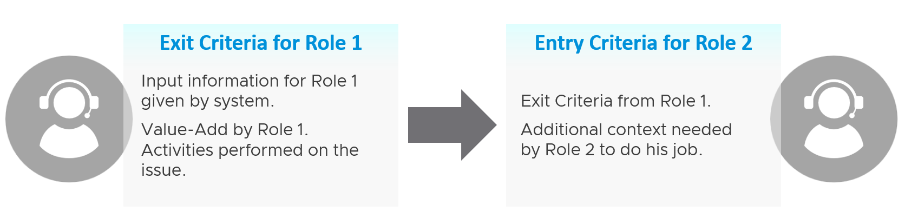

Take for example the escalation process from Level 1 to Level 2 support.

L1 Exit Criteria defines the set of analysis they have performed on the issue. If it’s not in their capability, they have the right to escalate to L2.

<table>
<colgroup>
<col style="width: 20%" />
<col style="width: 79%" />
</colgroup>
<thead>
<tr class="header">
<th rowspan="3"><strong>L1 Staff</strong></th>
<th>
Perform check following their SOP to ensure the Exit Criteria is satisfied.

The guide to analyze is provided by the respective L2 as part of the alert definition.
</th>
</tr>
<tr class="odd">
<th>
Add additional information that L2 needs, giving all the context an L2 personnel needs to perform their job. The context is part of the handoff process, meaning Level 2 will not accept the escalation if the necessary details are not provided

The list of information can be basic information, such as VM owner. It can also be a set of additional low-level counters or test results that the L1 Team ran but does not have the skills to analyze. It’s analogous to seeing a specialist doctor who asks you to bring your test results.
</th>
</tr>
<tr class="header">
<th>Since L1 is generalist, while L2 is specialist, the L1 staff must escalate to the right Level 2 group.</th>
</tr>
</thead>
<tbody>
<tr class="odd">
<td rowspan="2"><strong>L2 Staff</strong></td>
<td>The 2 pieces of information above becomes the Entry Criteria for L2.</td>
</tr>
<tr class="even">
<td>L2 Team automatically accept the issue and now the ball is in</td>
</tr>
</tbody>
</table>

##### “It’s on my court”

Each team need provide the standard list of metrics, events, error that shows that the problem is on their court. These items are monitored by their respective team, and alerts are in-place.

The following list examples metrics and events for different team.

<table>
<colgroup>
<col style="width: 21%" />
<col style="width: 78%" />
</colgroup>
<thead>
<tr class="header">
<th rowspan="2"><strong>Application Team</strong></th>
<th>Naturally, the actual metric and event are application-specific, and even version-specific.</th>
</tr>
<tr class="odd">
<th>
There is general abnormal behavior regardless of application. Examples:

<ul>
<li>
Memory that grows over time and does not go down despite loads going down. This indicates memory leak, or application does not release the memory back to Linux or Windows.
</li>
<li>
CPU on a thread that runs 100% constantly. While high utilization is good, a perfectly flat line over minutes could indicate process run away.
</li>
</ul></th>
</tr>
</thead>
<tbody>
<tr class="odd">
<td><strong>Database Team</strong></td>
<td>The counter depends on the specific database software</td>
</tr>
<tr class="even">
<td><strong>Windows Team</strong></td>
<td>CPU: Context Switch, Run Queue</td>
</tr>
<tr class="odd">
<td><strong>Linux Team</strong></td>
<td>CPU: Context Switch, Run Queue</td>
</tr>
<tr class="even">
<td><strong>K8 Team</strong></td>
<td>K8 Pod: CPU Throttle, Out of Memory event.</td>
</tr>
<tr class="odd">
<td rowspan="2"><strong>Virtualization Team</strong></td>
<td>
For VMware vSphere VM:

<ul>
<li>
VM CPU: Ready, Co-Stop, Overlap, Other Wait
</li>
<li>
VM Memory: Latency, Zipped, Swapped, Ballooned
</li>
<li>
VM Storage
</li>
<li>
VM Network:
</li>
<li>
VM System: vMotion down time
</li>
</ul></td>
</tr>
<tr class="even">
<td>
For Infrastructure :

<ul>
<li>
ESXi Performance (%)
</li>
<li>
ESXi Performance Risk (%)
</li>
<li>
Cluster Performance (%)
</li>
<li>
Cluster Performance Risk (%)
</li>
</ul></td>
</tr>
</tbody>
</table>

### SP5 Framework: Process

Day 0 & Day 1 are typically done by the Architecture team, and Day 2 is typically done by the day-to-day operations team. In large organization, Day 1 could be different as there is enough workload for them to continuously upgrade. For example, if you have 6000 ESXi hosts, and you have a 5-year depreciation policy, you’re basically replacing 100 boxes per month. That means 25 hosts per week on average.

#### 3 Categories

##### Day 0

<table>
<colgroup>
<col style="width: 15%" />
<col style="width: 84%" />
</colgroup>
<thead>
<tr class="header">
<th>Plan</th>
<th>
This is where you set the goals. The goal should follow the <a href="https://en.wikipedia.org/wiki/SMART_criteria">SMART</a> criteria. Make sure they are aligned with the business deliverable.

For example, if you plan to build a private cloud, how do you measure success? What are the metrics, so you know how successful you are?
</th>
</tr>
</thead>
<tbody>
<tr class="odd">
<td>Size</td>
<td>
A big chunk of planning is sizing the environment.

Some companies perform stress tests and load tests, so they know what to expect when the real load occurs. Without planning and testing, you don’t know if the reality should be, as you do not have a measured goal.

When you architect vSAN, how many milliseconds of disk latency did you have in mind? For example, you set the goal of 10 ms measured at VM level (not at the vSAN level and not at the individual virtual disk level) based on 5-minute average?
</td>
</tr>
</tbody>
</table>

##### Day 1

<table>
<colgroup>
<col style="width: 15%" />
<col style="width: 84%" />
</colgroup>
<thead>
<tr class="header">
<th>Design</th>
<th>
This is where you design, build the system, and launch the service. This includes configuring the various operations inputs such as cost drivers (e.g. application license costs, electricity rates). This is not part of the book as there are plenty of materials on it.

Day 1 is generally closer to Day 0, as it’s the realization of your plan.
</th>
</tr>
</thead>
<tbody>
<tr class="odd">
<td>Build</td>
<td>
Ideally this is automated to ensure what is designed is 100% identical to what is built.

This includes deployment of the infrastructure, physical and virtual.
</td>
</tr>
<tr class="even">
<td>Test</td>
<td>Ensure what is built works as intended. For example, if you build a vSphere cluster, test that each ESXi host can recover from an HA event.</td>
</tr>
<tr class="odd">
<td>Upgrade</td>
<td rowspan="2">
I do not consider them as part of Day 2.

Upgrade varies from a simple patch to complete rearchitecting, where you are running the old and new system side by side. This type of upgrade is basically a migration, as you have the luxury of a new build. It also involves substantial planning, so you might have to circle back to Day 0.
</td>
</tr>
<tr class="even">
<td>Migrate</td>
</tr>
</tbody>
</table>

##### Day 2

Day 2 is when the real challenge happens, as this is the stage you need to ensure critical workload is served well.

As a result, it includes proactive tests of the system resiliency and security. Monitoring is more than just checking. It’s about ensuring that the system is able to handle emergencies and remain secured.

Define your [Standard Operating Procedure](https://en.wikipedia.org/wiki/Standard_operating_procedure)s (SOP) to ensure knowledge is captured and lessons are learned. It’s also important to know “who does what when” to ensure gaps are covered. If your operations are partly or fully outsourced, ensure the vendor provides the documentation.

Having SOPs does not mean that you do not have ad-hoc tasks at all. You do, however, want to keep them minimum and so they are manageable.

<table>
<colgroup>
<col style="width: 16%" />
<col style="width: 83%" />
</colgroup>
<thead>
<tr class="header">
<th>Deploy</th>
<th>This refers to the deployment of workloads, not infrastructure. Workload lifecycle management happens throughout the years, hence it’s considered Day 2.</th>
</tr>
</thead>
<tbody>
<tr class="odd">
<td>Prove</td>
<td>
You have redundancy (HA) and DR, right? How do you know they work if you never test them? A pair of core switches that have been left untouched for years may give you a surprise when there is an unplanned HA event. Once a year, test your HA to make sure they work.

Annual reboots could be a good idea to clear cache and logs. As part of firmware, driver, OS, and VM Tools updates you may need to reboot anyway. Take advantage of this downtime by testing the resiliency of your infrastructure.

Another area you need to test is security. Conduct independent penetration tests.
</td>
</tr>
<tr class="even">
<td>Monitor</td>
<td rowspan="2">These 2 will be elaborated as they form the bulk of Day 2 activities</td>
</tr>
<tr class="odd">
<td>Troubleshoot</td>
</tr>
<tr class="even">
<td>Optimize</td>
<td>As part of your monitoring, you may not discover a problem, but you spot an opportunity to make performance even better, reduce costs even further, and free up wastage in capacity. It’s common for new versions to deliver performance improvement. Again, you do this proactively, not waiting for complaints to happen.</td>
</tr>
</tbody>
</table>

#### Proactive Operations

While we cannot eliminate troubleshooting, we can perform regular health check + auto remediation to minimize the reactive action.

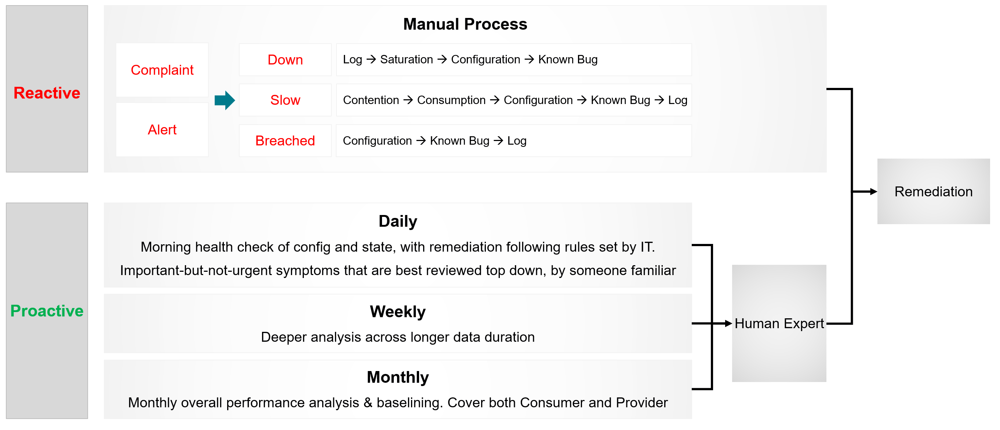

The preceding diagram shows the dual tracks.

It uses proactive as the primary, while still having reactive as the fall back.

Reactive deals with 3 types of problems:

1. Is it dead? If the system is down, you don’t have performance problem. It also cannot be hacked.

2. Is it slow?

3. Is it safe? Security compromise, breach, leak, or hack belong here.

Proactive is a superset of reactive, as you do not if you have a problem yet. You also need to check the future, hence you include “will it be enough” question.

You complement this daily cadence with weekly and monthly, where you can afford to spend more time.

The techniques are based on the fact that there is only a finite set of rules. The logic that human experts use to troubleshoot performance is known. This means it can be automated. The final solution does not even need AI for almost all cases, as the final remediation action is basically moving some VMs out of the cluster. This too can be automated.

This daily check + remediation, coupled with human verification, should free up IT Team to deal with corner cases.

The check must be quick, ~1 minute, so you can do 2x a day (Start of Your Day and End of Your Day).

The following diagram shows how Level 1 Team (the frontliner) and supporting team (Level 2, Application Teams, etc.) work together to avoid alert in the first place.

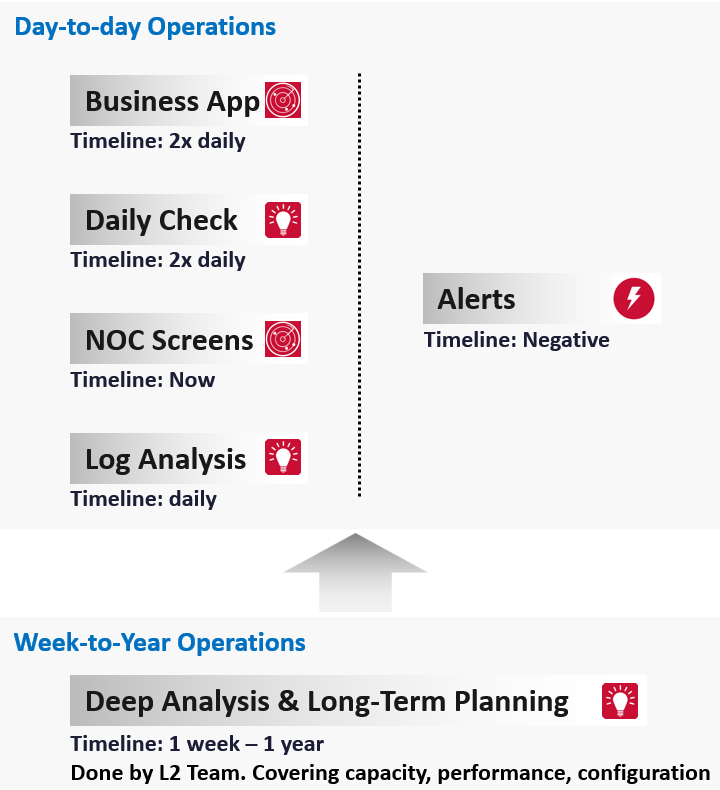

##### Day-to-day Operations

The daily discipline of who does what everyday matters.

1. The most important and the most basic is availability. If your system is down, you cannot have performance problem.

2. The next thing you ensure is performance. A system that is so slow is as good as down, perhaps to the point the hackers get tired of waiting

3. Yes, security is number 3, not number 1 in the grand scheme of operations.

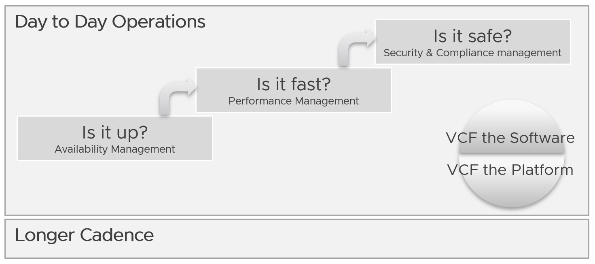

You assess the above on both “sides” of VCF, as they are intertwined. We covered this in earlier part of this book.

Day to day operations become more systematic when you distinguish between monitoring and troubleshooting.

The following shows the timeline of actions taken during a 24-hour period.

<table>
<colgroup>
<col style="width: 16%" />
<col style="width: 83%" />
</colgroup>
<thead>
<tr class="header">
<th>08:00 – 09:00</th>
<th>Automatic Health Optimization script runs. It flags VCF components needing attention that it cannot remediate.</th>
</tr>
</thead>
<tbody>
<tr class="odd">
<td>09:00 – 09:30</td>
<td>
Human Expert reviews as part of Daily SOP.

<ul>
<li>
The script outcome.
</li>
<li>
The daily dashboard, which also has the alert trend.
</li>
</ul></td>
</tr>
<tr class="even">
<td>09:30 – 10:00</td>
<td>Having reviewed in totality, humans proactively prep the environment for the expected load of the day. For example, approves inter-cluster rebalancing.</td>
</tr>
</tbody>
</table>

Live NOC screen and dashboard work together to realize proactive operations. You need both.

| **Live Screen** | They provide live, real-time, information. They are conveniently projected on the big screens for NOC Team to glance quickly. It is always available, and auto-refresh. |
|-----------------|-------------------------------------------------------------------------------------------------------------------------------------------------------------------------|
|                 | The NOC Room screens enable the L1 Team understands the situation better. Coupled with clear SOPs, it should result in less quantity and higher quality escalation      |
|                 | They complement daily check well. Since you only check the dashboard in the morning, what happens to the rest of the day?                                               |
| **Daily Check** | They focus on insight, not alert. We covered both in-depth in Part 1 of the book.                                                                                       |
|                 | Insight and alerts are complimentary. Open both pages side by side.                                                                                                     |

They complement alert well. The main limitation of alert is bottom-up. It can’t show the complete picture. Alert is the tip of the iceberg.

Why do we add critical business applications in the methodology?

As covered in chapter 1, we need to begin with the end in mind. Since the purpose of IaaS is to run the applications, we need both the application team and the infrastructure team to track the critical applications. I put 2x daily as the minimum.

Proactive operations should result in less alerts, both in frequency and intensity. Volume wise, the bulk of alerts are the yellow alerts, due to their lower threshold. They can be replaced with insight, which is discovered as part of a daily proactive health check dashboard.

<table>
<colgroup>
<col style="width: 18%" />
<col style="width: 81%" />
</colgroup>
<thead>
<tr class="header">
<th rowspan="3"><strong>Alerts</strong></th>
<th>
A better name for alert is guard rail. This way, the purpose is clear. It is to catch when human forgets, or system fails without warning.

It is not the starting point of operations, where operators passively waiting for alerts to happen then do something.
</th>
</tr>
<tr class="odd">
<th>A well-run operations have a low number of alerts.</th>
</tr>
<tr class="header">
<th>
The nature of alert means its use case is narrow. You do not want to run your operations based on alerts. Too many and you’re overwhelmed. Too few and you lack the early warning.

This is why insight is the main driver, with alert playing secondary role.
</th>
</tr>
</thead>
<tbody>
</tbody>
</table>

What’s the limitation of the above?

They focus on day-to-day operations. Both have short timeline. Maximum 1 day. If you have quarterly workload, you will not see them.

You also need a deeper and longer analysis, to implement major improvement. You do this via a set of interactive and powerful dashboards, such as the performance baseline profiling dashboard. Because you do it monthly or longer, you can afford a longer time to execute it. Use it to solve larger, more complex, and political problems.

Is there another benefit of this “out of band” operations management?

Yes. Use it to improve your daily operations itself. Both the Daily Check and the NOC Screens should help in preventing the alerts in the first place. However, you may have alerts that fall through the crack. On a weekly basis, review these alerts and improve the dashboards accordingly. Once this is repeated over a long period of time, you’re bound to catch many of the alerts and get better in preventing them.

###### Real Time

This is assisted with a set of live dashboards on the big screen in the NOC, showing real-time metrics and events. As the time duration is basically minutes, capacity is typically not relevant. You focus on availability, performance, and security.

The focus is to gain early warning, hence buying time if operations turn into an emergency. That means there is no alert triggered yet.

You want to put out fire fast.

| **Availability** | Focus on undesirable events. Make sure they match your expectations of what is actually happening in your environment at that time. For example, if you’re not deleting VMs and the live screen shows many VMs being deleted, something’s amiss. |
|------------------|--------------------------------------------------------------------------------------------------------------------------------------------------------------------------------------------------------------------------------------------------|
| **Performance**  | Focus on overall performance and make sure the fluctuation is within your expectation.                                                                                                                                                           |
| **Security**     | Focus on suspicious activity such as loosening of firewall rules or usage of administrator accounts.                                                                                                                                             |

###### Daily

The daily SOP should look ahead, using the historical data and business context as a guide.

<table>
<colgroup>
<col style="width: 16%" />
<col style="width: 83%" />
</colgroup>
<thead>
<tr class="header">
<th rowspan="2"><strong>Availability</strong></th>
<th>Check for soft errors. This likely requires you to look at the logs from each hardware and software vendor. For example, vSphere has proactive HA.</th>
</tr>
<tr class="odd">
<th>Ensure backups are performed. For example, if you take a snapshot of 1549 VMs and only removed 1518, the backup likely failed to consolidate the snapshot.</th>
</tr>
</thead>
<tbody>
<tr class="odd">
<td><strong>Performance</strong></td>
<td>
Insight analysis . Look at the overall environment.

Mission Critical VM Performance. Focus on looking forward to the next 1 day, by considering the pattern over the last 1 week. Know the expected workload, by working closely with the business owner.
</td>
</tr>
<tr class="even">
<td><strong>Compliance</strong></td>
<td>Ensure non-compliance is remediated.</td>
</tr>
<tr class="odd">
<td><strong>Security</strong></td>
<td>Check for potential security attacks, such as loosening of firewall rules and usage of administrator accounts.</td>
</tr>
<tr class="even">
<td rowspan="2"><strong>Configuration</strong></td>
<td>Check for misconfiguration that can cause issues.</td>
</tr>
<tr class="odd">
<td>Implement urgent patches, after appropriate validation</td>
</tr>
<tr class="even">
<td rowspan="4"><strong>Capacity</strong></td>
<td>VM provisioning. Ideally this is automated, so it happens throughout the day. In this way, your developers need not wait for the end of the day. What you need to ensure is the aggregate load does not overwhelm the shared environment.</td>
</tr>
<tr class="odd">
<td>
Snapshot deletion. Set up a policy to delete snapshot older than say 3 days. You do not want to wait until 1 week.

Ensure the exclusion is properly implemented, so you do not delete from VM whose snapshot you’ve agreed to keep.
</td>
</tr>
<tr class="even">
<td>Powered-off VM deletion. Once a VM passes the powered-off definition, there is no need to wait for another week before you delete them. You do have backups, don’t you?</td>
</tr>
<tr class="odd">
<td>Powering off Idle VMs. Once a VM passes the idle definition, there is no need to wait for another week before you gracefully shut the OS down.</td>
</tr>
</tbody>
</table>

##### Optimize

The outcome of monitoring is not always troubleshooting. You may discover nothing to fix. However, that does not mean you discover nothing as you may discover the opportunity to improve.

Optimization delivers many practical benefits and real business results. Here are some of them:

<table>
<colgroup>
<col style="width: 24%" />
<col style="width: 75%" />
</colgroup>
<thead>
<tr class="header">
<th>Lower Cost</th>
<th>
Reclamation: Orphaned VMs, powered off VMs, Idle VMs, Oversized VMs, snapshots.

Reduce DC footprint: Saves Software (MS, RedHat, VMW, etc.) and Hardware (server, storage, network) + Data Center (rack, space, cooling, UPS)

Move burst capacity from Own to On-Demand.
</th>
</tr>
</thead>
<tbody>
<tr class="odd">
<td>Better Performance</td>
<td>
Performance Profiling. Enable proactive monitoring via actual baselines.

Establish Performance SLAs, complementing Availability SLAs.

NOC Dashboards. Insight, then Alerts.

Faster business service via self-service + approval workflows.
</td>
</tr>
<tr class="even">
<td>Lower Complexity</td>
<td>
Standardize architecture.

Simplify business policy or security policy.

Standard Operating Procedures (SOP).

Reduce human error via automation.

Replace aging hardware and upgrade outdated software.
</td>
</tr>
<tr class="odd">
<td>Higher Customer Satisfaction</td>
<td>
Internal IT department. Reputation among Applications Team.

External SP. Repeat business.

Ability to justify or defend pricing. Price/Performance.
</td>
</tr>
<tr class="even">
<td>Higher Compliance</td>
<td>Internal compliance with evolving, mandatory and/or optional security benchmarks, such as VMware security hardening guides, CIS, ISO, or FISMA baselines, or industry regulation such as DISA, PCI DSS, or HIPAA.</td>
</tr>
</tbody>
</table>

I’m sure there are more of them. Drop me a note with your real-world stories!

##### VM Life Cycle

This should be supported with an approval system, so all Change Requests and associated actions are properly recorded. This eliminates finger-pointing in the future. It will also support audit: who is keen on “who did what change to which object on when”?

<table>
<colgroup>
<col style="width: 15%" />
<col style="width: 84%" />
</colgroup>
<thead>
<tr class="header">
<th>Stage</th>
<th>Notes</th>
</tr>
</thead>
<tbody>
<tr class="odd">
<td>Request</td>
<td>
If a VM is free (price is basically $0), then rely on business justification and IT policy. Policy states the criteria for the different class of services.

VM size is requested by the application team, approved by their management. For size or quantity above certain thresholds, IT should review.
</td>
</tr>
<tr class="even">
<td>Creation</td>
<td>
The actual deployment of the VM in vCenter. This is ideally automated.

This stage generates the actual VM name, create folders if necessary, and places the VM into the correct folder.

Once the VM object is registered in VCF Operations, create the custom group is necessary, and set the custom property.
</td>
</tr>
<tr class="odd">
<td>Changes</td>
<td>Changes in VM size need to be approved as it impacts capacity and performance. If you have to use shares and reservation, ensure they are updated accordingly.</td>
</tr>
<tr class="even">
<td>Retire</td>
<td>Delete the VM and remove it from inventory.</td>
</tr>
</tbody>
</table>

### Performance \| Capacity

Think of it as Quantity and Quality. Or Space and Speed.

They are heavily intertwined.

- Rightsizing belongs under capacity, but it uses performance as the primary consideration. For mission critical, the metric is highly granular (1 – 20 second), not 5 minutes average.

- Infrastructure capacity is about maximizing utilization, but it gets overridden by performance.

Performance is more time sensitive and important than capacity. Manage performance first, capacity second. Using the restaurant analogy, you focus on the dining area first, then the kitchen.

In larger organizations, they are typically managed by two different teams. The capacity team does not get involved in the day-to-day operations as they focus on longer-term resource availability. They also consider latent workload and future demand, which performance does not consider.

The capacity team may not have the technical skills to troubleshoot performance. On the other hand, the day-to-day operations deals with “what’s on the floor” of the data center. Their primary focus is meeting the demand from applications at that hour.

Capacity involves factors like HA, Buffer, Overhead and Reservation. None of these are relevant to performance monitoring. In Performance, you don’t care about them as performance is about reality (what actually happens). Those factors may cause performance problems, but they are not considered in the performance metric.

Capacity uses a smaller subset of the resource than performance. One main concept is Usable Capacity, which is unique to capacity. There are no such things as usable performance, usable compliance and usable availability.

The relationship between capacity and performance varies depending on the object.

- Consumer objects (e.g. VM, K8S Pod) have different natures than provider objects (e.g. vSphere Cluster, vSAN Cluster).

- For provider objects, performance is always bottom up. You start with the VM running inside in the provider object, and then aggregate the metrics. Capacity is always top down. You look at the big picture first, then drill down. For example, you start with the vSphere cluster, then drill down to ESXi.

For an IaaS provider, the following table explains how performance and capacity differ.

#### Utilization vs Demand

Utilization is not something you manage. It is just an input to what you actually care, which is capacity and performance. The nuance is both use utilization differently. In addition, capacity uses demand metrics, which takes the highest of utilization & reservation.

Performance will be absolute (real value), Capacity will be relative (it depends on settings). Unlike performance, Capacity is measured against usable capacity, not absolute capacity. There is no such thing as usable performance.

Now that we’ve looked at purpose, now let’s look at object.

Take a 16-node vSphere cluster, for example:

- For performance, taking the average utilization of 16 hosts is too late. It’s also not practical, as you don’t typically wait until all 16 have a problem. In this case, you want to take the highest among the host as your primary counter for cluster utilization. If the counters show no issue, then there is no need to look at the remaining hosts.

- From capacity, taking the average makes sense, as you do capacity at cluster level. You will continue adding until either you run out of capacity or you hit performance problems.

#### Contention vs Consumption

The following diagram shows 3 different scenarios on how contention and consumption can play out:

- What you think will happen: you theorize that contention will only happen when utilization is high, and the unused capacity acts as cushion to prevent unmet demand from happening. This is unlikely as there could be imbalance.

- What actually happens in most environments: demand is unmet even though utilization is not high, due to suboptimal configuration or constraints. Imbalances and incorrect cluster configurations are two typical causes of contention at low utilization.

- What would happen if your environment is optimized: you have very high utilization yet you keep unmet demand within the promised SLA.

Don’t confuse “ultra-high” utilization indicators as a performance problem. High utilization does not compromise performance, so long as there is no queue or contention. Just because an ESXi Host is experiencing ballooning, compression, and swapping does not mean your VM has memory performance problems.

| A   | It’s a common misperception that performance problems happen mostly here. It actually rarely happens here as utilization rarely exceeds 100% in real world due to buffer created by high availability. |
|-----|--------------------------------------------------------------------------------------------------------------------------------------------------------------------------------------------------------|
| B   | Maximum utilization is achieved at 100% utilization. Consequently, the overall Performance is best here as the system completes the most amount of work.                                               |
| C   | Worst performance actually happens when utilization = 0% as nothing gets done. The demand is not being met at all (for whatever reason).                                                               |
| D   | This is the threshold of Usable Capacity. It has nothing to do with Performance. Performance is in fact better above this threshold.                                                                   |

#### Pattern Difference

You can’t forecast performance using capacity. Their metrics have different patterns.

Let’s take an example to see how contention and utilization differ. The following is using a cluster object as the example. There are two metrics, each expressed in percentage.

You want your utilization to be as high as possible, as you’ve paid for the hardware already. So, you start from 0% but want to move up as far as possible.

Performance is different as it depends on the class of service. Your Gold Class should deliver higher performance than your free tier else you may breach your SLA. Metrics wise, there are 2 metrics: SLA and KPI.

## Performance Management

The goal of performance management is to address problem before customers complain. If you can’t detect the problem before customers do, then you don’t have performance management in place. The word manage implies proactive. Passively waiting for an alert or complaint to trigger the troubleshooting process is not performance management. Proactivity requires regular cadence to prevent the problem. This cadence requires an internal threshold that is more stringent than the external, formally agreed SLA.

### A Day in the Life of a Cloud Admin

Here is a common story often told in the virtualization community, which will resonate with you as an IaaS provider.

A VM Owner complains to you that her VM is slow. It was *not* slow yesterday. Her application architect and lead developer have verified that:

- The VM CPU and RAM utilization did not increase and are within a healthy range.

- The application team has verified that CPU Run Queue is also in the healthy range.

- The disk latency is good. It is below 5 milliseconds.

- There are no network packets loss.

- No change in the application settings. In fact, the application has not had any changes in the past month.

- No recent patches were installed into Windows.

- There was no reboot. It has been running fine for weeks prior to this issue.

She said your VMware environment is a shared environment, and perhaps an increase in the number of VMs and an increase in the workload of other VMs are straining your IaaS.

She also said that her other VM, which was [P2V](https://en.wikipedia.org/wiki/Disaster_recovery) recently, was performing much faster in physical.

If you think she is saying it’s your fault, you are right!

What do you do?

It is certainly a difficult situation to be in. You oversee more than 10,000 VMs. You have successfully consolidated them into 500 ESXi Hosts, saving the company 9500 servers, not to mention a lot of money. You built your reputation during the process, so this is not just a matter of her VM not performing. Your reputation is at stake here.

You also recall that your team has been adding new VMs regularly over the past several months so she could be right about the increasing number of VMs straining the IaaS platform. In addition, there have been several soft errors in your network and storage, and your team has been investigating for weeks. But why did she say it only happened today, but not yesterday or a few days ago?

It’s a hard question. To answer it, we need to take a step back and elaborate. Let’s dive in!

### The 3 Realms

In the big picture, there are 3 realms of IT in business. Each realm has its own set of teams. Each team has a set of unique responsibility and hence skills required. The following diagram outlines the 3 realms, alongside with typical layers within each realm and questions being asked.

The fight typically happens between application team and infrastructure team, as both are IT. The business folks are real consumers or end users and not technical enough to provide solutions.

By the way, for those who use enterprise architecture framework, the 3 realms above actually map to TOGAF[^9] by [The Open Group](https://www.opengroup.org/togaf).

- Business maps to Business Architecture

- Application maps to Information Systems Architecture

- IaaS maps to Technology Architecture

Each team need to have their own KPIs, and there must be SLAs between them.

<table>
<colgroup>
<col style="width: 19%" />
<col style="width: 32%" />
<col style="width: 48%" />
</colgroup>
<tbody>
<tr class="odd">
<td>Layer</td>
<td>Owner</td>
<td>Observability</td>
</tr>
<tr class="even">
<td>Business</td>
<td>
Non-IT

(specific departments owning the business functions, such as Internet Banking)
</td>
<td>Service Response Time. This is business-function specific. For example, if it’s an eCommerce website, a good example of function is the payment for a shopping cart.</td>
</tr>
<tr class="odd">
<td>Application</td>
<td>IT (Application Team)</td>
<td>It depends on the application software and codes. Typically requires agents with specific knowledge of that application, as it has unique metrics. As a result, it is not possible to develop a generic KPI.</td>
</tr>
<tr class="even">
<td>Infrastructure</td>
<td>IT (Infrastructure Team)</td>
<td>
It’s possible to develop a universal KPI that works on all applications as it’s basically about CPU, memory, disk, and network.

This is the focus of our work.
</td>
</tr>
</tbody>
</table>

While businesses run on IT, not all business KPIs depend on IT. Some depends on marketing, pricing strategy, and what your competitors are doing. Take an ecommerce portal: its top business KPIs probably involve revenue and gross profit. As you can imagine, if your competitors are doing a massive discount, you may not be able to achieve your sales and profit target.

That means there are 2 types of business KPIs:

- Metrics based on IT software.

- Metrics not based on IT software.

Examples for the ones relying on IT are business transactions (e.g. buy a product, update personal information, transfer fund) that are provided by the IT system. They can be online (real time, a user is waiting) or batch (runs in the background) in nature. They can be user to system, or system to system. Online transactions are often measured in time taken to process a single transaction (typically less than a few seconds) and is called Online Transaction Processing ([OLTP](https://en.wikipedia.org/wiki/Online_transaction_processing)). Batch transactions are often measured in time taken to process many transactions (which can be hours).

As you can imagine, different transactions require different amount of time. Even the same kind of transaction (e.g. generating a report), can vary as it depends on the amount of data or records. As an application architect, it’s important to define the expected time taken to complete commonly used business transactions. Obscured business transactions that are rarely used can be given low priority. However, this effort is not scalable if you have hundreds of business applications.

If you want universal metrics for all business applications, then page response time and error returns are the only metrics. I like the principle behind [apdex](https://www.apdex.org/), but not its implementation. Happy to share an improved formula if you are interested.

Performance troubleshooting is largely an exercise in elimination. The methodology slices each layer and determines if that layer is causing the performance problem. Hence it is imperative to have a single metric to indicate if a particular layer is performing or not. This primary metric is aptly named Key Performance Indicator.

Higher layers depend on the layers below, and hence the infrastructure layer is typically the source of contention. As a result, focus on the bottom layer first, as it serves as the foundation for the layer above. The good part is this layer is typically a horizontal layer, providing a set of generic infrastructure services, regardless of what business applications are running on it.

Now, we don’t know the impact to the application when there is latency in the infrastructure. That depends on the application. Even on the same identical software, e.g. SQL Server 2019, the impact may differ as it depends on how you use that software. Different natures of business workload (e.g. batch vs OLTP) get impacted differently even on the identical version of the software.

#### The Layers in IT Systems

To continue the discussion of layers in IT systems, the following example of an IT system shows 5 layers. The challenge in performance troubleshooting is the layers may not share context. Depending on the application and infrastructure architecture, there could be more layers.

Using the example above, we can demonstrate how the lack of visibility is making troubleshooting virtually impossible. Let’s run through the hypothetical example depicted above. The story starts with a complaint as that resonates better.

At the Business Layer, you can see the performance of each business transaction. You not only know which user was affected, you also know what transaction was affected as the metric has transaction ID. You can trace it in the code as you know how long each function calls take place, assuming you log for every single transaction.

The problem starts when you move beyond your code and into Commercial of the Shelf (COTS) software. The software may show that its queue is 10000, which is 5000 more than what the manual say it can handle. But you have no idea if the user’s transaction was in that queue or not. The COTS software metrics do not relate to users anymore, let alone individual transactions. The red explosive icon marks where context is lost.

Moving from application to infrastructure resulted in another loss of context. Windows or Linux has no idea what applications you’re running. As far as the OS is concerned, every application is just a process. It will report basic CPU, Memory, Disk and Network utilization per process. More advanced metrics are reported at OS-level, system wide. For example, you do not know if your process was the one experiencing network [packet loss](https://en.wikipedia.org/wiki/Packet_loss). The packet loss metric is a system-wide metric.

Moving from individual EC2 or VM to the shared infrastructure results in another loss of context. In the case of public cloud, you may not get visibility into the physical layers at all. Your troubleshooting ends at the consumer layer.

#### The Layers in IaaS

Let’s apply the layers to IaaS.

The 1st level is Guest OS contention. This is beyond the control of the IaaS platform. It’s completely up to each Guest OS to manage their given resources.

The 2nd level is useful for tracking VM capacity. Say a VM is given 8 vCPU. If you want to know if it’s using it, this is the area where you measure it. Whether you measure it In-guest or at the VM level, it depends on the specific use case because each layer lacks visibility into the other.

The 3rd level is where the VM meets the provider. This is where you track whether the IaaS platform is serving the VM well.

The 4th level is the underlying IaaS platform. This level is irrelevant to the VM Owner. This is normally the domain of the capacity planners and the troubleshooting specialists.

Let’s drill down further, breaking the layers more.

##### IaaS Metric Types

Broadly speaking, there are two categories of metrics we are interested in: consumer metrics, and provider metrics.

Consumer metrics consist of:

- Business Applications: this could span multiple VMs, containers, and serverless functions. The metrics here are business metrics, not IT metrics. They are the best at measuring the application performance, but they can’t explain why it’s not performing,

- Service: this is a process running inside Windows or Linux. We normally call this the application. An example is a database server.

- Guest OS: there are two kinds of performance metrics; One at the Windows/Linux layer, and one at the driver layer (e.g. PVSCSI, vmxnet).

- Container: this typically runs inside a VM. If there is more than 1 container in a VM, it makes operations management harder.

- The Virtual Machines themselves.

Provider metrics consist of:

- Compute virtualization, also known as the hypervisor. This is where the VM or container is running.

- Storage and Network virtualization: they act as subsystem, supporting layer to the hypervisor. Ideally, they should have VM-level metrics, so you can trace how a single VM is performing deep into the storage and networking stack.

- Physical resources: with hyperconverged, the only physical resources which are not already included in the categories above are basically network equipment due to their function as interconnects.

The following diagram captures the interrelationships between these metrics.

Notice how consumer and provider metrics are intertwined. A consumer contention metric becomes the performance metric for the provider.

Contention metrics are placed above utilization metrics as that’s what you should drive your operations. As [Mark Achtemichuk](https://blogs.vmware.com/vsphere/author/mark_achtemichuk) said in [this article](https://blogs.vmware.com/vsphere/2015/11/vcpu-to-pcpu-ratios-are-they-still-relevant.html), “drive by contention”. For each layer, you have a set of metrics. The black line indicates that contention is the primary counter for performance, and utilization is the primary metric for capacity.

| **Green lines** | show that contention metrics give valuable input to capacity metrics by showing how much additional capacity is required. For example, the number of queues in the CPU should be used to determine the amount of CPU to add.                       |
|-----------------|----------------------------------------------------------------------------------------------------------------------------------------------------------------------------------------------------------------------------------------------------|
| **Blue lines**  | show that contention in underlying layers directly impact performance in the layer above. For example, if a Guest OS experiences disk latency, the application will feel the impact. That can result in a ripple effect to the top layer.          |
| **Red lines**   | are not solid, as they’re highlighting a misconception. If contention = 0, then utilization at 100% is in fact maximum performance. If contention is not measurable, then add buffer to utilization as queue tends to develop at high utilization. |

On the other hand, you can have poor performance at low utilization. Many things can cause this as there are many possible configuration errors.

#### Optimized Performance

Optimized performance is difficult because the best performance is achieved when utilization/throughput is at 100%. This is when the most work is being done by the system overall. Running at that level requires a perfect level of mastery due to many dimensions of inter-dependencies. In addition, majority of loads have peaks so on average you could be well below 100% during idle periods.

| **Type of Dependency** | **Description**                                                                                                                                                                                                                               |
|------------------------|-----------------------------------------------------------------------------------------------------------------------------------------------------------------------------------------------------------------------------------------------|
| **Vertical**           | There are layers in the stack, and a problem in a lower layer can impact an upper layer.                                                                                                                                                      |
| **Horizontal**         | The four elements of IaaS are not standalone. When CPU is paused, RAM & Disk will experience latency as time shifts as far as the Guest OS is concerned.                                                                                      |
| **Flow**               | A problem in your NSX Edge VM on the NSX Edge Cluster can impact a business VM sitting on another cluster, because of the traffic flow. If you don’t understand the flow, you can waste time troubleshooting at the wrong place.              |
| **Version**            | There are valid reasons behind “What Works With What”. It’s a known problem that not all versions of all components work well together. Drivers, Firmware, etc. can cause interoperability problem, which can manifest itself as performance. |

### Key Performance Indicator

In day to day life, the word KPI is used to measure just about everything. For example, you may use the jargon Marketing KPI to measure the performance of your marketing program.

In this book, KPI is strictly on *performance*, for 2 reasons:

- The goal is automated, self-driving operations. Implementation-level solution requires us to be non-ambiguous with terminology.

- Performance management is a big part of IT management. The word *performance* can’t have flexible interpretation. The “P” in KPI strictly means performance. Other pillar of management, such as availability management and compliance management should not use KPI. The key indicators that determine availability is called **KAI**, and the key indicators that determine security is called **KSI**[^10].

We’ve covered SLAs in-depth. They are complex to operationalize, especially the performance SLA.

Google VMware “performance SLA”, and you will find only a few relevant articles. The string performance SLA must be within a quote, as it is not “performance” and “SLA”, but “Performance SLA”. Yes, I’m after web pages with the words Performance SLA together. You will get many irrelevant results if you simply google VMware Performance SLA without the quotes.

I checked the first few dozen results. Other than my own articles, Google returned only a handful of relevant articles. The rest were not in fact relevant once you read them carefully. The relevant articles did mention Performance SLA, but did not define and quantify what a Performance SLA is. If something is not quantified, it is subjective. It’s hard to reach formal agreement with customers quickly and consistently when the line is not clearly drawn. If you have a disagreement with your customers, especially paying customers, guess who wins 😊

#### KPIs as a Stepping Stone

As an SLA is hard to vrealize, what can you do today?

You walk from where you stand. Adopt KPIs first as you don’t have to worry about classes of service. If you have different expectations set for Production and Non-Production VMs, then create a group for each. Create a super metric that averages the performance of each group. You should expect production VMs to have a better KPIs overall.

KPIs complement SLAs by providing the stepping-stone in your operations transformation. It is a necessary step towards operations with formal business SLAs.

<table>
<colgroup>
<col style="width: 23%" />
<col style="width: 76%" />
</colgroup>
<thead>
<tr class="header">
<th><strong>Complaint</strong></th>
<th>
Metrics based on user complaints.

Blamestorming among teams. Politics come into play.

Alerts-driven, not insight driven. Reactive and firefighting.
</th>
</tr>
</thead>
<tbody>
<tr class="odd">
<td><strong>KPI</strong></td>
<td>
Using both 20-second average and 5-minute average.

Performance for both Consumer and Provider objects are quantified &amp; measured.

KPI includes Guest OS, if IT owns VM sizing.

1 common policy for all. No formal class of service defined. Performance is based on production environment.

Insight based, with SOP.

RCA is closed with alerts set up.

Customers can track the SLA via self-service portal.
</td>
</tr>
<tr class="even">
<td><strong>SLA</strong></td>
<td>
SLA is measured on 5-minute average.

SLA = 1 month average of SLI of that specific month.

SLA is part of business contract.

1 policy for each Class of Service.

Pricing &amp; QoS are used to differentiate each class.
</td>
</tr>
</tbody>
</table>

#### KPI \| SLA

KPIs and SLAs work hand in hand.

KPIs are also better suited for when the infrastructure team takes ownership (and responsibility) for sizing the VM. Since sizing the VM basically means sizing the Guest OS resource, you’re now responsible for metrics at Windows and Linux level.

Regardless of SLAs, the main reasons for creating a KPI metric is ease of monitoring. A KPI is color coded. Metrics can be color coded like traffic lights (e.g. green, yellow, orange, red), so you can understand their indications and react faster. The goal is in fact to enable proactive remediation, before the situation degrades too far.

##### Differences

<table>
<colgroup>
<col style="width: 46%" />
<col style="width: 53%" />
</colgroup>
<thead>
<tr class="header">
<th>KPI</th>
<th>SLA</th>
</tr>
</thead>
<tbody>
<tr class="odd">
<td>A single metric that quantifies the true performance of a logical entity.</td>
<td>A set of metrics written in the business contract between the service provider and service consumer. Typically, this is between the IaaS provider (the infrastructure team) and the IaaS consumer (the application team or business unit).</td>
</tr>
<tr class="even">
<td>VM and Guest OS are 2 separate objects, but they are 1 logical entity due to 1:1 permanent relationship, hence they are combined in 1 KPI number.</td>
<td>What happens inside the Guest OS is not even relevant to the VM SLA.</td>
</tr>
<tr class="odd">
<td>
Comprehensive coverage.

Covers the SLA metrics, plus relevant additional metrics that provide early warning before the SLA metrics are breached.

There are many KPI for a given SLA because not all metrics should be in the contract, while almost all performance metrics need to be monitored.
</td>
<td>
Limited.

Only important metrics are included. Having too many metrics in SLA makes it harder to comply.

Guest OS metrics should not be included as that’s part of “application KPI” or VM KPI, not IaaS SLA. They impact the VM performance, but nothing the IaaS can do, meaning the remediation is at the Guest OS layer.
</td>
</tr>
<tr class="even">
<td>
Tend to be lower in value.

A value of 75% is acceptable.
</td>
<td>Tend to be near 100%. A typical SLA is &gt; 99%</td>
</tr>
<tr class="odd">
<td>Simple to operationalize.</td>
<td>
Complex to operationalize.

It needs <strong>Operations Transformation</strong>, much more than technical changes. You need to look at contract, price (not just cost), process, people, class of service, etc.
</td>
</tr>
<tr class="even">
<td>It tends to be absolute, as it’s reporting raw metrics</td>
<td>It is always relative, compared to an agreed threshold.</td>
</tr>
<tr class="odd">
<td>
Leading Indicator.

5-minute window. They are used as the starting point to troubleshoot, before user complaint
</td>
<td>
Lagging Indicator.

30 days backward looking, to be precise. You complement it with SLI, a 5-minute tracking indicator.

If you breach, you’re talking penalty already. Typically it’s a credit for the next billing cycle as opposed to actual refund.
</td>
</tr>
<tr class="even">
<td>
20-second accuracy.

It tracks at higher intensity, and it covers more metrics and events.
</td>
<td>5-minute accuracy.</td>
</tr>
<tr class="odd">
<td>Based on day (e.g. last 1 hour), which is moving as time passes.</td>
<td>Based on date (e.g. June 1972), which is a fixed period.</td>
</tr>
</tbody>
</table>

#### KPIs in IaaS

Within the context of VM as a Service, here are the KPIs and SLA.

Why are there more KPIs than SLAs?

There is only 1 SLA per service.

<table>
<colgroup>
<col style="width: 21%" />
<col style="width: 78%" />
</colgroup>
<thead>
<tr class="header">
<th><strong>VM KPI</strong></th>
<th>It excludes the application or service running inside Guest OS as infrastructure team stops at Windows or Linux.</th>
</tr>
</thead>
<tbody>
<tr class="odd">
<td><strong>Business Application KPI</strong></td>
<td>There are actually 3 levels of KPI. The highest and most important tracks the business transaction (e.g. user login). If the number is below expectation, you check for application software KPI (e.g. Apache web server) and infrastructure KPI (which is basically the VM KPI)</td>
</tr>
<tr class="even">
<td><strong>vSphere Cluster KPI</strong></td>
<td>
It includes only the contention metrics of the running VMs. The utilization metrics are excluded as that has no direct correlation to the cluster performance.

If the cluster is running vSAN, then the KPI should include metrics measuring vSAN performance.
</td>
</tr>
<tr class="odd">
<td><strong>vSAN KPI</strong></td>
<td>I do not add in the diagram to keep the diagram simple. vSAN KPI includes VM disk latency of all VM accessing the vSAN datastore (from the same vSphere cluster or from other cluster).</td>
</tr>
<tr class="even">
<td><strong>NSX KPI</strong></td>
<td>I do not add in the diagram as it has a many to many relationship to vSphere cluster.</td>
</tr>
</tbody>
</table>

[^1]: For explanation of the terminology, refer to the Terminology section at the end of this book.

[^2]: Sunny and I went back a long way. We both came from the field before joining product team.

[^3]: Marketing architecture. A jovial reference to beautiful PowerPoint based diagram that hides implementation complexity. Amazon jungle looks green and beautiful from 10 thousand feet, but on the ground it’s a different matter.

[^4]: Day 2 will eventually hit technology refresh, which could be major overhaul in architecture. This will take you back to Day 0 as you need to plan for the new world.

[^5]: For consistency with other VCDX certifications, we should call it VCDX Management. I use VCMX to drive a point. Certification wise, it can start at VCP level, such as VCP Management.

[^6]: I don’t use MELT as Property is more fundamental than Trace. It also misses NetFlow.

[^7]: There are other frameworks, such as eTOM and [BIAN](https://bian.org/). Since they are domain specific, they are not suitable for VCF.

[^8]: Thanks [Tyson Then](https://www.linkedin.com/in/tysonthen/) for this idea.

[^9]: I’m TOGAF Certified, but it’s a long time ago in a galaxy far away. I believe in the principle of enterprise architecture, but not its heavy implementation.

[^10]: You see, I’m not allergic to jargons so long they are actually needed in live operations. If it’s just an objective, then no need to label it with jargon, else we have to create jargon for every single type of goals.
