How value, cost, and price work together, and how to optimize cost so you run the private cloud at half the cost of public cloud, while delivering higher business value.

### Cost versus Price

With hardware becoming commodity and infrastructure becoming invisible, price has become a common denominator among all IaaS providers. Applications can run spanning multiple cloud, so whichever cheaper is likely to get the deal to serve the applications.

“Cluster with plenty of capacity is more expensive as the cost is only shared by few VMs”.

Do you agree with the above?

If you do, you’re mixing cost and price. The cost of the cluster is fixed, regardless of the number of running VM. In fact, you likely pay 5-year cost in advance as you get a discount far higher than bank interest rate. For example, borrowing money costs 10% per year. The vendor salesman offers a 50% discount if you fully paid a 5-year ELA ([Enterprise License Agreement](https://www.techtarget.com/whatis/definition/enterprise-license-agreement-ELA)). Which one do you take, assuming you plan to run for at least 5 years?

Be consistent with the terminology. 1 English word shall give 1 meaning, regardless of the perspective. If you have different interpretation, you get confusion. Since what is price to you is cost to your customer, avoid using the word VM Cost as the definition changes. When you are talking about a specific VM, it has price, not cost.

Cost and Price are often confused as enterprise IT does not charge real money. The IaaS team typically will pass on the cost to the application team. This is where the confusion comes in, as there is no such thing as a VM Cost. Another word, nothing to pass on as VM price and VM cost are 2 independent numbers. The concept of unallocated cost is flawed.

Let’s use an example.

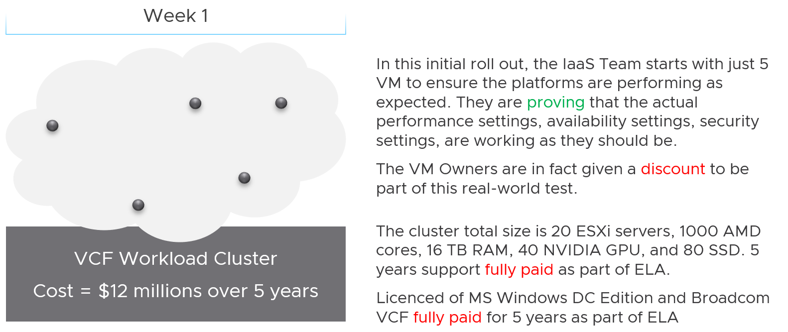

The total cost for 5 years, including data center facilities, is \$12 million.

Financially, it’s approximately \$200 K per month.

The VM are not large VMs. They are just 4 vCPU, 16 GB RAM. Together, they cannot even saturate 1 ESXi, let alone 20. Guest how much the total cost to run those 5 VMs for a month?

If your answer is \$200 K, you’re right.

Now, will the owner of those VMs be willing to pay that much?

Obviously not. She will compare you with AWS or Google.

She will say public cloud charges \$100 per month for such VM. So your price should be just \$500 total per month.

Now, the VMs cost is \$200 K per month, but you can only price \$500 per month. You suffer a big loss, which is common during the early days.

Fast forward…

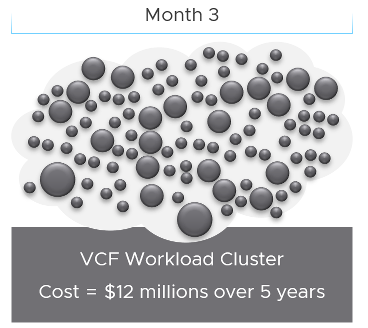

3 months have passed….

There is a lot of more VMs running, including much larger ones. You make higher profit on these monster VM as you apply a progressive pricing.

The cost of running all these VMs remain at \$200 K per month. However, the total price you earn has now increased drastically, in line with the additional VMs.

As you keep adding VMs, you eventually reach your break-even point.

#### Break-Even

When planning your pricing, think of the time required to reach the breakeven point. That period should leave enough time for you recoup your expenses as you likely will make a loss in the early period. It should be way before the depreciation ends.

In the following simplified example, the plan fails to balance cost and price. It assumes a break even that is too close to the end of the deprecation. While it’s profitable in the end, the profit is insufficient to cover the loss in the early years.

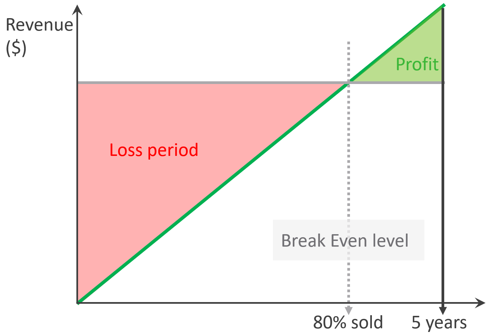

The [break-even point](https://en.wikipedia.org/wiki/Break-even) depends on the break-even level. You may not be able to fully sell all the resources at the end. So if your plan is based on 80% sold, then the total VM price of this 80% has to be able to cover the cost of everything.

In the following example, the financial plan correctly balances cost and price. They reach break-even point early enough to recoup the loss.

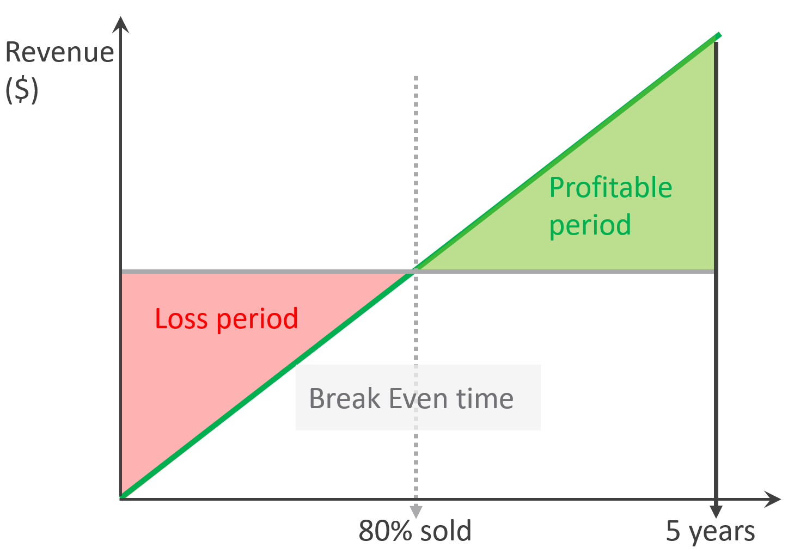

While there is unsold capacity, and hence less revenue, there is no such thing as unallocated cost.

The preceding examples are simple as they assume linear revenue. Your revenue may follow a slanted S curve, where first few months are low income, follow up rapid sales, but taper off after a few years. Regardless of how fast you make the sales, always ensure you’re not making a loss at the end of depreciation period.

#### VM Cost vs VM Price

There is no such thing as a VM Cost. So no point trying to figure out the cost per VM or the cost of VM 007.

To prove the point, assume you power off and delete every single VM today.

- How much money do you *save*? The answer is \$0. You already have multi-year ELA contracts with various IT vendors, you have to pay regardless of how many VMs are running.

- How much money do you *earn*? Well, the payment from tenants will drop to \$0. They will stop paying. Either real money to your company, or funny money to your cost center.

If that’s the case, how do you link between cost and price?

The answer is the Unit Cost is based on provider object while the Unit Price is based consumer object. In the case of CPU, the cost is per 1 GHz of ESXi physical core, while the price is per vCPU of VM. The price also depends on the overcommit ratio, so it varies despite the cost being constant.

Unit Cost and Unit Price are not mathematically related. The Unit Cost does not depend on how much you plan you plan to charge. It also does not depend on planned Overcommit Ratio. Let’s illustrate with an example:

- You bought 2 identical clusters from the same vendor at the same time. The total cost of both is the same.

- As a result, the unit cost is the same.

- You plan to use Cluster 1 for mission critical, and Cluster 2 for development. Cluster 1 will have no overcommit, while Cluster 2 will have 2x overcommit. As a result, you need to charge 2x for cluster 1 else you will not be able to break even as your cost per core is the same.

Unit Cost is associated with ESXi, not VM. VM is about price, not cost.

### Cost \| Capacity

Cost can go down while capacity goes up.

Is old hardware more expensive? It depends on the maintenance cost and cost avoidance.

Cost covers expenses that is beyond capacity. It covers people, process, and architecture. You can reduce these costs by improving

- process effectiveness, typically achieved by business process reengineering exercise.

- process efficiency by automation. E.g. deletion of powered off VM with approval workflow.

### Cost

<table>
<colgroup>
<col style="width: 19%" />
<col style="width: 80%" />
</colgroup>
<thead>
<tr class="header">
<th><strong>Cost Savings</strong></th>
<th>
This is an oxymoron. You can’t save on what you’ve already spent.

This also includes expenses you’re yet to spend but your Finance department has committed the amount in the accounting book.
</th>
</tr>
</thead>
<tbody>
<tr class="odd">
<td><strong>Cost Avoidance</strong></td>
<td>You avoid or defer a purchase or spending. You do save cost in the present as you’re no longer spending the money.</td>
</tr>
<tr class="even">
<td rowspan="2"><strong>Cost Optimization</strong></td>
<td>
You reduce future “on-going” cost.

For example, instead of $1 billion a year on total IT infrastructure, you will reduce to $800 million starting next year. That’s an actual savings that accounting department will register in the book.
</td>
</tr>
<tr class="odd">
<td>I use a fancy word instead of simply “Cost Reduction” as cost may increase from IT department but reduce in other departments as you automate and replace human with AI.</td>
</tr>
</tbody>
</table>

#### Total Cost

There are 3 main components that make up the entire 5 years cost.

- Product

- Service

- People

Product and Service are always external, meaning you pay a vendor. People can be internal cost or external.

Products are infrastructure hardware and software that you pay vendors. You typically pay a vendor a bundle, as hardware typically comes with support service and management software. To get the cost, simply look at all the sales contract from them.

There are many types of Service for private cloud. The most common ones are:

- Data Center facilities. The unit varies depending on the vendors. For example, you may pay per rack for a data center service, and it comes with certain amount of power and cooling capacity.

- Managed services. Examples are VCF operations management. You typically pay that the vendor to manage the VCF environment timely, and make sure it’s in healthy condition.

People mean time provided by a human. You pay for his time, not business outcome. The scope of service provided is generally more flexible as you pay for effort and skills, not outcome. It does not matter if the employment contact is part time or full time. You pay monthly salary or daily mandays rate.

People cost is the full loaded cost of the infrastructure team. This includes everyone needed to design, build and manage the private cloud. Yes, this includes portion of CIO salary, reflecting the portion of time he spends on infrastructure.

##### Cost Categorization

When you add any cost to the total cost, think of how you will allocate back. Since vSphere VM runs on an ESXi, you want to associate the cost to ESXi. From here, you can always include the HA host and aggregate the cost to the cluster level.

Since you will always have cost component that is not sold per ESXi, how do you associate to all the ESXi? For example, how do you associate the cost of network?

This is tricky as you may pay a lump sum amount to Cisco or Arista as part of your 5-year [ELA](https://www.techtarget.com/whatis/definition/enterprise-license-agreement-ELA). Some of these gears may not be used by ESXi hosts only. Some of the network license may not be used in all your ESXi hosts. In this case, the only way is a rough allocation. You simply get the total cost and divide into the number of ESXi.

Let’s look at more examples:

<table>
<colgroup>
<col style="width: 15%" />
<col style="width: 10%" />
<col style="width: 12%" />
<col style="width: 61%" />
</colgroup>
<thead>
<tr class="header">
<th>Area</th>
<th>Unit</th>
<th>Apportion</th>
<th>Reasoning</th>
</tr>
</thead>
<tbody>
<tr class="odd">
<td>Salary</td>
<td>People</td>
<td>Yes</td>
<td>
If the person has other responsibilities, then apportion by estimating the relevant time spent.

Example: 10 senior IT managers with average <a href="https://www.virtuallatinos.com/blog/fully-loaded-cost-employee">Fully Loaded Cost</a> of $ 1 million and 25% time spent on the private cloud.

A rough guide for Fully Loaded Cost for management layer is 1.5x – 2x of annual salary, to account for stocks and perks (e.g. secretary, business trips).
</td>
</tr>
<tr class="even">
<td>DC Facilities</td>
<td>Rack</td>
<td>Yes</td>
<td>
Only include the racks used by the private cloud. Within these racks, estimate the portion of the private cloud gears.

Example: $100 million for a 10-year lease contract for 100 dedicated racks in a co-location. 70% house the private cloud. Within these 70 racks, the share of private cloud equipment is 80%.
</td>
</tr>
<tr class="odd">
<td>Software X</td>
<td>Guest OS</td>
<td>Yes</td>
<td>
Assuming the ELA covers both private and public clouds, only includes the Guest OS running in the private cloud.

Whether you’re just in the planning stage (no VM is deployed) or in the operating stage (most VMs are running),

$10 million for 10 thousand OS images in a 5-year ELA. You want to minimize <a href="https://www.cobrief.app/resources/legal-glossary/true-up-overview-definition-and-example/">True-Up</a> as your Finance department does not like it, so your plan includes 10% buffer as experience tells you there is always a surprise project, and the new CEO has announced aggressive revenue growth internally.

Since the Plan A is based on 9100 VM, do you allocate based on 9.1K VM or 10K VM? Regardless, the $10 million is the minimum commitment you’ve signed, so it needs to be accounted for.

Planning stage: the cost

You need to do a rough translation
</td>
</tr>
</tbody>
</table>

#### Unit Cost

To calculate unit cost, get all the components so the Total Cost is complete. This must match the depreciation period. Do 5 years instead of 3 years as public cloud has gone up to 6-7 years.

The total cost includes everything. Any expense needed to provide the complete private cloud environment with operations. The workload running on top is not included, so it’s basically the infrastructure layer.

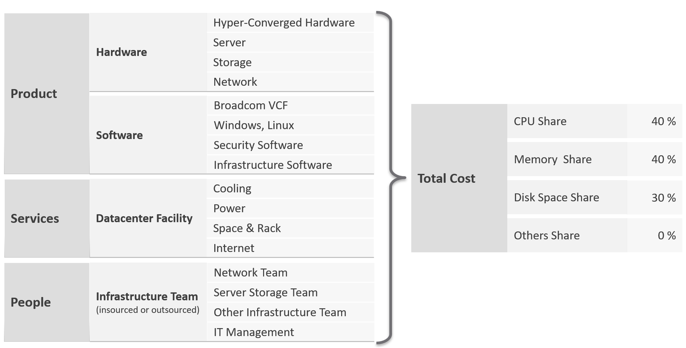

Infrastructure software includes software such as security and back up.

People including full time, part time and outsourced contractors. the salary of full-time employee and IT leadership.

Dividing the total cost into CPU, memory and disk is not easy. For examples:

- VMware Cloud Foundation contains storage components.

- Network hardware is also used by storage if the storage array is Ethernet based.

Why is the total cost only split into 3 components? The share of others is 0%.

The reason is this is not cost, not price. The Unit Cost has to be based on provider layer. The Unit Cost can not be allocated to consumer (VM or K8 Pod) as we do not know how many they are.

##### Unit Cost

Unit Cost depends on hardware and software. New cluster should cost less due to bigger hardware.

For the CPU portion, it is expressed in physical core, not vCPU nor GHz. Notice how software vendors also charge their product by core. How much you price that core depends on the overcommit ratio and SLA.

##### Complication with CPU

The above works well with memory and disk space. Both have only 1 unit.

CPU has 2 units. One for speed, one for space.

As you’re dealing with capacity, choose the one for space, which is in physical threads.

An ESXi with 10 cores, 20 threads, always have 20 threads of capacity, regardless of the power management settings. Unit Cost is derived by dividing against 20 threads. There is no Class of Service in cost, as the overcommit ratio is always set to 1:1.

##### Cost Allocation

What if you need to pass the cost back to your internal consumers? Your IT department is not a profit center, so you just need to show other departments the cost you spend and then divide among the consumers.

The answer is “the request is invalid”.

- The reason is your cost is actually price to them.

- Likely, you don’t enough demand in the first year. Can you pass this total cost among few tenants? You can’t, as they will not pay higher than what AWS or Azure discloses publicly.

- In the last year, where you have full demand, do you intend to pass on the savings? If yes, how will you recover the loss of the initial years?

Based on the above, it’s clear you should not allocate cost to each running VM.

Let’s use an example from service industry where the practice is matured.

An airline plane carries 300 passengers and fly 500 times a year on multiple routes. There are potentially 150 K seats passengers can buy. The airline has a price for every one of those seats, and they will manage and adjust the price dynamically. There are days they make a loss on a flight, there are days they make a profit.

Do they have 150 K costs for each seat? No. There is no need to calculate the profitability of every single seat.

All they need is the standard or general unit cost.

Same thing with VM as a Service. If you insist on allocating cost to every running VM, you likely end up with incorrect calculation. Show the price instead.

#### Cost Avoidance

Since the savings is always in the future, you should not use historical or past value as the value of money changes over time.

Let’s take a simple example:

- You spent \$3 million on a hyper-converged infrastructure (HCI) solution 5 years ago.

- It has been used well, and capacity remaining is now 0%, so you need to buy a new HCI. This will cost you only \$1 million as the cost of HCI solution has gone down by 2/3 in the last 5 years.

- Via a diligent and arduous reclamation process, you manage to free up capacity. As a result, you do not need to spend the \$1 million. You can defer this purchase to the next fiscal year.

- What’s your cost savings from this reclamation: \$3 millions or \$1 million?

Accounting wise, it’s \$1 million only as that’s the amount you defer to spend. While that HCI cost you \$3 millions 5 years ago, a brand new set with equivalent capacity costs a lot less. In accounting fundamental, you should not mix numbers from different date, let alone from different fiscal years.

BTW, depreciation is not relevant here as you’re talking about new system, and not the old one. Depreciation applies to the old storage.

The \$1 million cost avoidance is certainly an *estimation*. The actual cost to be avoided or to be spent depends on vendor quotation, and your negotiation skills. Take note that the actual cost typically is more than the HCI cost. Additional costs can exceed the hardware cost. You need to include the full loaded cost, such as data center facility, implementation service, back up storage, administration service, software license, management, etc.

Reclamation alone does *not* save cost. How much do you save when you delete files in your notebook?

Right. Zero.

Only when it helps you defer buying a new drive that the reclamation becomes real. But it’s a cost avoidance, not cost saving.

How about service? We like to cite productivity improvement as a cost saving. While this delivers business value, it is not a hard cost savings. It is a soft benefit with no accounting value. The hard savings only happen when the need to buy additional resource/headcount is deferred, or reduction in Managed Services contract value.

#### Cost Avoidance

<table>
<colgroup>
<col style="width: 17%" />
<col style="width: 43%" />
<col style="width: 39%" />
</colgroup>
<thead>
<tr class="header">
<th>Area</th>
<th>Action</th>
<th>Calculation</th>
</tr>
</thead>
<tbody>
<tr class="odd">
<td>Storage</td>
<td>
Delete orphaned files and powered-off VMs.

Delete unused files from Guest OS
</td>
<td>
GB of disk deleted files * Cost per GB of new capacity.

E.g. 10 TB files * $10 per TB = $100 <em>future</em> expense avoided.
</td>
</tr>
<tr class="even">
<td>Compute</td>
<td>
Power off idle VMs

Reduce oversized VM
</td>
<td>
Total GB of Consumed RAM saved.

Total vCPU saved.

Express the above in terms of No of ESXi, multiply by the average cost of <em>new</em> ESXi.
</td>
</tr>
<tr class="odd">
<td>Network</td>
<td>Consolidate and power off hardware</td>
<td>Total physical network ports saved.</td>
</tr>
<tr class="even">
<td>Facility</td>
<td>
Power off equipment.

Change DC Provider to cheaper one.
</td>
<td></td>
</tr>
<tr class="odd">
<td>Service</td>
<td>
Move from cloud to on premises for long term workload. Cloud gets expensive with long term contract.

Optimize cost so it does not grow as fast as business demand.
</td>
<td>Get the actual monthly bill from your cloud provider. Use 1 year of cost and exclude the highest 20% bill as that is likely a momentary spike.</td>
</tr>
</tbody>
</table>

IT needs to be ahead of business. When calculating the cost avoidance, includes committed projects and future growth. It’s common for projects to not have enough capital to buy from vendor. Reusing existing assets can go along way.

You should also take into account undersized VMs, as the application team may demand that they are upsized.

Calculate CPU, RAM and Disk. If possible, include network too. It is harder to calculate, as by nature it’s just interconnect. For each of these three IaaS resources, calculate both the demand and the reclamation. For the demand, don’t forget to include the full cost. When a VM needs 100 GB, it translates into a lot more as you factor is DR, cyber recovery, back up, snapshot, etc.

The following table provides an example.

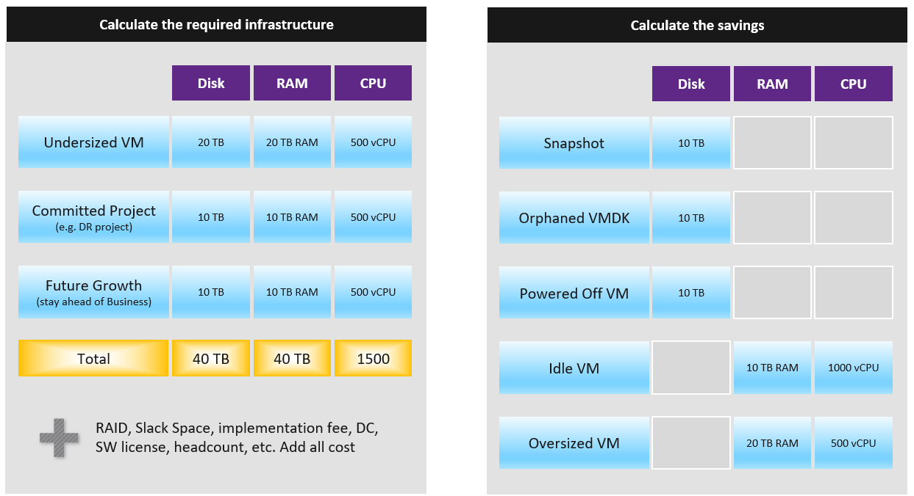

You need to prepare the above table per physical location. Just because you have 10 TB RAM in Singapore does not mean the VMs in Armenia can use it.

#### Cost Optimization

For organizations with a large infrastructure footprint, tech refresh is a great way to reduce cost. Going down from 100 racks to 50 racks will reduce both capital and operating cost if you can reduce software licensing cost. Nowadays the software, especially business application software and not infrastructure software, costs more than the hardware.

<table>
<colgroup>
<col style="width: 19%" />
<col style="width: 80%" />
</colgroup>
<thead>
<tr class="header">
<th>Area</th>
<th>Action</th>
</tr>
</thead>
<tbody>
<tr class="odd">
<td>Vendor</td>
<td>
Vendor consolidation.

Some vendors prefer you commit long term and will give you lower unit cost.
</td>
</tr>
<tr class="even">
<td rowspan="2">Hardware</td>
<td>Technology refresh. Moving from FC SAN + Array to ethernet based HCI should deliver lower cost.</td>
</tr>
<tr class="odd">
<td>Virtualize. While server virtualization is widely practiced, there is much more work to be done for storage and network virtualization. Use vSAN as it’s already part of VCF.</td>
</tr>
<tr class="even">
<td rowspan="2">Software</td>
<td>Technology refresh that standardizes or reduces license count.</td>
</tr>
<tr class="odd">
<td>Removal of overlapping software</td>
</tr>
<tr class="even">
<td>People</td>
<td>
Do away with less employees. In general, many organizations are both top heavy and laden with overlapping departments. A classic example is a centralized Project Management Office and the middle management layers.

Be careful with accounting engineering where headcount is saved but the work is outsourced.
</td>
</tr>
<tr class="odd">
<td>Facility</td>
<td>
Power off equipment and reduce rack footprint

Change DC Provider to a cheaper one.
</td>
</tr>
</tbody>
</table>

#### Optimized Cost

The above exercise will help in optimizing cost. There are certainly other avenues to optimize cost, as cost covers more than just capacity. It covers People, Process, Architecture.

<table>
<colgroup>
<col style="width: 15%" />
<col style="width: 27%" />
<col style="width: 56%" />
</colgroup>
<thead>
<tr class="header">
<th></th>
<th>Level</th>
<th>What</th>
</tr>
</thead>
<tbody>
<tr class="odd">
<td>Consumer</td>
<td>
Process

Guest OS

Container

VM
</td>
<td>
Remove wastage, such as Orphaned VMDK, Snapshots, Powered off VM and Idle VM.

Reclaim by shrinking oversized VM. Only useful for allocation based from cost viewpoint.

Automate, with approval workflow &amp; audit trail.
</td>
</tr>
<tr class="even">
<td>Provider</td>
<td>
ESXi

Cluster

Datastore &amp; DS Cluster

Switch and Port Group

Hardware
</td>
<td>
Hardware tech refresh. Newer hardware have more capacity and faster performance, at the same price. You can also save expensive software license (e.g. database, middleware).

Virtualize storage and network, not just compute.

Consolidate. Small clusters have higher HA overhead, smaller datastore have higher overhead. Optimize cost by consolidating them.

Increase utilization of clusters and datastores, without compromising performance.

Reduce overhead. Review if the applications truly justify active/passive, resulting in 50% overhead.

Standardize the architecture. This reduces complexity, not cost.
</td>
</tr>
</tbody>
</table>

#### Complexity

Complexity has cost.

- A public cloud outage, despite not being your fault as you’re just a consumer, can cost your company reputation, business and regulatory fine.

- Some cost such as company reputation is priceless.

- Complexity is hard to quantity. Human error can be costly but you need to resort into probability theory to quantify that.

- Reduction of complexity typically increases cost. Simplifying operations, such as not mixing VMs with different class of services in the same cluster, will reduce complexity. But it also comes at a cost of larger infrastructure.

- Standardization will reduce chance of human error. But this also means less flexible configuration, which tends to increase cost. One way to reduce is automation as that reduces the human cost.

### Price

Price is what your customers care as that’s what they pay. Since you compete with public cloud, your VM price is largely set. Yes, it’s a commodity market after all.

VM Price is not a function of VM cost adjusted with margin, discount and penalty. Price is determined by the value perceived by the paying customer. The cost is actually irrelevant as customers do not and should not have to care about how you manage your profit and loss.

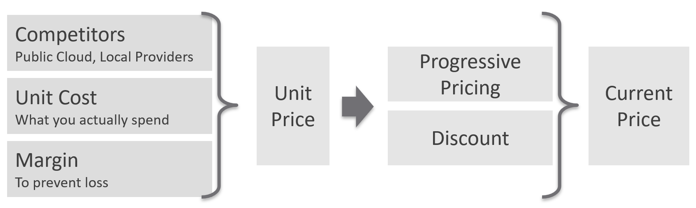

Unit Price should remain the same within the same class of service. Using the airline industry example, the ticket price does not depend on the plane generation. Singapore Airlines has multiple generations of business class seats across different size of planes, yet you never see them price based on that.

Overcommit Ratio is the way you justify a higher price, hence it’s imperative to disclose upfront to your customers.

You need to develop both the Pricing Model and the Cost Model together.

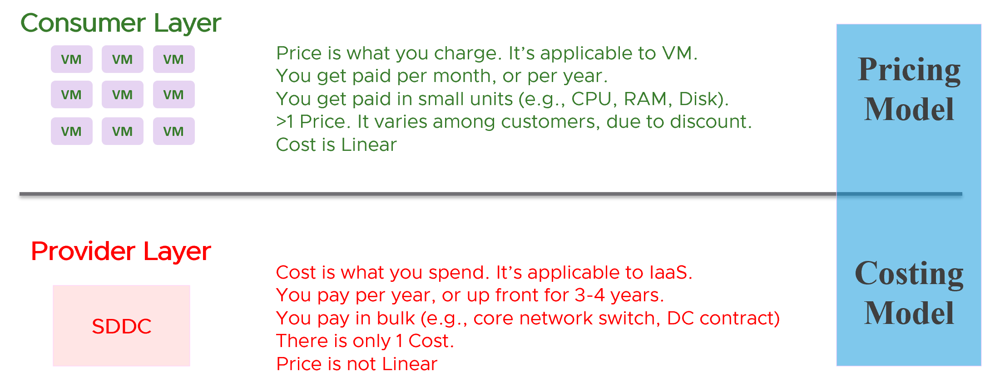

There are 2 types of pricing model

- Allocation

- Utilization

Allocation is best when the consumption has a limit. That’s why it fits VM well, as a VM always has fixed CPU and Memory configuration. A 64 vCPU VM is charged more than a 8 vCPU VM, regardless of utilization. Both can be idle for days, and the bigger VM will be charged more.

Utilization is the only choice when there is no limit. A container without limit means we don’t know what amount to allocate as it does not have predefined size.

#### Usage-based Pricing

What exactly is “usage”?

The answer actually varies, depending on the service.

Let’s say you provide desktop as a service. If you truly charge based on usage, then if a user does not log in, then there is no usage. The problem here is you need to provide the desktop available 24 x 7, as you do not when the user will login. If you have 1000 users, you need to make sure you can cater for the peak demand, else there will be complaint from users who do not get a desktop when they ask for it.

A good comparison is NetFlix or Internet Broadband. You pay a fix fee, regardless of your usage. Whether you are watching 24 x 7 or just occasionally, you are paying the same rate. The same with your home broadband.

In Kubernetes, pods are by default unlimited. It can grow the size of the node. As the pod has no fixed size, you can’t charge based on allocation.

In this case, here are the steps:

1.  Work out the total cost.  
    This means the sum of everything that you’re spending. Do it over 5 years, or whatever the depreciation time you use.

2.  Normalize the above to hourly.  
    This gives you the hourly total cost.

3.  Figure out your capacity.  
    Usable, not Total. This is your sellable capacity.

4.  For K8 or vSphere, allocate into Compute and Storage.  
    Since K8 uses core instead of MHz, you charge using core or millicore as the unit. Do not charge per MHz as that complicates the formula.

5.  Project your expected utilization. If you only project 40%, then your price has to be at least 2.5x of the cost.

To translate into price, consider the peak hour. For example, you may mark up during office hours and provide discounts for after office hours. Some workloads need not be run immediately. By having "peak hour" pricing, you spread out the demand to weekend.

What about storage IOPS and throughput? One way to prevent abuse of the shared environment is using cost. This is tricky though, as the usage comes at 2 levels (Guest OS and VM). For example, do you charge for the IOPS caused by back up and snapshots? That’s why it’s important to keep the pricing model simple.

#### Progressive Pricing

As an internal cloud provider, what business problems do you want to solve with pricing? Use price to drive the right behavior and encourage adoption.

Oversized VM is a problem that is best solved *before* the VM hits production. So design your pricing model to encourage the right size from the beginning. Right size, right from the start. Create a progressive pricing and apply discounts for smaller VM sizes. The following diagram shows an example of tiered pricing. Premium pricing is applied on VMs larger than 16 vCPU, while discounted pricing is applied on VMs smaller than 8 vCPU.

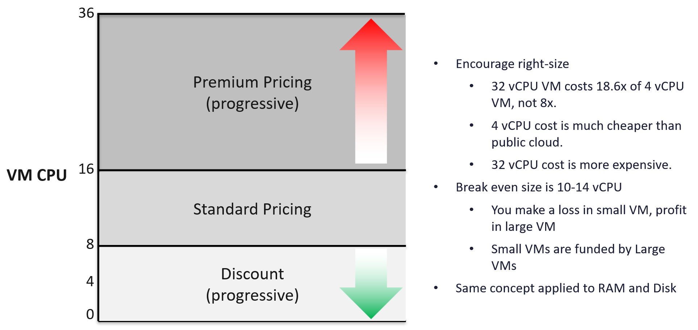

#### Class of Service

How do you apply the progressive pricing above into different Classes of Service? How much of a premium should you put on the big VM? How deep should you discount the small VM? The multiplier effect (the progressive tax) cannot be too high because public cloud does not have such tax. They follow a linear pricing. If you use a high multiplier, your price will be too high, or you will absorb a deep loss.

The following table provides an example of multiplier.

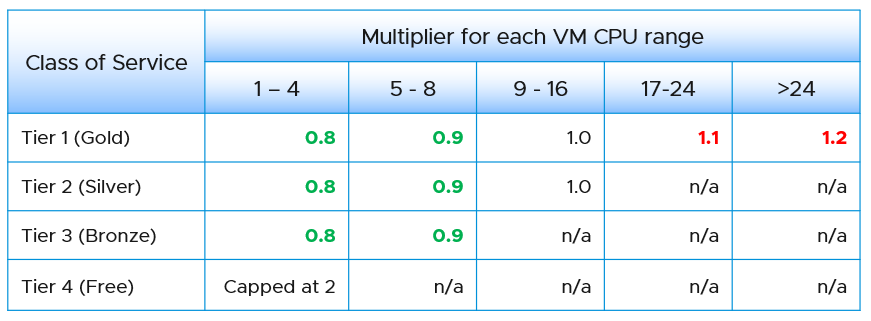

We apply the same principle for RAM.

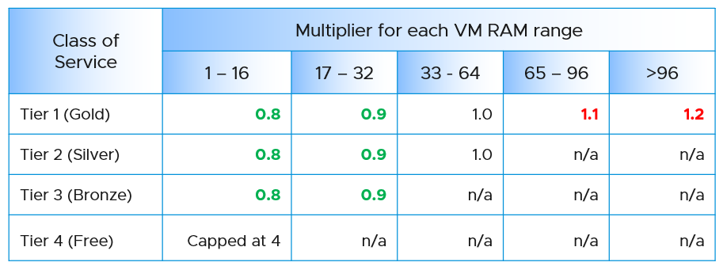

Keep your pricing model simple. The more complex your bill, the more you have to explain. The following table provides a suggestion of what to charge and what to bundle. Bundling means you include it in your overall cost but not charge explicitly for it. You are certainly trading off accuracy with simplicity.

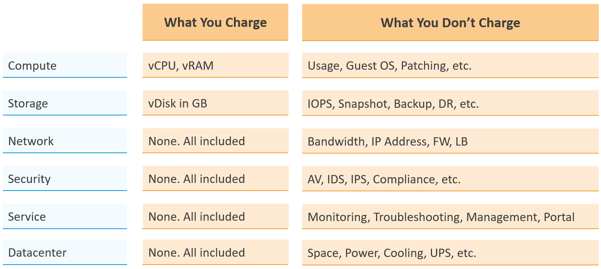

Overly simplified pricing could be unfair to customers, but that’s common in other industries. Take the airline industry, where my favorite airline is Singapore Airlines. I notice they have at least 4 generations of planes. The new plane is more efficient, costs less to operate and is more enjoyable to customers. On the other hand, if you take into account depreciation, the old plane is already fully depreciated. And yet, the price is the same across all generations.

### Private Cloud \| Public Cloud

In the cloud era, application teams are provided with more choices of infrastructure. All they need is a credit card and application development can start. No need to deal with internal red tape just to get a bunch of hardware, since infrastructure is all available as an on-demand service.

The public cloud providers are competitors to internal on-prem cloud. These vendors are happy to migrate all your workload to their cloud, and replace the infrastructure team with their own staff.

In reality, public cloud and private cloud are complimentary. They have their pros and cons. See [this](https://spacelift.io/blog/cloud-vs-on-premise-cost) for comparison.

As an internal cloud provider, you need to turn the public cloud providers into allies. That requires a shift in your business model, from infrastructure provider to a multi-cloud service broker. You broker the request for infrastructure with the most appropriate provider. You evaluate, choose and deliver multiple clouds if the on-prem cloud does not meet the business needs. Even the on-prem cloud can be a service that you procure (meaning you do not own the hardware and software), if that fits your business requirements better.

It is indeed possible for a small and no-frill internal IT infrastructure team to complement a much larger cloud provider. Being small, especially since you are on-site and work in the same company, enables you to offer a better service. Nobody likes dealing with the *bureaucrazy*, pun intended, of a large corporation’s support organization. You can get lost in the mountain of policies.

You also need to do an apple-to-apple comparison. List the entire components of the service. The following table provides an example, where you add your private cloud alongside externally hosted cloud. You should complement this table with another table comparing the SLA and price. I’ve provided a sample of SLA table in the [Capacity Management](#_Capacity_Planning) section.

<table>
<colgroup>
<col style="width: 20%" />
<col style="width: 15%" />
<col style="width: 19%" />
<col style="width: 19%" />
<col style="width: 25%" />
</colgroup>
<thead>
<tr class="header">
<th>Component</th>
<th>AWS</th>
<th>VMware on AWS</th>
<th>On-Prem Cloud</th>
<th>Remarks</th>
</tr>
</thead>
<tbody>
<tr class="odd">
<td>Server Hardware</td>
<td>Identical</td>
<td>Identical</td>
<td>Identical</td>
<td>Comparable hardware spec</td>
</tr>
<tr class="even">
<td>Storage</td>
<td>Excluded</td>
<td>Included (vSAN)</td>
<td>Included (vSAN)</td>
<td>Cost under Storage</td>
</tr>
<tr class="odd">
<td>Backup &amp; DR</td>
<td>Excluded</td>
<td>Excluded</td>
<td>Excluded</td>
<td>Cost under Storage</td>
</tr>
<tr class="even">
<td>MS Windows</td>
<td>Included</td>
<td>Included</td>
<td>Included</td>
<td></td>
</tr>
<tr class="odd">
<td>Hypervisor</td>
<td>AWS</td>
<td>vSphere</td>
<td>vSphere</td>
<td></td>
</tr>
<tr class="even">
<td>Management Tool</td>
<td>Excluded</td>
<td>VCF Operations</td>
<td>VCF Operations</td>
<td></td>
</tr>
<tr class="odd">
<td>Support</td>
<td>Excluded</td>
<td>Included (remote)</td>
<td>Included (on-site)</td>
<td>IT provide full time on-site support</td>
</tr>
<tr class="even">
<td>Sys Admin</td>
<td>Included</td>
<td>Included</td>
<td>Included</td>
<td></td>
</tr>
<tr class="odd">
<td>Security</td>
<td>Excluded</td>
<td>Included</td>
<td>Included</td>
<td>AV, Firewall, IDP, IDS, etc.</td>
</tr>
<tr class="even">
<td>Network: Bandwidth</td>
<td>Excluded</td>
<td>Excluded</td>
<td>Included</td>
<td></td>
</tr>
<tr class="odd">
<td>Network: Core</td>
<td>Add it</td>
<td>Included</td>
<td>Included</td>
<td>
NSX + physical + People

LBaaS, FWaaS
</td>
</tr>
<tr class="even">
<td>DC Facility</td>
<td>Included</td>
<td>Included</td>
<td>Included</td>
<td></td>
</tr>
</tbody>
</table>

The comparison can be done in 2 ways:

<table>
<colgroup>
<col style="width: 19%" />
<col style="width: 80%" />
</colgroup>
<thead>
<tr class="header">
<th>Consumer</th>
<th>
You compare a single unit of consumption, and over a short time.

For example, you compare a VM with 4 vCPU 16 GB RAM 100 GB disk. You take the daily cost, not the 3-year cost.
</th>
</tr>
</thead>
<tbody>
<tr class="odd">
<td>Provider</td>
<td>
You compare the whole infrastructure to support all the consumers, and over a long time.

For example, you compare the entire private cloud over 5 years. The cloud may have 10K VM on it.
</td>
</tr>
</tbody>
</table>

#### Sample Comparison

In this example, we take the lowest cost from AWS. Start with EC2 as that’s the most popular services that matches what you provide. Take the lowest possible cost. In this case, it is 3 years commit with full upfront payment. Also, take Linux as opposed to Windows.

For CPU, we take AWS Graviton, as it’s cheaper than Intel Xeon and AMD EPYC.

For tenancy, we take Shared as it’s cheaper. This means your private cloud has an advantage as it’s not shared with other companies.

For VM size, we take 4 vCPU and 16 GB RAM as that’s the most popular size.

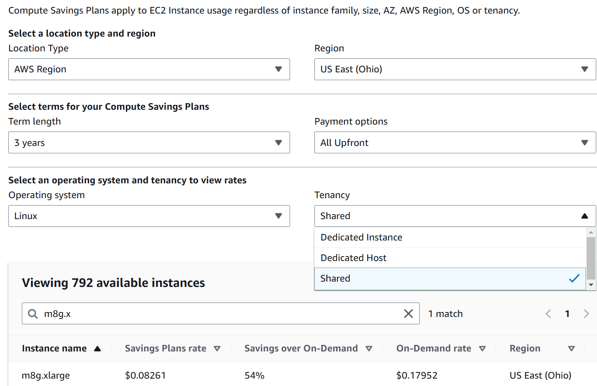

Since you commit this for 3 years regardless of usage, you pay US\$ 2171 in advance for a 4 vCPU, 16 GB RAM, 1 TB SSD disk VM without Guest OS.

END OF PART 1  
Okay… now that the concept makes sense to you, let’s move into how to apply and consume them.
